<p align="center">
  
</p>

<div align="center">

# Novel Studio · 小说工坊

Local-First Fiction Workbench // A Calm, Fluid Studio for Long-Form Writers

[简体中文](README.md) | English

[](https://github.com/linque0/novel/releases)
[](https://github.com/linque0/novel/blob/main/LICENSE)
[](https://github.com/linque0/novel/stargazers)
[](https://github.com/linque0/novel/issues)
[](https://github.com/linque0/novel/releases/latest)
[](https://nodejs.org/)
[](https://www.electronjs.org/)
[](https://vuejs.org/)

[Quick Download](#quick-download)
·
[Showcase](#showcase)
·
[Core Capabilities](#core-capabilities)
·
[Development & Build](#development--build)
·
[Upcoming Features](#upcoming-features)
·
[Documentation](#documentation--changelog)

</div>

## About

**Novel Studio** is an open-source, **local-first** desktop workbench built for long-form fiction authors. Every story, outline, worldbuilding node, character dossier, snippet, and writing analytics record stays strictly on your own disk—no login required, no silent cloud sync, and instant save-as-you-type persistence.

Designed around the unified **Latent（幻流）** workspace interface, Novel Studio closes the structural gaps that commonly fragment long novels:

- **Cohesive Manuscript Workspace**: A two-level volume/chapter tree, a TipTap rich-text manuscript editor, and a chapter-synced right rail (`Annotations`, `Chapter Outline`, `Appearing Cast`, `Illustrations`, and `Metadata`) stay side-by-side—or collapse down to ultra-slim edge tabs for distraction-free drafting and read-only review.
- **Hierarchical Freeform Outline Canvas**: Organize plotlines visually across drill-down container canvases or an outline-synchronized tree view. Seven card types connect via four semantic edge types with locked endpoint ports and Hanan sparse-grid A* obstacle avoidance.
- **Connected Lore & Cast Web**: Store worldbuilding in an infinitely nested flat-hierarchy outliner paired with a 3-pane reader and an interactive concentric **3D Orbit Galaxy**; build multi-essay character dossiers and a drag-to-connect Relationship Theater, cross-linked right from the prose via `[[Relation Links]]`.
- **Snippets to Structure & Local Analytics**: Group raw ideas on a color-tagged pinboard and promote any snippet directly into a chapter or lore entry without losing provenance, while 9 offline ECharts analytics views track every writing session.

Built with Electron 33 and Vue 3 for Windows x64, the repository also supports a local browser debug server (`npm run web`) and a shared plugin frontend build (`plugin/dsh/`).

## Quick Download

> [!TIP]
> - **GitHub Releases**: Download the latest `novel-studio-setup-<version>.exe` installer (Windows x64 NSIS wizard) from [Latest Release](https://github.com/linque0/novel/releases/latest).
> - **In-App Updater**: Installed desktop builds check GitHub Releases from **Settings → Help & About**, verify packages via SHA-512, and launch updates cleanly.

> [!NOTE]
> The installer and binary are not commercially code-signed yet. On first launch in Windows, click **More info → Run anyway** if SmartScreen prompts. Uninstalling the app never deletes your local story library.

## Showcase

> **About these screenshots**: Captured directly at `1920×1080` from the **Latent（幻流）** interface using a fictional sample project (*Starbound Traveler / 星尘旅人*)—all book titles, characters, chapters, and statistics are test fixtures rather than real author data. All 22 high-resolution captures and detailed walkthroughs are available in the local showcase ([`项目展示.html`](docs/项目展示文档/项目展示.html), [`产品介绍.md`](docs/项目展示文档/产品介绍.md), and [`产品介绍-图文版.pdf`](docs/项目展示文档/产品介绍-图文版.pdf), Chinese).

### Workspace Previews

<table>
  <tr>
    <td width="50%">
      
    </td>
    <td width="50%">
      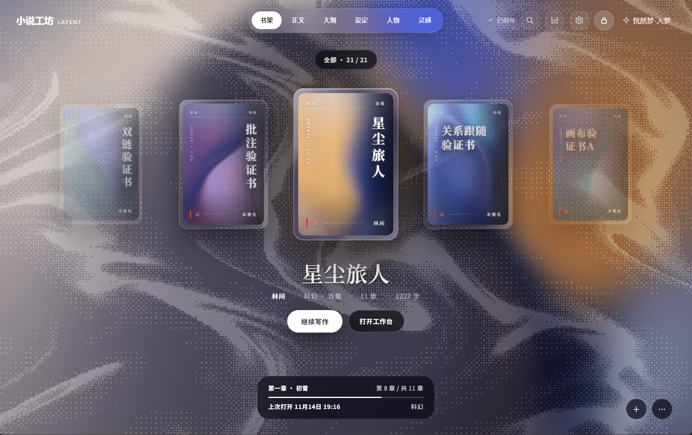
    </td>
  </tr>
  <tr>
    <td align="center"><strong>Bookshelf · 3D Cover Carousel &amp; Last-Read Bookmark Stub</strong></td>
    <td align="center"><strong>Flow Shader · Cover-Adaptive or Custom Dual-Tone Backdrop</strong></td>
  </tr>
  <tr>
    <td width="50%">
      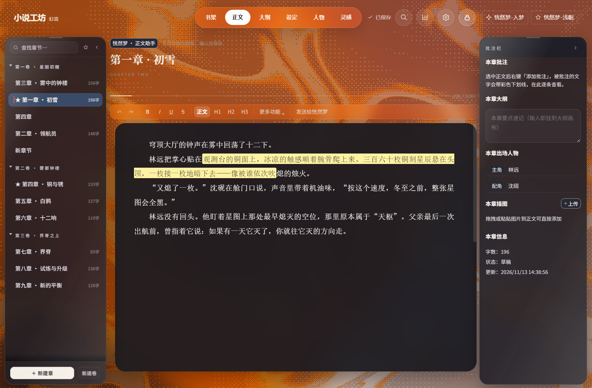
    </td>
    <td width="50%">
      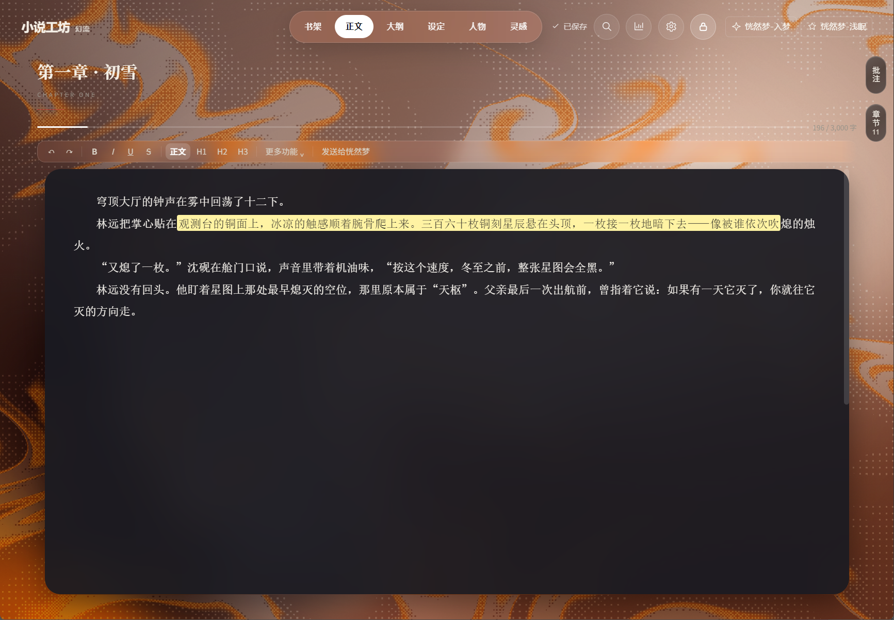
    </td>
  </tr>
  <tr>
    <td align="center"><strong>Manuscript · Chapter Tree, Rich Editor &amp; Context Rail</strong></td>
    <td align="center"><strong>Focus View · Collapsible Sidebars with Edge Access Tabs</strong></td>
  </tr>
  <tr>
    <td width="50%">
      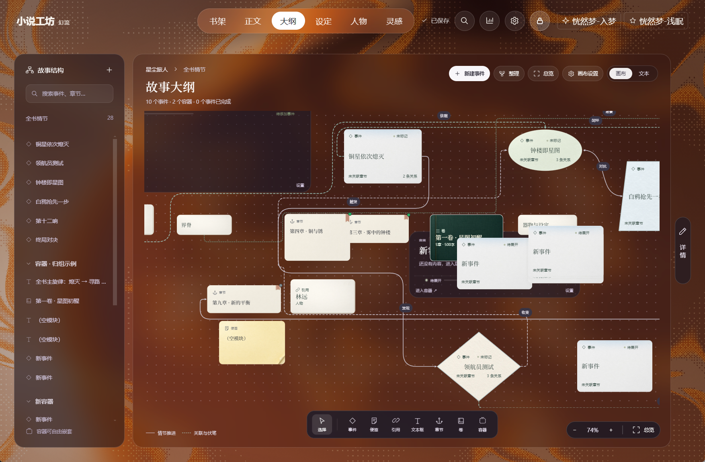
    </td>
    <td width="50%">
      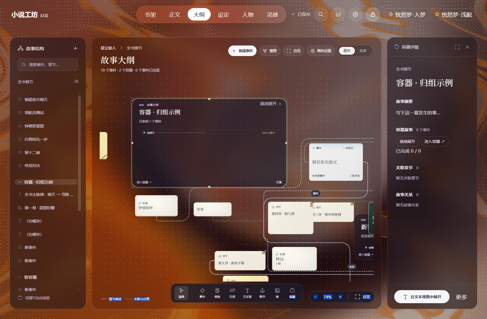
    </td>
  </tr>
  <tr>
    <td align="center"><strong>Outline Canvas · 7 Card Types &amp; Hanan A* Edge Routing</strong></td>
    <td align="center"><strong>Containers · Drill-Down Sub-Canvases &amp; Inline Expansion</strong></td>
  </tr>
  <tr>
    <td width="50%">
      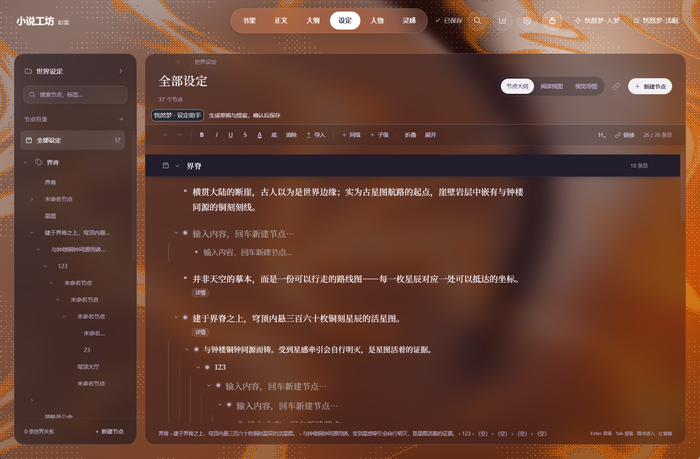
    </td>
    <td width="50%">
      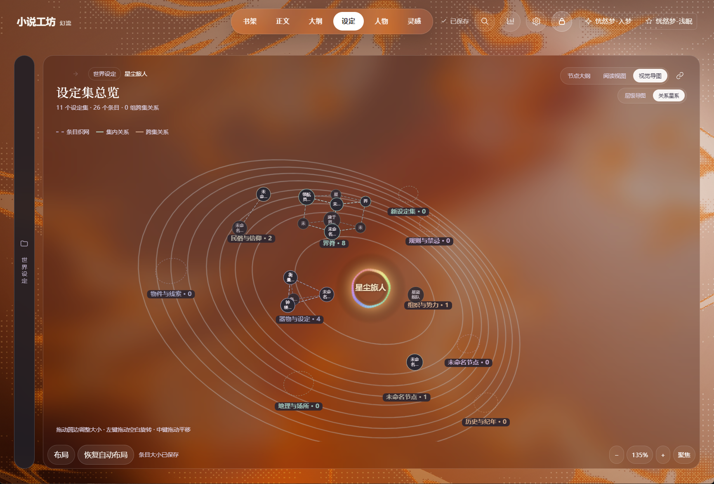
    </td>
  </tr>
  <tr>
    <td align="center"><strong>Worldbuilding · Infinite-Nesting Flat-Node Outliner</strong></td>
    <td align="center"><strong>Relation Galaxy · Concentric Orbits &amp; Cross-Set Links</strong></td>
  </tr>
  <tr>
    <td width="50%">
      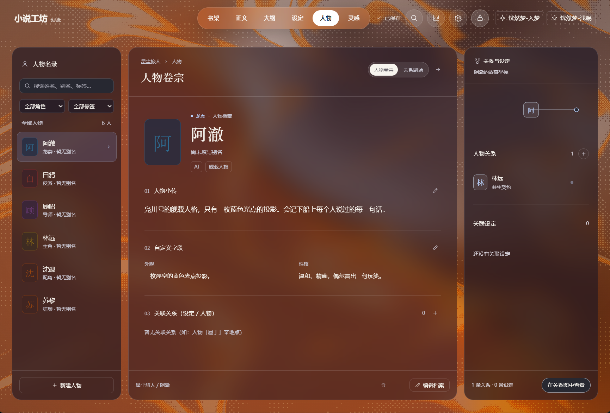
    </td>
    <td width="50%">
      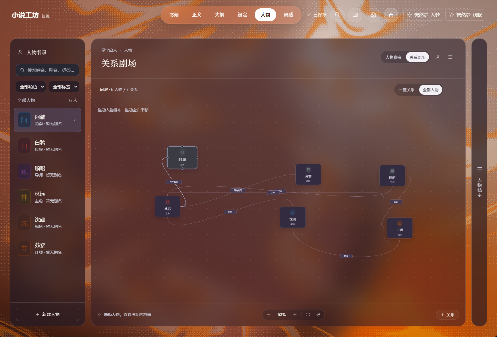
    </td>
  </tr>
  <tr>
    <td align="center"><strong>Character Dossier · Multi-Bio Essays &amp; Story Coordinates</strong></td>
    <td align="center"><strong>Relationship Theater · Drag-to-Link &amp; Live Dossier Sync</strong></td>
  </tr>
  <tr>
    <td width="50%">
      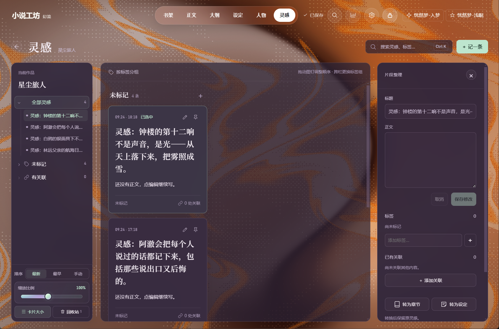
    </td>
    <td width="50%">
      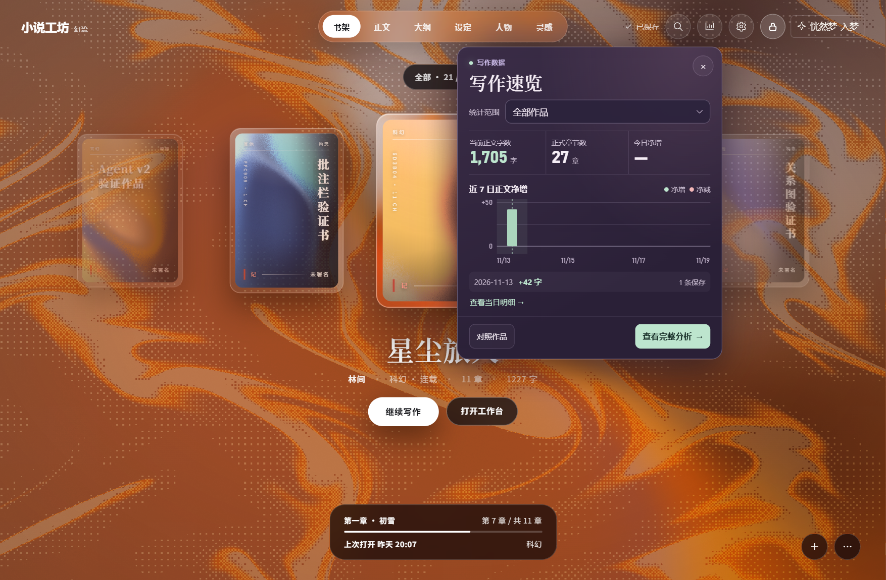
    </td>
  </tr>
  <tr>
    <td align="center"><strong>Inspiration Board · Tag Columns &amp; One-Click Conversion</strong></td>
    <td align="center"><strong>Quick Stats · Instant Word Totals &amp; 7-Day Net Progress</strong></td>
  </tr>
  <tr>
    <td width="50%">
      
    </td>
    <td width="50%">
      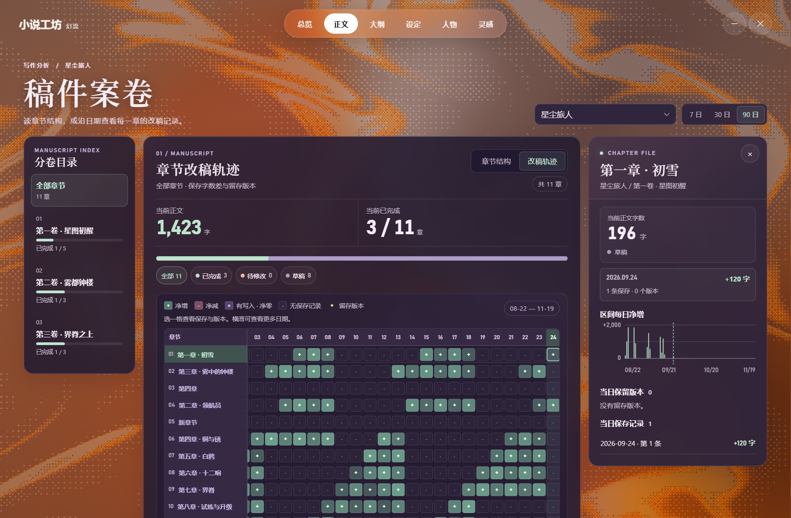
    </td>
  </tr>
  <tr>
    <td align="center"><strong>Writing Analytics · Cumulative Growth &amp; 180-Day Calendar</strong></td>
    <td align="center"><strong>Revision Matrix · Chapter × Date Save History Heatmap</strong></td>
  </tr>
</table>

<p align="center">
  For all 22 views (Reader View, Dossier Editing, Book Comparison, Chapter Structure, and per-module breakdowns), see <a href="docs/项目展示文档/产品介绍.md">产品介绍.md</a> (Chinese).
</p>

## Core Capabilities

| Module | Highlights |
|---|---|
| **Bookshelf & Flow Shader** | 3D cover carousel with last-read progress stub, status filters, and local search; WebGL shader backdrop adapts to book covers or custom dual-tone palettes with adjustable speed (`0–2×`). |
| **Manuscript Editor** | Volume/chapter tree (drag reordering, bookmarks, chapter statuses) paired with TipTap rich editing and Word-style context menus; purpose-colored solid underlines for **annotations** coexist cleanly with dotted underlines for **`[[Relation Links]]`** and draggable pinned hover cards; collapse sidebars or enter fixed-width **Reading Mode**. |
| **Hierarchical Outline** | Root view shows direct children while containers drill down into sub-canvases or expand inline as mini-card grids; 7 card types (event, note, reference, text, chapter anchor, volume, container) connect with locked ports, Hanan sparse-grid A* obstacle routing, line-to-line **junctions**, manual curve shaping, cross-layer projections, and a synced text outliner view. |
| **Worldbuilding** | Unified infinite-nesting node tree (`MD/TXT` heading-hierarchy import, 3-zone drag indicators, snapshot undo/redo) alongside a 3-pane **Reader View** and interactive **3D Relation Galaxy**; supports bidirectional typed relations across lore entries and characters plus double-click detail graphs. |
| **Character Dossiers & Theater** | Filter by role pills and tags; maintain avatars, multi-role tags, custom fields, and **multiple titled biography essays**; switch to the **Relationship Theater** to create or edit relationships with one unified drag gesture synced live back to dossiers. |
| **Inspiration Pinboard** | Single tag-grouped pinboard with draggable pushpin sorting, resizable cards (`80–125`), palette tags, trash recovery, and one-click conversion from snippet drawer to formal chapters or lore entries (preserving the original idea). |
| **9-View Writing Analytics** | Offline ECharts suite driven solely by local save history: **Quick Stats**, **Writing Journey**, **Project Comparison**, **Chapter Structure**, **Revision Matrix**, plus module-level deep dives for **Outline / Lore / Cast / Snippets** linked to a detail inspector. |
| **Global Search & I/O** | `Ctrl+Shift+F` cross-module full-text search with snippet highlights; import `TXT / MD / DOCX / PDF / EPUB / Images` (with GBK detection and chapter-split preview); export selected volumes/chapters to `TXT / MD / Word (.docx)` or `.zip` archives. |
| **Detached Windows & Entity Locks** | Detach Manuscript, Outline, Cast, Lore, Snippets, or Analytics into full-featured standalone windows; main-process **entity locks** convert active items in the main window to read-only jump placeholders to eliminate concurrent write conflicts. |

<details>
<summary>Expand details on Word (.docx) export, bidirectional linking &amp; bundled OFL fonts</summary>

- **Native OOXML `.docx` Export**: Built with JSZip into standard A4 Word packages preserving bold, italics, underlines, headings, alignment, lists, and blockquotes; multi-chapter threshold defaults to 30 chapters (`2–500` configurable), switching between single merged file or volume-folder `.zip`.
- **Resilient `[[Relation Links]]`**: Select text or type `[[Title]]` anywhere in manuscripts, lore notes, bios, or snippets to link entities across modules. Renaming titles preserves links cleanly, and hover popovers remember dragged pinned screen positions.
- **Bundled Local OFL Fonts**: Separate Chinese (6 typefaces including *Noto Serif SC* and *LXGW WenKai*) and Latin (3 options including *Playfair Display*) font controls with `13–24px` sizing—100% offline with zero external network calls.

</details>

## Development & Build

Prerequisites: **Node.js ≥ 18** (developed on Node 24).

```bash
npm install           # Install Electron and renderer dependencies
npm run dev           # Hot-reload Vite + Electron isolated with --profile=dev
npm run build         # Build production renderer bundle into dist/
npm run build:plugin  # Build DSH plugin frontend into dist-plugin/
npm start             # Launch Electron using built dist/
npm run web           # Start local web debug server (http://127.0.0.1:18688)
npm run dist          # Build NSIS installer & portable dir into release2/
npm run stop          # Gracefully close all running Novel Studio instances
```

### Distribution Targets

| Target | Path / Usage | Notes |
|---|---|---|
| **Windows Installer** | [Releases](https://github.com/linque0/novel/releases/latest) / `release2/novel-studio-setup-<version>.exe` | NSIS guided installer with desktop & Start Menu shortcuts |
| **Portable App** | `release2/win-unpacked/小说工坊.exe` | Extract-and-run directory output from `npm run dist` |
| **DSH Plugin Build** | `npm run build:plugin` (`plugin/dsh/`) | Shares core Latent UI and storage foundation with host integration |
| **Web Debug Mode** | `npm run web` | Browser IndexedDB only (`.docx` import relies on desktop parsing) |

> [!NOTE]
> Only one desktop instance can hold a given data directory (`%APPDATA%\小说工坊`) at a time to prevent database corruption. Pass `--profile=<name>` to run isolated side-by-side libraries, and always run `npm run stop` after automated debugging sessions.

## Storage, Safety & Auto-Update

- **Isolated Dual-Track Storage**: Local persistence runs on `Dexie / IndexedDB` paired with `packages/novel-core/` file-library primitives behind a clean Repository abstraction (`src/db/repo.js`). Zero default telemetry or background uploads.
- **Zero-Loss Safeguards**: `1s` typing debounce + `30s` periodic fallback + forced save on blur/switch/close, backed by `30` rolling chapter snapshots (`5-minute` cooldown) and a unified module Trash bin.
- **Library Migration & Full Backups**: Relocate your data directory in one click from Settings, or export/restore full JSON snapshots (with embedded images).
- **Verified Desktop Updates**: `electron/updates.cjs` fetches stable releases from GitHub `latest.yml` and checks downloaded installers against SHA-512 hashes (`timingSafeEqual`) before launching the updater.

## Upcoming Features

These areas remain actively in development and are intentionally excluded from finalized feature claims until ready:

- **Dream AI Companion Agent（恍然梦 · In Progress）**: Designed around immersive story co-writing and subtle workbench assistance while strictly enforcing an **"AI proposes, author decides"** boundary. Long-form context precision, local knowledge-base consistency, and workflow reliability are still under active refinement for upcoming releases.
- **Storage & Format Roadmap**: Planned SQLite single-file backend switch (via the isolated Repository layer) as well as scanned OCR and legacy `.doc` / `.mobi` import extensions.

## Contributing & Testing

Bug reports, feature proposals, and pull requests are welcome via [GitHub Issues](https://github.com/linque0/novel/issues):

- **Git & Commit Conventions** (see [Development Workflow](docs/开发流程.md)): `main` serves as the integration/release branch while features and refactors use topic branches; commits follow `feat / fix / refactor / docs / test / chore` prefixes; `package.json` is the single source of truth for versioning and [CHANGELOG.md](CHANGELOG.md) tracks release history.
- **Verification Scripts**: Over a hundred automated logic and CDP end-to-end verification scripts live under `tools/`:

```bash
# Pure logic tests (no running Electron instance needed)
node tools/canvas-model-test.mjs

# Live CDP end-to-end suites (against one running --remote-debugging-port=9222 --profile=dev instance)
npx electron . --remote-debugging-port=9222 --profile=dev
node tools/olcanvas-verify.mjs            # Hierarchical outline canvas
node tools/chargraph-verify.mjs           # Character relationship theater
node tools/dl-verify.mjs                  # Relation link end-to-end
node tools/lorelink-verify.mjs            # Lore relations & detail graph
node tools/multiwindow-verify.mjs         # Detached windows & entity locks
node tools/latent-integration-verify.mjs  # Latent UI & writing analytics
node tools/pack-smoke.mjs                 # Package smoke checks
```

### Repository Layout

```text
electron/                  Main process (windows, local protocols, auto-update, entity locks, IPC)
packages/novel-core/       Shared novel library storage & domain primitives
plugin/dsh/                DSH plugin host integration layer
src/
  components/              Bookshelf, manuscript, outline, lore, cast, snippets, analytics UI
  db/                      Schema definitions & Repository isolation layer
  services/                Auto-save, WebGL flow shaders, OOXML/ZIP export, file importers
  stores/                  Pinia stores (bookshelf / project / UI state)
  styles/                  Latent workspace theme styles & tokens
  assets/                  Bundled OFL fonts (subsetted woff2) & static assets
docs/                      Showcase assets, user manual (synced into app), and dev workflows
tools/                     CDP end-to-end verification scripts & unit tests
```

## Documentation & Changelog

| Document | Contents |
|---|---|
| [项目展示.html](docs/项目展示文档/项目展示.html) | Self-contained interactive showcase page with WebGL flow shader & 22 zoomable screenshots (Chinese) |
| [产品介绍.md](docs/项目展示文档/产品介绍.md) / [图文版 PDF](docs/项目展示文档/产品介绍-图文版.pdf) | Full 22-screenshot feature breakdown and A4 printable edition (Chinese) |
| [使用手册.md](docs/使用手册.md) | Complete user manual, shortcuts, export matrix, and FAQ synced with in-app Help (Chinese) |
| [开发流程.md](docs/开发流程.md) | Architecture layering, verification discipline, and release workflow (Chinese) |
| [CHANGELOG.md](CHANGELOG.md) | Release-by-release changelog and test verification records (Chinese) |

## Development Notice & Disclaimer

This project was developed with extensive AI coding assistance across implementation, refactoring, and automated test authoring. Edge-case bugs may still exist—issue reports and contributions are appreciated.

All core writing workflows run completely offline on local storage. Please back up critical manuscripts regularly via **Settings → Backup & Data**.

## Acknowledgements

Novel Studio builds upon these open-source projects and assets:

- [Electron](https://www.electronjs.org/) · [Vue 3](https://vuejs.org/) · [Pinia](https://pinia.vuejs.org/) · [Naive UI](https://www.naiveui.com/)
- [TipTap](https://tiptap.dev/) (rich-text manuscript editor core)
- [Apache ECharts](https://echarts.apache.org/) (local writing analytics visualizations)
- [Three.js](https://threejs.org/) · [paper-design/shaders](https://github.com/paper-design/shaders) (WebGL flow shader foundation; see [paper-shaders-LICENSE.txt](public/paper-shaders-LICENSE.txt))
- [Dexie.js](https://dexie.org/) · [JSZip](https://stuk.github.io/jszip/) · [Mammoth](https://github.com/mwilliamson/mammoth.js) · [PDF.js](https://mozilla.github.io/pdf.js/) · [Marked](https://marked.js.org/) · [DOMPurify](https://github.com/cure53/DOMPurify)
- Bundled local Chinese typography: [Noto Serif SC](public/licenses/Noto-Serif-OFL.txt) and [LXGW WenKai](public/licenses/LXGW-WenKai-OFL.txt) (SIL Open Font License 1.1)

## License

Novel Studio is open source under the [`AGPL-3.0`](LICENSE) license.

Bundled third-party shaders and local fonts remain governed by their respective open-source licenses; see [public/paper-shaders-LICENSE.txt](public/paper-shaders-LICENSE.txt) and [public/licenses/](public/licenses/).
