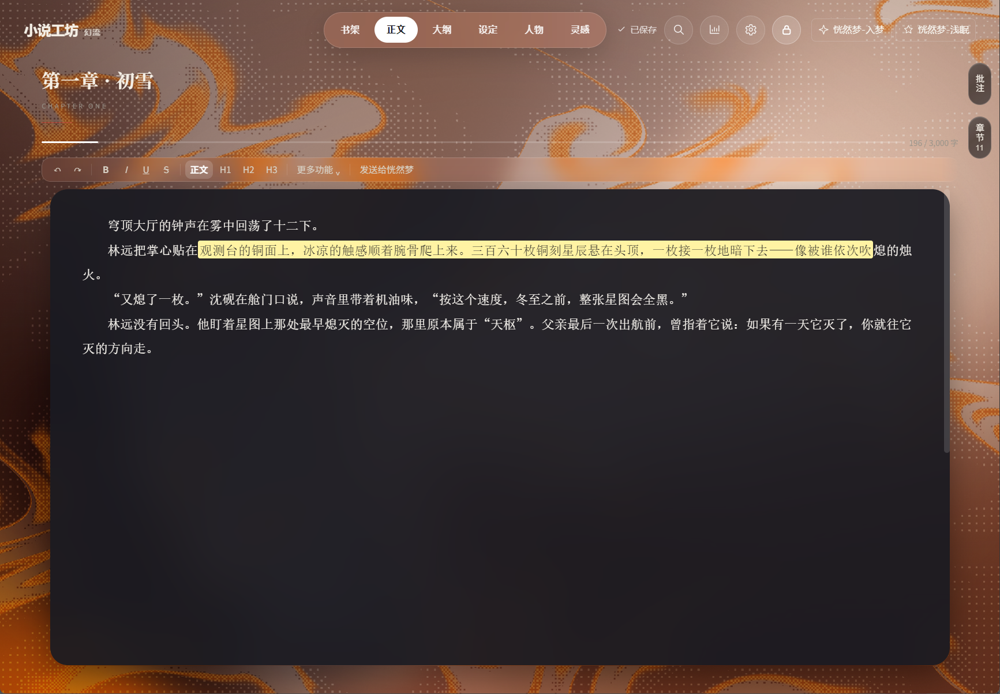
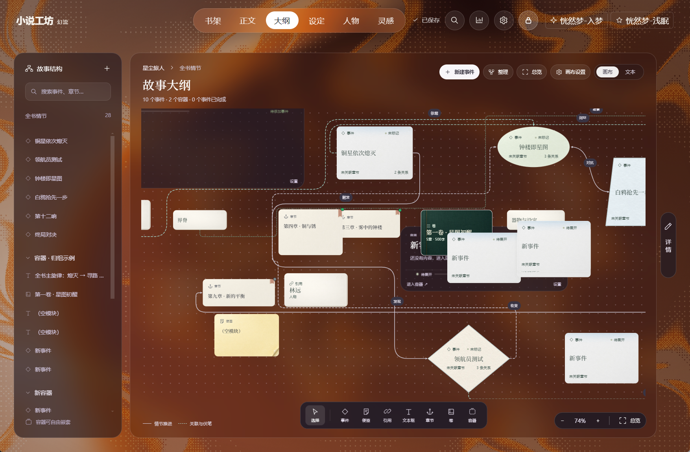
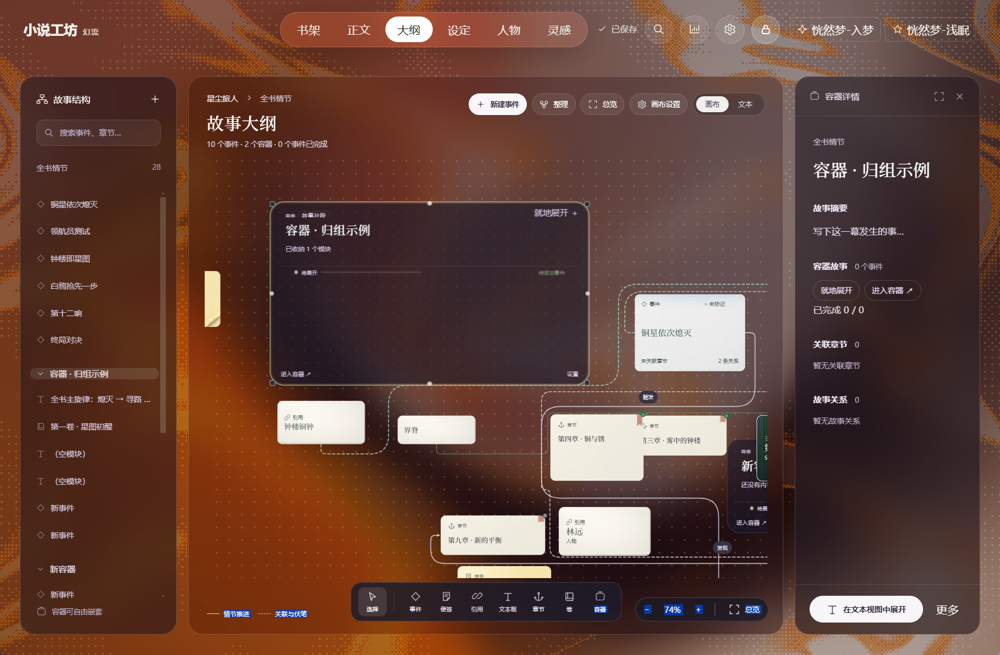
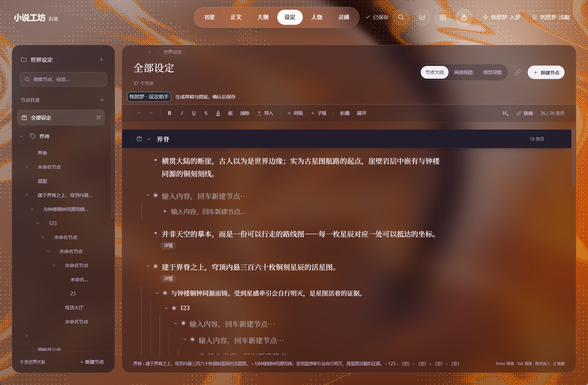
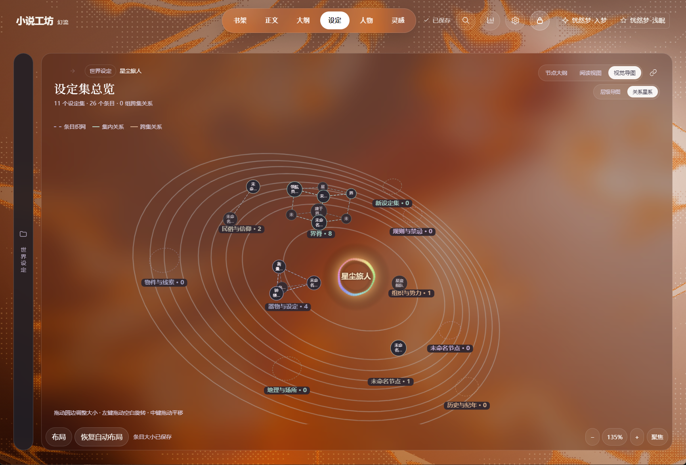
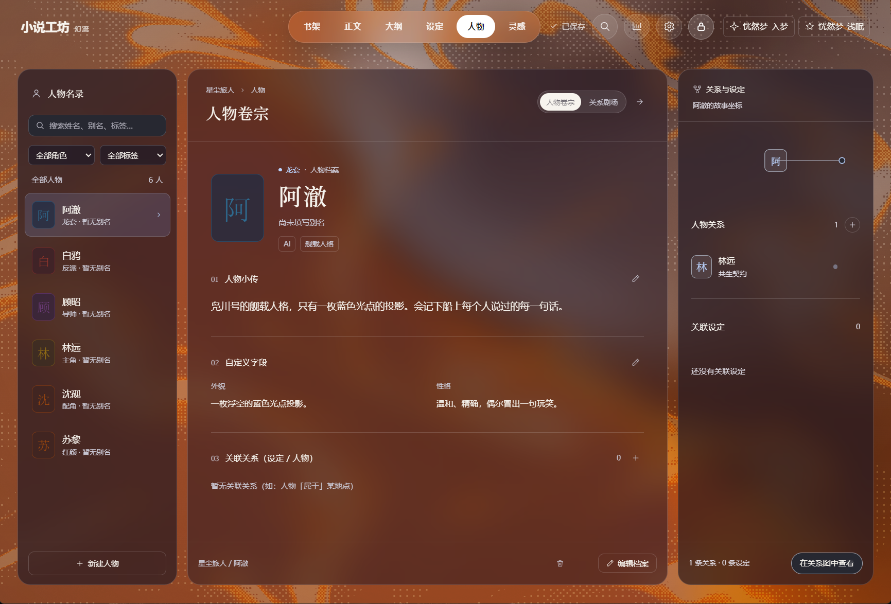
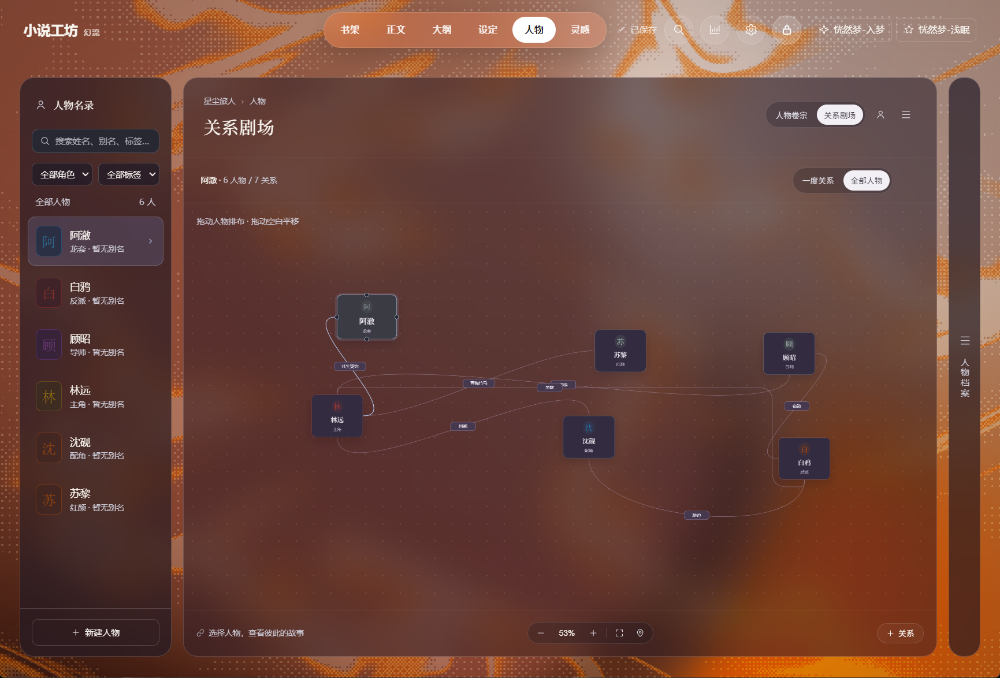
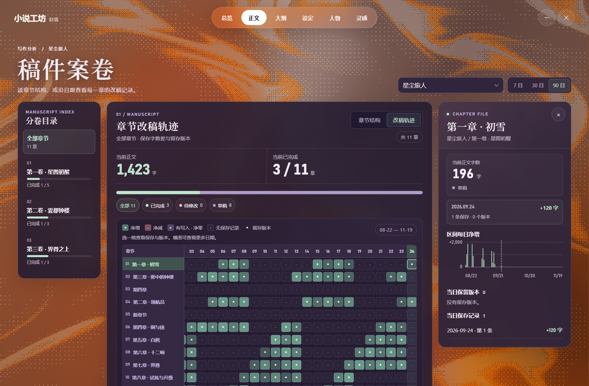

<p align="center">
  
</p>

<div align="center">

# 空想书典 · Reverie Fiction

Local-First Fiction Workbench // 为长篇作者打造的本地幻流写作书典

简体中文 | [English](README.en.md)

[](https://github.com/linque0/novel/releases)
[](https://github.com/linque0/novel/blob/main/LICENSE)
[](https://github.com/linque0/novel/stargazers)
[](https://github.com/linque0/novel/issues)
[](https://github.com/linque0/novel/releases/latest)
[](https://nodejs.org/)
[](https://www.electronjs.org/)
[](https://vuejs.org/)

[快速下载](#快速下载)
·
[界面展示](#界面展示)
·
[核心能力](#核心能力)
·
[本地开发与构建](#本地开发与构建)
·
[正在更新的功能](#正在更新的功能)
·
[文档与变更记录](#文档与变更记录)

</div>

## 项目简介

**空想书典（Reverie Fiction，原名「小说工坊」）** 是一款面向长篇小说创作者的开源桌面写作软件，以**本地优先、输入即存、永不丢稿**为第一原则——所有作品、设定、关系与写作统计均存储在用户本机目录中，无需登录、不上传云端。

软件围绕长篇创作常见的结构断裂，将**书架、正文、大纲、设定、人物、灵感与写作分析**收进统一的「**幻流（Latent）**」工作台：

- **正文不再孤立**：左侧卷章目录、中央 TipTap 富文本稿纸与右侧随章批注栏实时联动，同时支持收起两侧栏专注书写与只读阅读模式。
- **结构可视可下钻**：大纲采用分层自由画布，支持 7 类模块与 4 类语义连线（端口锁定 + Hanan 稀疏网格 A* 自动绕障），并与文本幕布视图同源切换。
- **世界观与人际网互联**：设定为无限嵌套的统一幕布树与 3D 轨道关系星系；人物具备多篇小传卷宗与拖线即连的关系剧场，三者均可通过 `[[关系链接]]` 与正文互相引用。
- **灵感与数据全链路沉淀**：按标签分栏管理的灵感拼板可一键转化为正式章节或设定；基于本机保存记录的 9 视图写作分析全程离线运行。

桌面端基于 Electron 33 + Vue 3 构建，提供 Windows x64 安装包与免安装运行形态；仓库同时支持本地网页调试端（`npm run web`）及同步插件端构建（`plugin/dsh/`）。

## 快速下载

> [!TIP]
> - **GitHub Releases**：前往 [Latest Release](https://github.com/linque0/novel/releases/latest) 下载 `reverie-fiction-setup-<版本>.exe`（Windows x64 NSIS 向导式安装程序，支持自定义路径与创建快捷方式）。
> - **应用内更新**：已安装桌面端可在「设置 → 帮助与关于」检测 GitHub Releases 新版并经 SHA-512 校验自动安装。

> [!NOTE]
> 安装包与可执行文件暂未购买商业代码签名证书。Windows 首次运行如遇 SmartScreen 安全提示，点击「**更多信息 → 仍要运行**」即可；所有创作数据均独立存储在本地数据目录，卸载重装不会删除已有作品库。

## 界面展示

> **截图说明**：以下画面均采集自「幻流」主界面真实构建（`1920×1080`），演示作品为虚构的《星尘旅人》，书名、人物、章节与写作分析数据均为测试生成，未包含任何真实作者稿件。完整 `22` 张实机长篇图鉴与细节解析可参阅 [`产品介绍.md`](docs/项目展示文档/产品介绍.md)、[`产品介绍-图文版.pdf`](docs/项目展示文档/产品介绍-图文版.pdf) 或在浏览器直接打开 [`项目展示.html`](docs/项目展示文档/项目展示.html)。

### 核心工作区预览

<table>
  <tr>
    <td width="50%">
      
    </td>
    <td width="50%">
      
    </td>
  </tr>
  <tr>
    <td align="center"><strong>书架主舞台 · 3D 轮播书封与上次阅读票根</strong></td>
    <td align="center"><strong>幻流流场 · 支持跟随封面取色或自定义双色流动背景</strong></td>
  </tr>
  <tr>
    <td width="50%">
      
    </td>
    <td width="50%">
      
    </td>
  </tr>
  <tr>
    <td align="center"><strong>正文三栏 · 卷章目录 / 富文本稿纸 / 五项批注联动</strong></td>
    <td align="center"><strong>专注写稿 · 一键收起侧栏仅留竖轨入口</strong></td>
  </tr>
  <tr>
    <td width="50%">
      
    </td>
    <td width="50%">
      
    </td>
  </tr>
  <tr>
    <td align="center"><strong>大纲画布 · 七类模块摆位与 Hanan A* 绕障连线</strong></td>
    <td align="center"><strong>容器体系 · 次级画布下钻、就地展开与详情面板</strong></td>
  </tr>
  <tr>
    <td width="50%">
      
    </td>
    <td width="50%">
      
    </td>
  </tr>
  <tr>
    <td align="center"><strong>世界设定 · 无限嵌套平权节点幕布树</strong></td>
    <td align="center"><strong>关系星系 · 多圈同心轨道与跨设定集关联网络</strong></td>
  </tr>
  <tr>
    <td width="50%">
      
    </td>
    <td width="50%">
      
    </td>
  </tr>
  <tr>
    <td align="center"><strong>人物卷宗 · 多篇带标题小传、自定义字段与故事坐标</strong></td>
    <td align="center"><strong>关系剧场 · 节点拖线建改关系、双向同步卷宗</strong></td>
  </tr>
  <tr>
    <td width="50%">
      
    </td>
    <td width="50%">
      
    </td>
  </tr>
  <tr>
    <td align="center"><strong>灵感拼板 · 按标签分栏拖拽并一键转为章节或设定</strong></td>
    <td align="center"><strong>写作速览 · 顶栏一键唤出全书字数与七日净增分布</strong></td>
  </tr>
  <tr>
    <td width="50%">
      
    </td>
    <td width="50%">
      
    </td>
  </tr>
  <tr>
    <td align="center"><strong>写作分析 · 累计净增曲线与 180 天活跃热力日历</strong></td>
    <td align="center"><strong>改稿轨迹 · 章节×日期存稿热力矩阵与历史版本回溯</strong></td>
  </tr>
</table>

<p align="center">
  更多视图（阅读视图、卷宗编辑、作品对照、章节结构、大纲 / 设定 / 人物 / 灵感专项分析）见 <a href="docs/项目展示文档/产品介绍.md">产品介绍（22 图完整版）</a>
</p>

## 核心能力

| 模块 | 能力摘要 |
|---|---|
| **书架与幻流流场** | 3D 轮播书封陈列与上次阅读进度票根，支持按连载/完结/构思/搁置筛选及书名作者搜索；底层 WebGL 着色器流场支持跟随封面取色、自定义双色、5 组预设与 `0–2×` 流速调节。 |
| **正文写作台** | 卷—章两级树（拖拽排序 / ★ 书签 / 状态标记）+ TipTap 富文本稿纸与 Word 式右键操作栏；被批注文字（按用途分色实线下划线）与 `[[关系链接]]`（点状下划线 + 可钉住悬停预览窗）上下错位共存；右栏「批注栏」随章节五项联动，支持折叠专注视角与限宽只读「阅读模式」。 |
| **分层大纲画布** | 根层只展直接子节点，容器支持进入次级画布或就地展开为迷你卡；事件/便签/引用/文本框/章节锚点/卷/容器 7 类模块自由摆位，4 类语义连线严格锁定建立时的两端接口并用 Hanan 稀疏网格 A* 自动绕障；支持连接点（线连到线）、拖拽塑形、跨层投影及同源幕布文本视图。 |
| **世界设定** | 统一无限嵌套幕布节点树（支持三区拖拽、悬停自动展开与 `MD/TXT` 标题层级导入）；配套「三栏阅读视图」和「视觉导图（层级导图 + 可调轨道间距/半径的 3D 关系星系）」；支持设定↔设定、设定↔人物双向关联与双击详情页。 |
| **人物卷宗与剧场** | 左侧按角色定位与标签双重筛选；卷宗支持自定义头像、多角色分隔、多篇带标题小传及自由自定义字段；「关系剧场」中拖线到空白人物建关系、落到已有关系边即改写，并与卷宗双向实时同步。 |
| **灵感拼板** | 收敛为按标签分栏看板，拖动图钉调整顺序或跨栏归组；可调节卡片尺寸（`80–125`）、配色与排序；在右侧「片段整理」抽屉一键转为正式章节或设定条目，同时保留原灵感追溯。 |
| **九视图写作分析** | 基于本机保存记录与 ECharts 生成，无需联网：顶栏「写作速览」浮窗直达独立分析台，覆盖总览（创作历程 / 作品对照）、正文（章节结构 / 改稿轨迹热力矩阵）及大纲 / 设定 / 人物 / 灵感专项统计与联动检查器。 |
| **全局检索与导入导出** | `Ctrl+Shift+F` 跨五模块全局搜索命中跳转；支持 `TXT / MD / DOCX / PDF / EPUB / 图片` 预览分章导入（自动识别 GBK 编码）；按卷勾选导出 `TXT / MD / Word (.docx)`，超阈值可选合并或按卷分目录打包 `.zip`。 |
| **独立拆窗与实体锁** | 正文、大纲、人物、设定、灵感、写作分析均可拆出为完整功能的独立窗口；主进程级别**实体锁**防止多窗并发覆写，被占用条目在主窗转为只读提示并可一键跳至目标窗口。 |

<details>
<summary>展开查看导出排版、关系链接与本地 OFL 字体详情</summary>

- **OOXML 原生 `.docx` 导出**：由 JSZip 组装标准 Word 文档，保留加粗、斜体、下划线、标题层级、段落对齐、列表与引用块样式，按 A4 版式输出；默认单批阈值 30 章（设置页 `2–500` 可调）。
- **关系链接双向索引**：输入 `[[标题]]` 或右键「添加关系链接…」即可把章节、人物、设定与灵感彼此串联；标题改名不断链，悬停弹出带动画预览窗，拖动标题栏即可钉住到屏幕任意位置。
- **中西文分离排版与本地字库**：随包附带 6 款中文字体（思源宋体、霞鹜文楷、京华老宋体、朝华标题、云游手书、系统黑体）与 3 款西文字体选项（跟随中文、Playfair Display、Montenegrin Gothic One），支持 `13–24px` 无级调节并零网络请求运行。

</details>

## 本地开发与构建

前置环境：建议 **Node.js ≥ 18**（当前开发环境为 Node 24），仓库 `.npmrc` 已预置国内镜像配置。

```bash
npm install        # 安装依赖（Electron 与渲染器依赖）
npm run dev        # 启动开发模式（Vite 热更新 + Electron --profile=dev 隔离测试数据）
npm run build      # 仅构建前端资源到 dist/
npm run build:plugin  # 构建插件前端输出到 dist-plugin/
npm start          # 以生产模式启动本地 Electron 应用
npm run web        # 启动本地静态网页调试端（http://127.0.0.1:18688）
npm run dist       # 构建并打包 Windows x64 安装包与免安装目录到 release2/
npm run stop       # 优雅关闭所有运行中的空想书典实例确保落盘
```

### 交付形态对照

| 形态 | 路径 / 启动方式 | 说明 |
|---|---|---|
| **Windows 安装程序** | [Releases](https://github.com/linque0/novel/releases/latest) / `release2/reverie-fiction-setup-<版本>.exe` | NSIS 向导式安装，支持桌面与开始菜单快捷方式 |
| **免安装本体** | `release2/win-unpacked/空想书典.exe` | 解压即用，与安装程序共用构建产物 |
| **DSH 插件前端** | `npm run build:plugin`（源码衔接 `plugin/dsh/`） | 与桌面版幻流界面共享核心代码并适配宿主环境 |
| **网页调试版** | `npm run web` | 本地浏览器调试（IndexedDB 与桌面库相互独立，不支持 `.docx` 解析导入） |

> [!NOTE]
> - 桌面安装版、免安装版与正式模式默认共用数据目录（`%APPDATA%\小说工坊`，为兼容老版本平滑升级沿用旧目录名），同一目录同一时间仅允许运行一个实例防止并发冲突；需要多开对比时请附加 `--profile=你的配置名` 启动隔离目录。
> - 调试或自动化测试结束后请执行 `npm run stop` 安全退出。

## 数据存储、安全与自动更新

- **本地双轨与隔离架构**：创作数据存储在本机应用目录（通过 `Dexie / IndexedDB` 与 `packages/novel-core/` 文件库底座双轨支撑），所有表结构访问经 Repository 层（`src/db/repo.js`）隔离，零默认遥测与零后台上传。
- **多重防丢稿机制**：正文输入防抖 `1s` 自动落盘 + `30s` 定时兜底 + 失焦 / 切章 / 关窗前强制存盘；每章按 `5 分钟` 冷却策略自动保留最近 `30` 份版本快照并支持逐条一键回滚；四模块统一配备软删除回收站。
- **备份恢复与目录迁移**：设置内支持查看当前作品库目录并**一键迁移存储路径**；可导出包含全部插图的 **JSON 全库快照**，恢复前预览摘要后整库还原。
- **SHA-512 校验自动更新**：桌面版内置更新模块（`electron/updates.cjs`）读取 GitHub Releases `latest.yml`，仅接受正式版本，下载安装包后执行本地 SHA-512 摘要比对再调起安装器。

## 正在更新的功能

以下能力当前仍在持续开发与打磨中，暂未作为正式定型特性开放或宣传，将在后续版本逐步成熟后陆续交付：

- **「恍然梦」创作协同 Agent（持续完善中）**：探索面向长篇创作场景的沉浸式故事协同与侧边辅助工作流，坚持**「只提提案、作者定夺」**的边界设计。当前正在持续完善长篇上下文记忆精度、本地知识库检索一致性及流程稳定性，敬请期待后续更新。
- **底层存储与格式演进**：围绕已隔离的 Repository 层推进向单文件 SQLite 底座平滑迁移的可选方案，并逐步补充扫描件 OCR 与老版 `.doc` / `.mobi` 文档解析支持。

## 参与贡献与工程测试

欢迎通过 [Issues](https://github.com/linque0/novel/issues) 反馈 Bug、提出建议，或在遵循以下协作规范的前提下提交 Pull Request：

- **分支与提交纪律**（详见 [开发流程.md](docs/开发流程.md)）：`main` 为稳定集成与发布分支，特性开发与重构请从主题分支切出；提交信息统一采用 `feat / fix / refactor / docs / test / chore` 前缀；版本历史统一记录于 [CHANGELOG.md](CHANGELOG.md)，`package.json` 为版本号唯一权威来源。
- **验证脚本体系**：`tools/` 目录下维护了百余套覆盖纯逻辑与 CDP 真机驱动的回归与验收脚本：

```bash
# 画布核心模型纯逻辑自测（无需启动应用）
node tools/canvas-model-test.mjs

# 启动调试端后运行专项端到端验收（需保持单一 dev 实例与远程调试端口）
npx electron . --remote-debugging-port=9222 --profile=dev
node tools/olcanvas-verify.mjs            # 大纲分层自由画布
node tools/chargraph-verify.mjs           # 人物关系剧场
node tools/dl-verify.mjs                  # 关系链接全链路
node tools/lorelink-verify.mjs            # 设定关联与详情图谱
node tools/multiwindow-verify.mjs         # 独立拆窗与实体锁
node tools/latent-integration-verify.mjs  # 幻流界面整合与写作分析回归
node tools/pack-smoke.mjs                 # 打包产物与解析冒烟
```

### 仓库结构

```text
electron/                  主进程（窗口管理、本地协议、更新、实体锁与导入导出 IPC）
packages/novel-core/       作品核心存储与领域模型复用底座
plugin/dsh/                DSH 插件宿主适配层
src/
  components/              书架、工作台、编辑器、幻流工作区与分析组件
  db/                      数据表结构与 Repository 隔离层
  services/                自动保存、WebGL 流场着色器、导出(OOXML/ZIP)、导入解析
  stores/                  Pinia 状态管理（书架 / 作品 / 界面状态）
  styles/                  幻流视觉样式与布局令牌
  assets/                  本地随包 OFL 字体（woff2 子集化）与静态资源
docs/                      项目展示图文、使用手册（与内置帮助同源）与开发规范
tools/                     CDP 端到端验收脚本与单元测试集合
```

## 文档与变更记录

| 文档 | 说明 |
|---|---|
| [项目展示.html](docs/项目展示文档/项目展示.html) | 单文件交互式图文展板（含 WebGL 流场与 22 张可缩放截图） |
| [产品介绍.md](docs/项目展示文档/产品介绍.md) / [图文版 PDF](docs/项目展示文档/产品介绍-图文版.pdf) | 全模块 22 图详尽产品说明文档与 A4 排版版 |
| [使用手册.md](docs/使用手册.md) | 详尽功能操作、快捷键一览、导出规则与 FAQ（与软件内置手册同源） |
| [开发流程.md](docs/开发流程.md) | 架构分层、五步开发法、测试验收纪律与打包发布规范 |
| [CHANGELOG.md](CHANGELOG.md) | 逐版本变更记录与验收数据存档 |

## 开发说明与免责声明

本项目在开发与迭代过程中广泛借助了 AI 辅助编程工具完成代码编写、重构整理与自动化测试构建，部分边缘场景仍可能存在未覆盖到的细节瑕疵。欢迎在使用或二次开发过程中通过 Issue 协助完善。

应用所有写作功能默认完全在本地离线执行，不采集任何作者文稿；无论使用何种本地或在线扩展工作流，建议对重要的长篇连载作品定期通过「设置 → 备份与数据」导出完整 JSON 快照妥善保存。

## 致谢

空想书典的构建离不开以下优秀开源项目与创作资源的支撑：

- [Electron](https://www.electronjs.org/) · [Vue 3](https://vuejs.org/) · [Pinia](https://pinia.vuejs.org/) · [Naive UI](https://www.naiveui.com/)
- [TipTap](https://tiptap.dev/)（正文富文本编辑内核）
- [Apache ECharts](https://echarts.apache.org/)（本地多维度写作分析图表）
- [Three.js](https://threejs.org/) · [paper-design/shaders](https://github.com/paper-design/shaders)（幻流 WebGL 着色器灵感与协议详见 [paper-shaders-LICENSE.txt](public/paper-shaders-LICENSE.txt)）
- [Dexie.js](https://dexie.org/) · [JSZip](https://stuk.github.io/jszip/) · [Mammoth](https://github.com/mwilliamson/mammoth.js) · [PDF.js](https://mozilla.github.io/pdf.js/) · [Marked](https://marked.js.org/) · [DOMPurify](https://github.com/cure53/DOMPurify)
- 本地中文字体 [思源宋体 (Noto Serif SC)](public/licenses/Noto-Serif-OFL.txt) 与 [霞鹜文楷 (LXGW WenKai)](public/licenses/LXGW-WenKai-OFL.txt)（SIL Open Font License 1.1）

## 开源协议

本项目基于 [`AGPL-3.0`](LICENSE) 许可证开源。

内置的第三方着色器及本地随包字体等资源各自遵循其原始开源协议（详见 [public/paper-shaders-LICENSE.txt](public/paper-shaders-LICENSE.txt) 与 [public/licenses/](public/licenses/)）。
