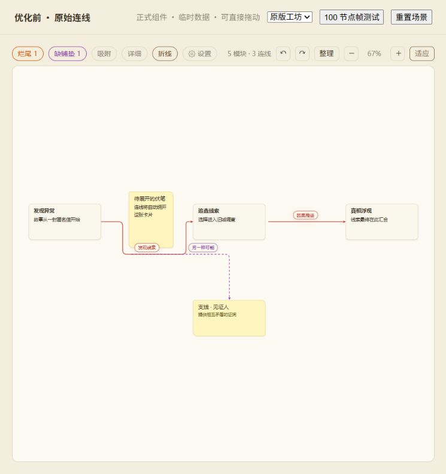
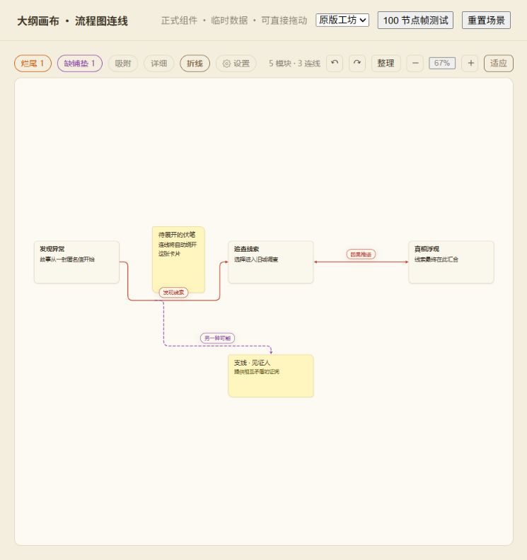
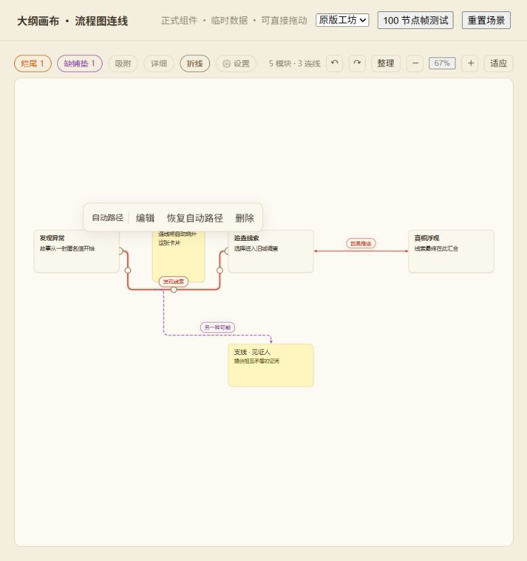

# 大纲画布连线路由验收

验收日期：2026-10-19。实现接入正式 `src/components/OutlineCanvas.vue`，此目录的页面直接使用正式组件和 store，以内存场景展示，不打开用户作品、不保存数据。

开发服务启动后访问 [可交互验收页](http://127.0.0.1:5173/docs/outline-routing-validation/)。工具栏可切换折线／曲线、缩放和皮肤。单击连线或标签选中，拖动线段手柄或端点；双击编辑；Esc 取消；Delete 删除；工具条可恢复自动路径。页面“重置场景”还原临时数据。

## 实现范围

- 路由保留现有 A*，统一可见线段、投影、连接点、箭头、截短和标签几何。自适应曲线检测障碍，绕行仍保留平滑曲线。
- 固定端口、相邻通道代价、上次走向偏好、手动路径避障和受阻状态。手动线段被模块遮挡时，同轴端点共同修正至可通行通道。
- 手势只在成功松手时提交，单次撤销覆盖端口、连接点和关系归属。重连保留编号、属性及分支；校验宿主依赖环。删除模块时完整清理依赖分支。
- 动画帧合并拖动，节点索引、障碍和路径缓存减少重复计算。取消手势同时恢复路径缓存。
- 新作品默认圆角折线；旧作品保留偏好，无偏好时使用原曲线默认值。切换作品重置偏好和撤销历史。旧 custom 继续读取，首次手动调整才保存 routing v1，无数据库结构迁移。

## 验证结果

| 检查 | 结果 |
| --- | --- |
| 原有纯逻辑基线 `node tools/canvas-model-test.mjs` | 48/48 |
| 新增几何、避障、稳定性、兼容及缓存 `node tools/canvas-routing-test.mjs` | 57/57 |
| 关系事务、分支、重连及删除级联 `node tools/canvas-relations-test.mjs` | 11/11 |
| 正式画布交互与数据库重读 `node tools/outline-routing-verify.mjs` | 55/55 |
| 四皮肤 × 两线型 × 30%／100%／220% | 24 个状态；20px 命中层均完全透明 |
| CUA 真实指针 | 手柄拖入模块后自动修正；端点吸附预览与松手路径一致；撤销还原 |
| `npm run build` | 通过 |

交互脚本只读写已登记的“画布验证书B”。覆盖四类端点组合、两端重连、预览匹配、单次撤销／重做、Esc 数据与可见路径恢复、无效落点、删除、输入删除保护、受阻宿主不吸附、新作品默认、数据库重读和完整页面刷新。Electron 测试窗口存在隐藏／节流状态，该脚本以 DOM 鼠标事件测试事务，并临时替代 rAF；性能和视觉另在可见 IAB 页面验证，未把该脚本当作真实指针或性能证据。

## 性能

固定场景：100 节点／150 边，连续拖动 140 次，排除最初 10 帧，记录 129 个真实 requestAnimationFrame 间隔。两种线型均记录 130 个不同的模块位置。

| 线型 | 浏览器帧 P95 | 目标 |
| --- | --- | --- |
| 圆角折线 | 16.6ms | ≤32ms |
| 平滑曲线 | 11.2ms | ≤32ms |

浏览器测试在本机可见 IAB、默认视口、适应视图下执行，输入为页面测试按钮发送的 DOM 鼠标事件；帧间隔包含正式组件更新与浏览器渲染。数值反映该固定场景和当前设备，不代表任意布局或设备的保证。

原始结果见 [browser-frames.json](browser-frames.json)、[benchmark.json](benchmark.json)、[interaction-results.json](interaction-results.json)、[visual-results.json](visual-results.json)。

## 前后对照

同一组模块与连接关系。优化后，宿主连线与分支分离，箭头和连接点使用统一路径。

| 优化前 | 优化后 |
| --- | --- |
|  |  |

`?before=1` 仅用于开发期对照，依赖本次修改前保存在 `.superpowers/sdd/outline-routing/` 的组件、模型和样式备份。其余截图文件记录各皮肤和缩放状态，220% 截图平移至连线主体。

最终独立代码复核已修正：节点删除留下孤立宿主引用、Esc 保留预览缓存、受阻连接点仍可吸附。之后的手动路径整段修正和曲线近重叠修正也已复核，无剩余重要问题。工作区原有未提交修改保留，本次未创建提交。
