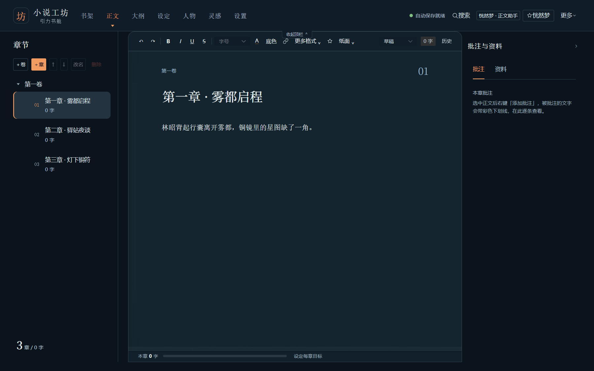
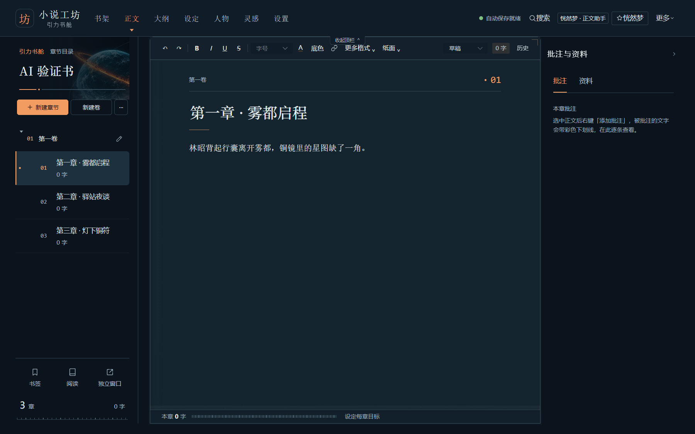
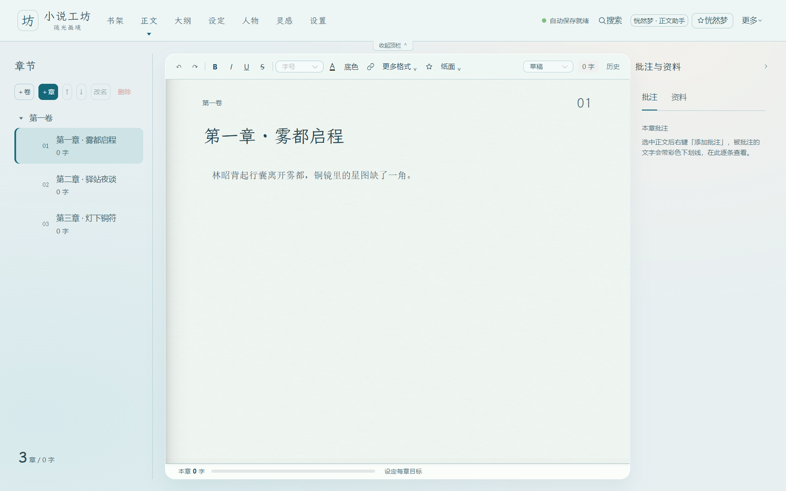
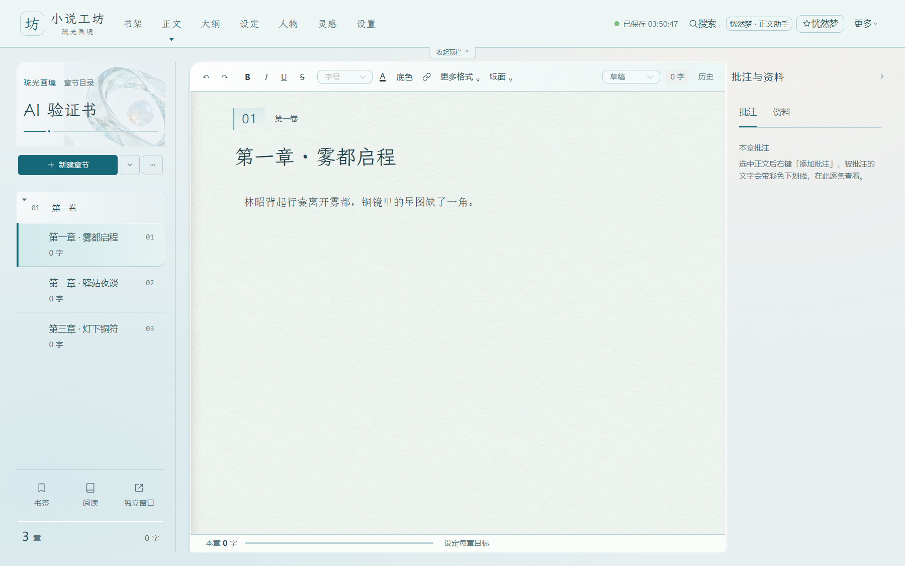
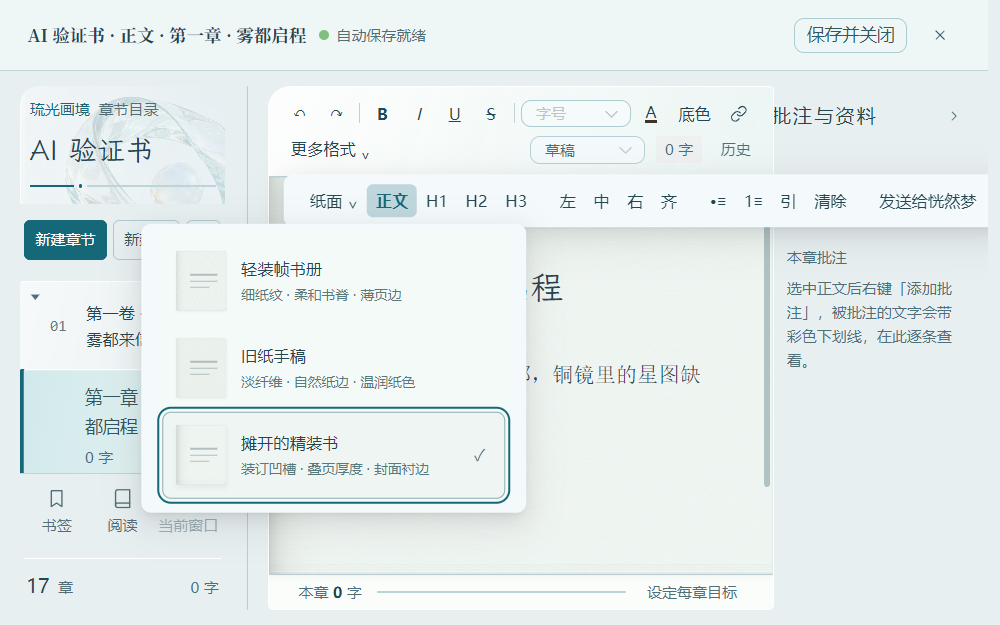

# 引力与琉光正文专属界面

2026-10-26。按已确认的场景化方向完成：引力为“轨道档案舱”，琉光为“折光叠册”。正文功能、用户字体、三种纸面、长标题换行及单一编辑器沿用现有实现；没有修改 store、数据库、IPC、模型调用或新增应用偏好。没有自动提交或升级版本。

## 设计结果

同日按后续反馈将新建卷和卷名编辑改为直接可见入口，截图与13项新增验证见 [卷操作优化与验证](../volume-entry-20261026/卷操作优化与验证.md)。下方整页截图保留本轮设计交付时的状态。

引力保留深海军蓝与铜橙，以局部行星、轨道弧线、等宽编号、目录导轨和定位灯组织章节；章首页使用紧凑卷章仪表条、铜色短线，外围为薄金属装订框。琉光保留浅青与深青，以玻璃丝带、分卷页签、青色嵌页和右置小章号组织目录；章首页使用靠页边的薄书签编号和文楷题名，外围使用玻璃衬页。

复用本地 `gravity-planet.png`、`glaze-ribbon.png`，新增装饰由 CSS 绘制，未引入远程素材。纹理仍由既有三种纸面负责，不叠加新的正文纹理、折角或文字反光。未新增持续动画，只有目录选中、按钮背景和边框的约160ms过渡，尊重减少动画偏好。

章首页随正文滚动；实测两套章首页没有比旧结构增加占高。目录作品名自然换行；卷章名称采用两行密度，悬停可查看全文，键盘聚焦会弹出完整名称。目录单独滚动，底部快捷入口固定。800×500短窗口进一步收紧铭牌及统计留白，完整露出当前卷、两行当前章节和字数，不缩小正文。

### 前后对照（1440×900 CSS视口）

| 引力：改版前 | 引力：改版后 |
| --- | --- |
|  |  |

| 琉光：改版前 | 琉光：改版后 |
| --- | --- |
|  |  |

### 两主题与三种纸面

| 纸面 | 引力 | 琉光 |
| --- | --- | --- |
| 轻装帧书册 |  |  |
| 旧纸手稿 |  |  |
| 摊开的精装书 |  |  |

截图为原生窗口合成帧。系统125%缩放下，1440×900 CSS视口输出1800×1125图像。图中为隔离验证书的测试文字与数据，不代表作者作品；三纸面截图包含长文与多卷目录，前后对照使用较短的同类验证数据。

## 功能入口映射

| 现有功能 | 新入口 | 接线与保护 |
| --- | --- | --- |
| 新建章节 | 左栏主按钮“新建章节” | 复用原创建动作；管理目标跟随新章节 |
| 新建卷 | 主按钮旁直接显示“新建卷” | 先填写卷名，确认后复用原创建卷动作；取消不创建 |
| 编辑卷名 | 每个卷名右侧的铅笔按钮 | 直接编辑指定卷名，不切换当前章节 |
| 上移／下移／改名／删除 | “···”目录管理菜单 | 保留禁用状态、改名对话框、删除确认及回收站规则 |
| 目录切章／跨卷拖拽／卷排序 | 原 NTree | 保留原数据和移动动作；适配实际拖拽回调传参 |
| 本章书签 | 左栏底部“书签／已书签” | 原书签动作；两主题工具栏不重复展示 |
| 章节书签列表 | 全局“更多 → 章节书签” | 原列表与来源跳转 |
| 阅读 | 左栏底部“阅读” | 原阅读状态；阅读抽屉采用原目录，不添加未接线的快捷按钮 |
| 正文独立窗口 | 左栏底部“独立窗口” | 原拆窗与锁规则；已拆出的窗口显示禁用的“当前窗口” |
| 三种纸面 | 宽工具栏“纸面”；窄工具栏“更多格式 → 纸面” | 原持久化与同步动作；窄入口悬停提示注明包含纸面 |
| 格式、章节状态、历史、字数目标 | 原工具栏／原页脚 | 不更换处理逻辑 |

管理目标会跟随实际章节，避免创建、外部导航或“点卷后回点当前章”时误操作旧卷。删除确认保存打开时的目标及作品身份，后台切章不会令确认转向另一章。拖拽修复限于组件适配：NTree的落点判断不提供来源，来源由原拖拽开始／结束事件记录；视图节点从既有 key 补齐原移动处理所需的 ID，不改变存储格式。

## 验证结果

使用独立 `booksource-verify` profile、CDP 9333、主进程 inspector 9229，复用已登记《AI 验证书》《批注验证书》《多窗口验证书》。操作窗口的脚本串行执行，不请求真实模型，不操作作者作品。

| 检查 | 结果 |
| --- | --- |
| `studio-writing-skins-verify.mjs` | **22/22，连续三次通过**：真实菜单与管理、删除确认与目标隔离、书签、阅读抽屉、拖拽跨卷、卷排序、焦点全文提示、选区/正文/撤销/编辑器保持、滚动与AI浮层、章首页占高及其他皮肤保留 |
| `studio-writing-skins-layout.mjs` | **54/54**：两皮肤 × 180/252/480px侧栏 × 三种纸面 × 1280×720、1440×900、1920×1080；无横向溢出，纸面切换排版与编辑状态保持 |
| 独立窗口、纸面菜单、200%组合检查 | 完整脚本及 `--windows-only` 组合连续三次通过，最终完整矩阵再通过；800×500中当前窗口按钮禁用、目录有效高度、阅读恢复和三纸面切换均正常 |
| `chapter-title-wrap-verify.mjs` | **20/20**，四皮肤长标题、IME、Enter/失焦、旧回调、阅读与独立窗口 |
| `readmode-verify.mjs`，CDP_PORT=9333 | **16/16**，目录抽屉、两级Esc、选区与同一编辑器 |
| `multiwindow-verify.mjs`，CDP_PORT=9333 | **11/11**，锁定、重复打开、写入落库、切章锁迁移和关闭恢复 |
| `crimson-writing-rail-verify.mjs` | **12/12**，赤月戏目录及正文空间回归 |
| 静态检查 | 五个受改Vue组件的SFC解析、脚本和模板编译通过；受改文件 `git diff --check` 通过 |

边界检查覆盖空书、空卷、未分卷、多章节、超长中英文名称以及窄目录。先补缺失入口的失败检查再实现；发现管理目标、删除目标、旧拖拽兼容、阅读抽屉和短窗问题后均补了定向检查并验证修复。无真实模型生成，因此不需要配置模型固定响应。此次按前端定向范围验证，未运行生产构建或全量无关测试。

原始数据见 `results.json`、`layout-results.json`、`window-results.json`，初始失败记录为 `red.json`。

## 视觉与代码复核

完成一轮独立视觉复核并检查修正后的截图：修复短窗目录高度不足，补充窄窗纸面菜单展开证据；两行名称与全文提示按已确认密度保留。未增加填缝文案，将原目录“章节”标题替换为作品铭牌，并收纳横排管理按钮，保留对象名、真实字数及操作名称。详细记录见 [独立视觉复核](独立视觉复核.md)。

完成独立代码复核：发现并修复“卷→回点当前章仍针对卷”和“阅读抽屉快捷入口未接线”，原发现与处理证据保留在 [代码复核](代码复核.md)。当前没有未解决的严重问题；确认中显示对象名称、伪卷无效动作禁用等次要建议保留供后续迭代。

| 短窗口 | 纸面入口展开 | 200%原生缩放 |
| --- | --- | --- |
|  |  |  |
|  |  |  |
