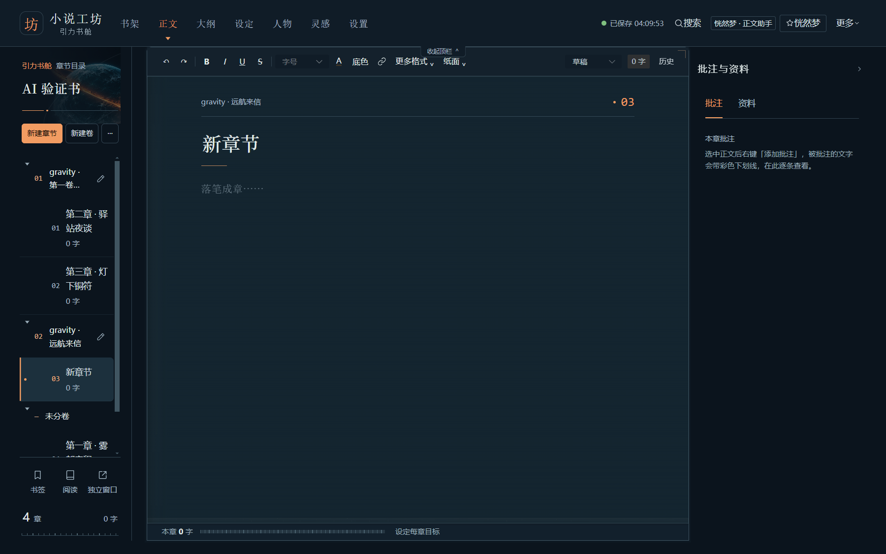
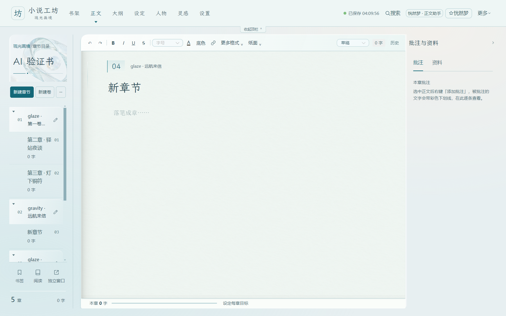

# 新建卷与编辑卷名入口优化

2026-10-26。针对引力、琉光正文目录入口不够明显的问题，直接显示“新建卷”，并为每个真实卷提供常驻铅笔按钮“编辑卷名”。本轮没有扩展其他模块或修改存储结构。

后续同日已为赤月戏补齐相同能力，另见 [赤月戏卷操作优化与验证](../crimson-volume-entry-20261026/赤月戏卷操作优化与验证.md)。原版沿用既有入口。

## 现在的操作

- 左栏“新建章节”旁直接显示“新建卷”，不再收在下拉箭头中。
- 点击“新建卷”先填写名称，确认后调用原创建卷动作，并选中新卷；接着新建章节会归入该卷。取消不创建空卷，空白卷名不能提交。
- 每个卷名右侧显示铅笔按钮，直接打开该卷的名称编辑。按钮不会切换或折叠卷，也不会切走当前章节；保存只更新打开时的目标卷。
- 卷名弹窗保留Enter确认，并处理中文输入法组词，组词确认不会误创建卷。保存中阻止重复确认。未分卷为虚拟分组，不显示改名铅笔。
- 操作仍走现有 `addVolume`、`renameVolume` 与自动保存通路；没有新增数据库字段、IPC或偏好，不改正文及撤销记录，不自动提交。

## 验证

复用已登记《AI 验证书》、独立 `booksource-verify` profile、CDP 9333 / inspector 9229；不操作作者作品、不调用模型。先补“新建卷和逐卷编辑入口直接可见”的失败检查，观察两皮肤均失败后实施。

- `node tools/volume-entry-verify.mjs`：**13/13，连续三次通过**。覆盖入口可见、创建前命名、取消无空卷、空名禁用、IME、确认创建并落盘、新章归卷、编辑目标隔离及正文/编辑器保持、180px窄栏、未分卷以及刷新后读回。
- `node tools/studio-writing-skins-verify.mjs`：**22/22通过**；只更新新建卷入口的定位和命名步骤，保留原业务断言。
- `node tools/studio-writing-skins-layout.mjs --windows-only`：两皮肤800×500独立窗口、窄工具栏三纸面、阅读恢复及原生200%缩放通过。
- ChapterTree 的 Vue SFC脚本/模板编译和受改文件 `git diff --check` 通过。

小范围入口改动由主任务查看实际截图，没有另做整页设计评审。加 `--screens` 保存命名、编辑和180px侧栏截图；结果保存在 `results.json`。正文及其他目录行为沿用上一轮，并已运行受影响的定向回归。

## 截图

| 状态 | 引力 | 琉光 |
| --- | --- | --- |
| 新建卷 |  |  |
| 编辑卷名 |  |  |
| 180px侧栏 |  |  |
