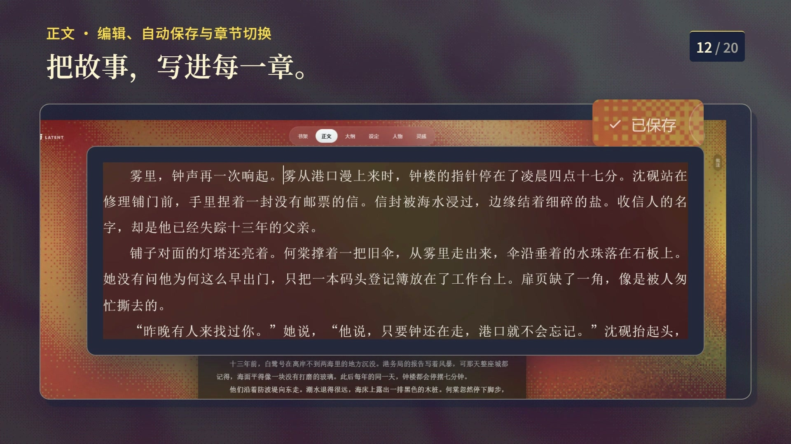
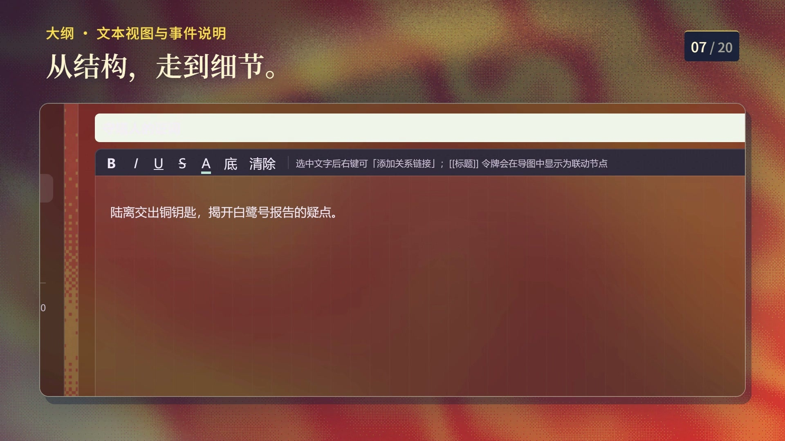
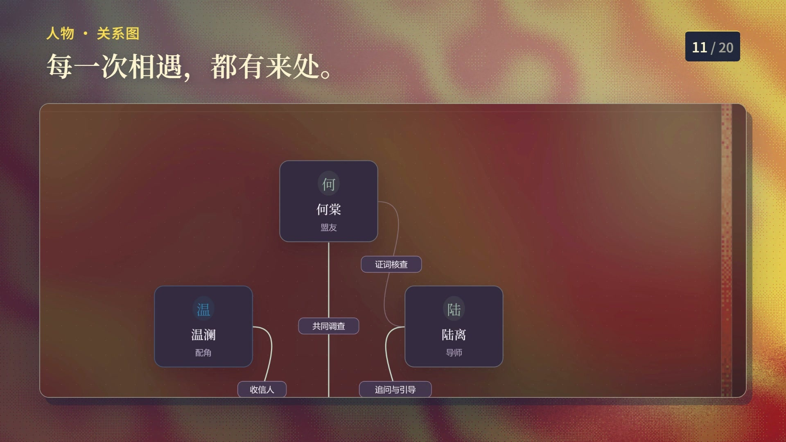
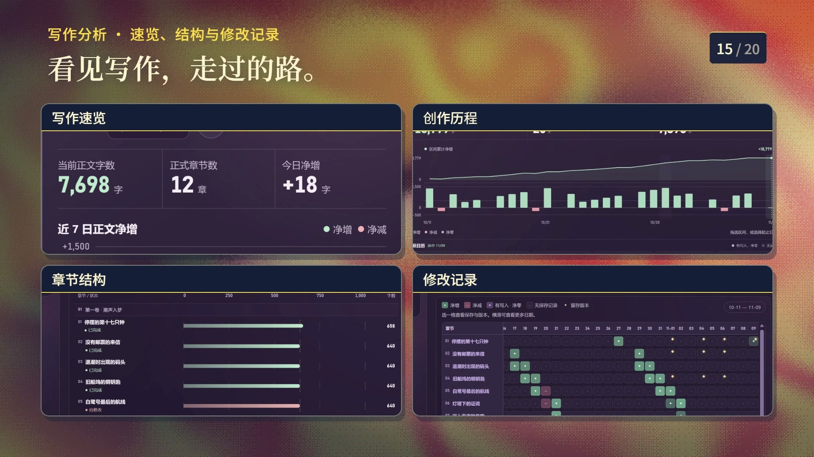
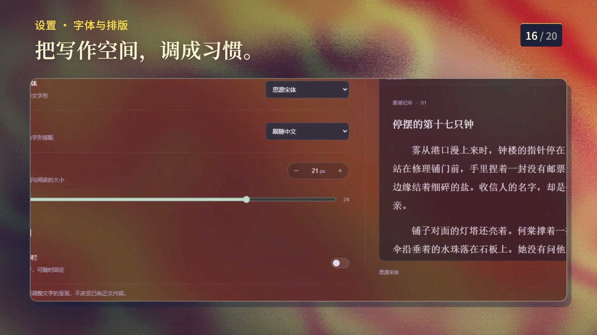

# 小说工坊 Novel Studio · 产品介绍

> 本地优先的小说创作软件 ｜ 当前版本 **v1.2.0** ｜ Windows x64
> 项目主页：<https://github.com/linque0/novel> ｜ 安装程序：[Releases](https://github.com/linque0/novel/releases)
>
> **图文排版版**：[产品介绍-图文版.html](产品介绍-图文版.html) · [产品介绍-图文版.pdf](产品介绍-图文版.pdf)（25 页 A4，封面 / 目录 / 分章排版，适合直接分发或打印）
>
> 本文界面配图取自产品演示片实拍（1920×1080，拍摄时使用内置皮肤 **赤月戏**，演示作品《雾港纪年》）。演示片把各模块的布景底色替换为红黄色调，其余版式、控件与交互与软件一致；画面中的书名、人物、章节与统计均为演示数据，不来自任何真实作者作品。皮肤与布景只影响外观，不改变功能与数据。

---

## 一、这是什么

**小说工坊**是一款面向个人作者的桌面写作软件：把「正文 / 大纲 / 人物 / 设定 / 灵感」五个创作要素收进同一个工作台，**输入即存、永不丢稿**，所有作品数据留在本机。

它要解决的是长篇小说创作中最常见的三个断裂：

| 创作痛点 | 小说工坊的做法 |
|---|---|
| 正文与大/小纲分离，写着写着失去结构 | 大纲做成**可分层进入的自由画布**，事件、便签、引用卡自由摆位并用连线表达因果；正文可拆窗与大纲并排 |
| 人物关系记在纸上、设定散在多个文档 | 人物有**关系图**，设定是**无限嵌套的幕布树**，二者都能与正文通过关系链接互相引用 |
| 心血丢失、版本混乱 | 输入防抖 1 秒自动落盘 + 30 秒兜底 + 失焦/切章/关窗强制保存；章节自动版本快照可回滚 |

*书架。三本书以竖排书名 + 生成式书封陈列，顶部「全部 · 3 / 3」是当前筛选计数，卡片信息行给出「作者 · 章数」；选中项下方展开「继续写作 / 打开工作台」两个入口。*

---

## 二、界面总览：一座折屏戏台

赤月戏的视觉语言是「**金屏为台，折缝为幕，纸页为文，朱印为场，书签为序**」。它把书架和五个创作模块都放进一座深墨色的舞台上：深墨底、暖纸面、旧金细线、朱砂印章，纸页之间用折缝分隔。

### 书架

书架页由四层组成：

- **76px 页头**：品牌「小说工坊 / 赤月戏」、书架/正文/大纲/设定/人物/灵感/设置七模块导航、皮肤选择器与设置入口；
- **主舞台**：按作品切换的布景图，左侧竖排大题名与简介，中央是生成式书封，下方是「接续上次的故事」首章票根；
- **316px 剧目栏**：其余作品的纸色列表，显示字数、章数与「上次打开」时间；
- **40px 底栏**：作品总数、最近打开时间与「重播演出」。

### 作品内工作台

进入作品后是统一的工作台外壳：

- **76px 顶栏**：返回书架、保存状态、搜索、拆窗、恍然梦助手、设置与更多；
- **86px 模块条**：当前模块标题、真实上下文与模块动作（大纲的视图切换、整理、独立窗口都在这里）；
- **中央工作区**：正文 / 大纲 / 人物 / 设定 / 灵感五个模块；
- **40px 底栏**：作品 · 模块、居中「赤月戏」、保存状态与「重播开场」。

每个模块都有自己的布景图；窗口缩到 1080×680 时，栏宽与字号会自动收窄，不会出现横向溢出。

*正文工作台。顶部模块条在书架 / 正文 / 大纲 / 设定 / 人物 / 灵感之间切换，右上角常驻「已保存」状态提示；正文区保留居中章题与页边札记栏，格式动作在选中文字后就地浮出。*

---

## 三、正文：写作的主战场

正文采用 **卷—章两级树 + 富文本编辑器**。左侧章节树支持拖拽排序与快捷操作（＋卷 / ＋章 / 上下移 / 改名 / 删除）；中间是稿本，格式条提供加粗、斜体、下划线、删除线，正文与 H1–H3 标题，字号、字体颜色、突出显示，超链接，左中右两端对齐，有序/无序列表与引用，撤销重做与清除格式。

赤月戏把正文拆成三栏：

- **章节目录**（248px，可收到 56px）：按卷分组、搜索章节、显示每章字数与当前章；
- **稿本**（296px 起）：居中章题、花饰、状态行、页脚 folio，正文继续尊重你的字体与字号偏好；
- **页边札记**（252px）：本章批注、资料、字数目标与恍然梦入口。

写作时顶栏常驻保存状态（「自动保存就绪 / 保存中… / 已保存 HH:MM:SS」）。选中文字可以添加**批注**与**关系链接**：批注是带用途色的实线下划线，关系链接是点状下划线，两者可以叠在同一段文字上；悬停关系链接会弹出可拖动的预览窗。

*阅读模式与批注栏。左侧巨排章号加限宽只读列，右侧批注栏逐条对应正文里的下划线；每条批注带用途色、时间戳与「编辑 / 删除」操作，被批注原句与批注内容同框显示。*

### 右键即用：Word 式操作栏

在正文中右键会就地弹出快捷操作栏，把最常用的编辑动作一次摊开：剪切 / 复制 / 粘贴为纯文本、加粗斜体下划线删除线、标题与字号、字体颜色与突出显示、对齐（二级飞出菜单）、列表与引用、超链接、添加批注、添加关系链接、撤销重做与全选。

---

## 四、大纲：分层自由画布

v1.1.3 的大纲是一张**可以逐层进入的纸面画布**：根层只显示直接子节点，容器以章节卡呈现；点「进入容器」进入它的次级画布，面包屑返回上级并恢复各层相机。根层与容器内部都可以自由摆位、连线、搜索和整理。

### 根层与容器

- **根层**：事件、便签、引用、文本框、锚点、卷、容器七类模块自由摆放；顶部显示事件数、容器数与完成进度；
- **容器卡**：显示标题、摘要、章节标签、事件进度与嵌套数；卡上提供「进入容器 ↗」与「就地展开 ＋」；
- **进入容器**：切换到该容器的次级画布，只显示它的直接子节点，面包屑可逐级返回；
- **就地展开**：不离开当前画布，把容器展开为两列迷你卡（窄容器单列），可直接改文字、打开设置抽屉、拖端口连线；
- **容器缩放**：八向缩放柄，宽度 260–720；内容超出时迷你卡在容器内容区内部滚动，连线与端口跟随滚动。

*大纲画布。事件卡显示标题、正文摘要、章节绑定状态与关系条数；被选中的事件带八向端口与「进行中」状态，连线按因果语义着色并自动绕行，不穿过其他模块。*

### 七类模块与事件状态

画布工具条是唯一的添加入口，共 **7 类模块**：

| 模块 | 用途 |
|---|---|
| **事件** | 剧情节点，支持矩形 / 菱形 / 平行四边形 / 椭圆四种形状，SVG 真实描边 |
| **便签** | 随手记、伏笔、悬念等轻量内容 |
| **引用** | 可关联设定 / 章节 / 人物，画布上显示卫星令牌 |
| **文本框** | 主题句、幕间说明，透明度可调 |
| **锚点** | 绑定章节或空白锚点，点击跳回正文位置 |
| **卷** | 绑定分卷，作为结构坐标 |
| **容器** | 归组同类模块，可折叠、可进入、可就地展开、可调色 |

事件有四种状态：**已完成 / 正在写 / 待修改 / 待展开**。新事件默认「待展开」，容器进度只统计已完成事件；工具条的「多选」可以勾选当前层节点，≥2 个时一次撤销内封装为新容器。

### 连线：四类语义、严格端口、全局最短绕行

连线用四类语义着色——**关联**、**因果**、**伏笔**（默认虚线）、**冲突**——并可独立设置单向 / 双向 / 无向箭头、实线 / 虚线 / 点线、线宽与箭头大小。

两条工程上的硬保证：

- **严格端口锁定**：建立连线时记录两端的接口方向并落库，渲染只认记录值；节点挪到任何位置，连线绝不漂移到别的边；
- **全局最短绕行**：连线途经任何模块（含两端节点本体）一律自动绕行，采用 **Hanan 稀疏网格 A\*** 求解全局最短路，再做直连 / L 形拉直收敛。

连线还支持**拖拽塑形**（左键按住连线拖弯，拖回接近直线自动拉直，双击恢复自动路由）、**连接点**（右键连线 →「在此处创建连接点」，连接点可作终点也可作起点，右键删除）与**自动避线浮层**（按连线走向选择不遮挡本体的一侧，并保持在可视区内）。

### 关系投影与跨层接续

收起或不在当前层的节点不会让关系消失：它们会**投影到最近的可见容器卡**（淡线 + 空心落点）；当前层之外的端点会收进上方「前接」/ 下方「后续」接续卡；同一对端点的同类关系合并为「类型 · N」，可在关系组浮层里批量改类型、箭头与标签，点「详情」查看每条真实关系。

### 文本视图与搜索

画布之外还有**文本视图**：同一份大纲数据以缩进树呈现，适合快速罗列与调整层级。两个视图共享数据，随时切换。`Ctrl+K` 会搜索全部层级，自动进入目标父层并定位。

*文本视图。同一份大纲数据以缩进树呈现，选中事件后就地编辑正文；格式条与「选中文字后右键可添加关系链接」的提示固定在顶部，画布与文本改动即时互通。*

### 画布工具

顶部工具条提供总览、展开全部、收起全部、整理布局与文本视图；右侧是画布透明度（20–100%，只影响底色/点阵）、连线粗细、箭头大小、卡片密度、曲线/折线切换与网格吸附。撤销 / 重做覆盖画布编辑。

---

## 五、人物：卷宗与关系图

人物模块同时提供**列表**与**关系图**两种视图。

### 关系图

人物是节点、关系是连线。可以直接在画布上**拖线建立关系**，点边就地改标签；支持圆形 / 网格一键排布、悬停高亮一度关系网、按角色或标签筛选、孤岛人物提示。拖线落到已有关系上则打开该关系的编辑浮层——**拖线既是「建立关系」也是「改变关系」的统一手势**。

*人物关系图。节点是人物卡（姓名 + 角色定位），边上直接写关系名——共同调查、证词核查、追问与引导；拖线即可建立关系，拖线落到既有边上则改写该关系，建立与修改是同一个手势。*

### 人物卷宗

列表视图是完整的人物档案：姓名、角色定位（主角 / 配角 / 反派 / 导师 / 红颜 / 盟友 / 旁观者 / 龙套，也可自定义）、别名、标签、**自定义字段**（默认预置「外貌 / 性格」，可自由增删）、头像、人物小传，以及与其他人物关系的增删改。赤月戏把它做成一张竖排卷宗：330×420 拱顶肖像在左，档案纸在右，下方是竖排演员表。

*人物档案。左侧是竖排演员表，中间卷宗含别名、标签、自定义字段与人物小传；字段可自由增删，头像与姓名同步到关系图节点。*

---

## 六、设定：幕布树与设定详情

设定库是一棵**统一节点树**：没有「文件夹 / 条目」二分，任意节点地位平等、可无限嵌套、自由拖拽（三区插入指示、悬停折叠节点自动展开、FLIP 衔接动画、拖到空白处移到顶层）。

节点内容支持内联格式（加粗 / 斜体 / 下划线 / 删除线 / 颜色 / 底色 / 清除格式），带快照式撤销重做，以及节点级复制 / 剪切 / 粘贴。侧边栏是同一棵树的镜像，点击定位、逐级折叠展开；支持 **MD / TXT 导入**——标题层级自动转成节点层级。

双击设定条目进入**设定详情页**：面包屑路径、关联关系列表、可拖动关系图谱与子条目树；「幕布中定位」关闭详情并闪烁定位原条目。设定之间、设定与人物之间都可以建立带类型的关系，并在条目行尾以关系卡片展示。

*设定幕布。条目行内是内联格式工具条与「导入 / 同级 / 子级 / 折叠」动作，行尾标签即条目级关联资料；标题下的「4 个子节点 · 8 个后代节点」实时统计层级规模，编辑区与侧边树双向同步。*

---

## 七、灵感：随手记

灵感是一张随时可用的纸条：在输入框记下一句话，`Ctrl+Enter` 提交，列表按时间倒序排列。任何一条灵感都能**一键转为章节或设定**，从「想到」到「落在结构里」只差一次点击。

赤月戏把灵感页做成三栏：220px 灯笼河布景、420px 手记墙与 1fr 阅读纸；手记卡错落排布，选中后在右侧阅读纸里继续编辑。

*灵感页。纸条按日期分组（今天 / 11 月 01 日），每条记录时间、标题、正文与标签，「已选中」标记出当前条；选中后即可在阅读纸里继续编辑。*

---

## 八、全局工具

### 搜索 · 统计 · 关系链接

- **全局搜索**（`Ctrl+Shift+F`）：跨正文 / 大纲 / 人物 / 设定 / 灵感检索，命中高亮、点击跳转；
- **写作统计**：总字数、章节数、近 7 日新增、累计写作天数四张卡片，配近 90 天每日新增柱状图与近 180 天写作热力图（ECharts）；
- **关系链接**：任意位置选中文字 → 右键「添加关系链接…」或手输 `[[标题]]`，把章节 / 人物 / 设定互相引用；悬停链接可预览目标内容，预览窗可拖动钉住。

*写作分析。四块面板分别是写作速览、创作历程（区间净增曲线 + 每日净增柱）、章节结构（每章字数与状态）与修改记录（章节 × 日期热力格）；数据由本地记录生成，无需联网。*

### 导入与导出

**导入**支持 TXT / Markdown / DOCX / PDF / EPUB / 常见图片。TXT 自动识别 GBK 等编码并按「第 X 章」智能分章；DOCX 按标题样式分章；PDF 优先按书签目录分章；导入前有预览确认。

**导出**提供对话框按卷分组勾选章节，格式三选 **TXT 纯文本 / Markdown / Word (docx)**（docx 由 JSZip 手组 OOXML，保留加粗、标题、对齐、列表等基础语义，A4 版式）。批量策略随选中规模自动切换：

| 选中范围 | 导出行为 |
|---|---|
| 1 章 | 直接以 `章节名.格式` 导出 |
| 多章（≤ 阈值，默认 30） | 逐章分批：仅首次确认位置，之后自动写入同目录，每章一个文件 |
| 超过阈值 | 可选「合并为单个文件」或「按章打包 zip」（按卷分目录、`序号-章节名` 命名） |

阈值 2–500 可调，即改即存。

*实际导出与导入。左侧是落地成盘的 TXT，卷与章的标题层级原样保留；右侧是由导入新增的「海潮之后」，进入原章节列表后可直接编辑，说明导入不是只入库不出现在结构里。*

---

## 九、多窗口：边看大纲边写正文

顶栏「⧉ 拆窗 ▾」可把**正文 / 大纲 / 人物 / 设定 / 灵感**任一模块拆出为**完整功能界面的独立窗口**（侧栏 + 编辑区 + 调宽手柄），面板内可自由切换条目——不是只读预览，而是完整的第二编辑现场。

为防同一内容被两个窗口同时改写，软件内置**实体锁**：面板占用的章节，主窗口该章转为只读占位并给出「前往窗口」按钮，其余章节照常可写；面板内切换条目时锁**随选中迁移**。面板按类型记忆窗口几何，主窗口关闭时级联关闭全部面板。

---

## 十、视觉与主题：四套皮肤

软件内置**四套皮肤**，可在书架页头或设置窗口一键切换。皮肤覆盖书架、工作台与独立窗口；切换皮肤不改变作品数据、功能与操作习惯。

| 皮肤 | 视觉气质 | 关键色 |
|---|---|---|
| **原版工坊** | 熟悉的书架与工作台；含宣纸 / 羊皮纸 / 暗夜书房三套主题 | 暖米色纸纹、深色书房 |
| **引力书舱** | 深海蓝、铜色轨道与安静的创作舱 | 背景 `#0b131d`、强调 `#f29c62` |
| **琉光画境** | 浅青折射、玻璃叠册与文楷题名 | 背景 `#e7eff1`、强调 `#146878` |
| **赤月戏** | 墨纸旧金、折屏戏台与宋体竖题 | 背景 `#171c1b`、纸 `#eee5cc`、旧金 `#cfb06b`、朱印 `#a84135` |

赤月戏的设计语言可以概括为「**金屏为台，折缝为幕，纸页为文，朱印为场，书签为序**」：

- **深墨舞台 + 暖纸页面**：大面积深墨底承托纸白阅读面，纸页带错位背纸、软影与折角；
- **旧金细线，不做大面积金色**：金线用于栏界、当前项与小标题；朱砂只用于印章、当前书签与主 CTA；
- **折缝分栏**：大栏之间用 11px 明暗渐变带分隔，而不是硬边框；
- **字体**：标题用京华老宋体，文学性文字用霞鹜文楷；正文继续尊重你的中文字体与字号偏好；
- **三张布景**：人物页的红月、设定页的天象图、灵感页的灯笼河；正文、大纲与设置各有独立布景；
- **外壳尺寸**：76px 顶栏 + 86px 模块条 + 40px 底栏；正文 248 / 296 / 252 三栏，人物 330×420 拱顶肖像，灵感 220 / 420 / 1fr；
- **可访问性**：2px 纸白焦点环 + 墨色外晕，`prefers-reduced-motion` 下入场动画直接落到终态。

*设置 · 字体与排版。中文字体、西文字体搭配、字号与行高在这里无级调节，右侧纸面预览即时复现正文排版；设置只改显示，不改动已有正文内容。*

原版工坊下另有**宣纸**（默认，暖米色纸纹）、**羊皮纸**、**暗夜书房**（深色）三套主题，以及色带书封（G）体系：竖版 2:3 开本、平涂单色、书脊装订带、书名与作者名圆印，六款配色冷暖对位。其他三套皮肤则各自使用生成式书封。

---

## 十一、内置帮助与数据安全

顶栏「帮助」按钮（书架页与书内均有）打开**内置使用手册**——手册与源码同源打包（Markdown 以 raw 导入 + marked 渲染），包含功能详解、**键位详解**、导出行为表与 FAQ，永不失同步。

删除的章节 / 人物 / 设定 / 灵感进入**回收站**，可恢复或彻底删除。

**数据与安全**：

- 作品数据存于本机（Electron 用户数据目录下的 IndexedDB），**不登录、不上传**；只有你主动使用恍然梦 AI 助手时，才会按你配置的模型服务发起请求；
- 菜单「备份」导出 JSON 全库快照（含图片），「恢复」可整体还原；
- 超链接仅接受公网 http/https 地址（拒绝本地 / 私有 / 保留 IP），点击时交由系统默认浏览器打开；
- 同一数据目录同时只允许一个实例运行，后启动者给出提示且不损坏数据；需要多开时用 `--profile=名字` 隔离数据目录。

---

## 十二、安装与运行

| 形态 | 获取方式 | 说明 |
|---|---|---|
| **安装程序** | [Releases](https://github.com/linque0/novel/releases) 下载 `novel-studio-setup-1.2.0.exe` | Windows x64，NSIS 向导式（可选安装路径、创建桌面与开始菜单快捷方式） |
| **免安装本体** | `npm run dist` 产物 `release2/win-unpacked/小说工坊.exe` | 双击直接运行 |
| **源码运行** | `npm install && npm start` | 开发者方式（需 Node.js ≥ 18） |

安装程序未做代码签名，首次运行如遇 SmartScreen 提示，选「更多信息 → 仍要运行」即可。

---

## 十三、技术一览

| 项 | 内容 |
|---|---|
| 形态 | Windows 桌面应用（Electron），本地优先、离线可用 |
| 前端 | Electron 33 + Vue 3 + Pinia + Naive UI |
| 编辑器 | TipTap 富文本（正文）、自研幕布编辑器（设定 / 大纲文本）、自研画布引擎（大纲 / 人物关系图） |
| 存储 | Dexie / IndexedDB，Repository 层隔离（后续可平滑迁移 SQLite） |
| 图表 | ECharts |
| 打包 | electron-builder（NSIS 安装程序 + 免安装目录，maximum 压缩） |
| 规模 | 66 个 Vue 组件，约 4.6 万行 JS / Vue / CSS 源码 |
| 质量 | 60+ 套测试与验收脚本，覆盖画布、分层作用域、连线路由、皮肤接入与打包冒烟 |

功能与版本演进详见 [CHANGELOG.md](../CHANGELOG.md)；开发方法与工程纪律见 [开发流程.md](开发流程.md)；面向使用者的操作说明见 [使用手册.md](使用手册.md)。
