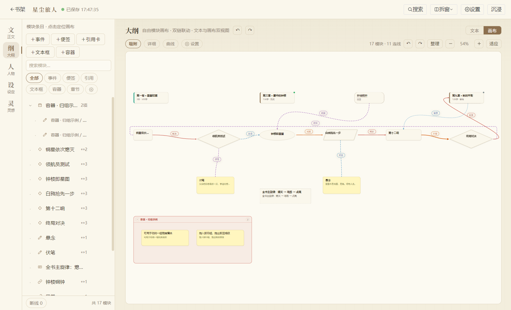
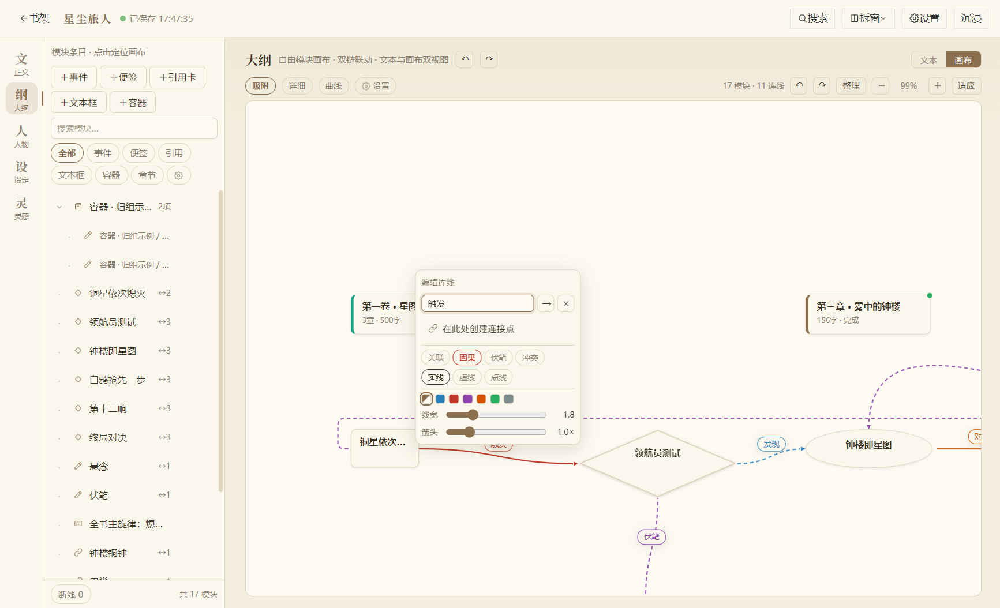
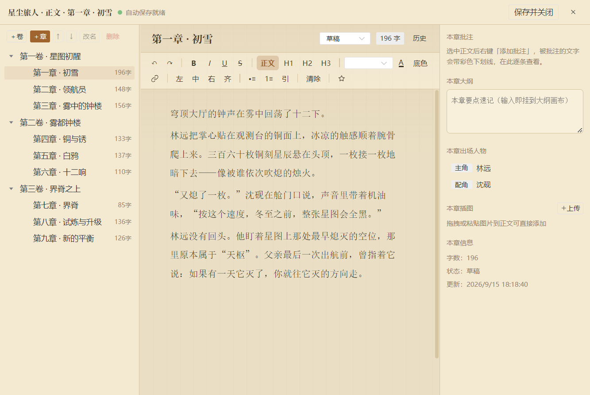

# 小说工坊 Novel Studio · 开发流程

> 本文档记录本项目的**工程方法**：怎么改代码、怎么验证、怎么发版。**本文档是现行工程规则的唯一权威来源**（分支与提交策略、版本唯一来源、测试分层、产物位置）。
> 面向接手人员与协作者。功能与版本历史见 [CHANGELOG.md](../CHANGELOG.md)；阶段汇报见 [工作报告书.md](工作报告书.md)（历史快照，不代表现行规则）；产品功能见 [产品介绍.md](产品介绍.md)。

---

## 一、项目概况

| 项 | 内容 |
|---|---|
| 项目位置 | `F:\deepseek workplace\novel-studio` |
| 代码仓库 | <https://github.com/linque0/novel>（`main` 为稳定集成与发布分支；功能/重构/清理走主题分支） |
| 技术栈 | Electron 33 + Vue 3 + Pinia + Naive UI + TipTap + Dexie/IndexedDB + ECharts |
| 规模 | 116 个源码文件（56 个 Vue 组件）、约 2.8 万行源码、104 次提交 |
| 版本 | **以 `package.json` 的 `version` 为唯一权威来源**（当前 1.1.2）；历史见 [CHANGELOG.md](../CHANGELOG.md) |
| 交付 | electron-builder 打包 NSIS 安装程序，发布至 GitHub Releases |
| 质量 | 47 套验收脚本（清单与逐套检查数见 §5.1，随版本入库 `tools/`） |

> 上表规模与套数为**快照值**，会随清理与新增漂移。复核命令：
> ```bash
> find src -type f \( -name '*.js' -o -name '*.vue' \) | wc -l   # 源码文件数
> find src -name '*.vue' | wc -l                                  # Vue 组件数
> ls tools/*-verify.mjs | wc -l                                   # 验收脚本数
> node -p "require('./package.json').version"                     # 权威版本号
> ```

**核心文件规模**（改动最频繁、风险最集中）：

| 文件 | 行数 | 职责 |
|---|---|---|
| `src/stores/work.js` | 2130 | 作品全部实体的状态与操作（章节/大纲/人物/设定/灵感/画布节点） |
| `src/components/OutlineCanvas.vue` | 1562 | 大纲自由画布（模块、连线、连接点、浮层、右键菜单） |
| `src/components/MubuView.vue` | 1012 | 设定幕布编辑器 |
| `src/components/outline/canvas-model.js` | 999 | 画布纯逻辑：尺寸计算、端口锚点、避障路由、布局算法（两画布共享） |
| `src/components/CharacterGraph.vue` | 656 | 人物关系图 |
| `src/services/doublelinks.js` | 364 | 双链解析与目标定位 |

---

## 二、架构分层

```
electron/            主进程：窗口管理、app:// 静态协议、文件对话框、
                     导入导出 IPC、多窗口面板与锁仲裁（panels.js）
src/
  db/                表结构（database.js，Dexie 版本迁移）+ Repository 层（repo.js）
  services/          自动保存、导入解析、导出（txt/md/docx/zip）、文件 IO、
                     双链、字数统计、富文本转换、画布引擎（graphview.js）
  stores/            Pinia：shelf（书架）/ work（作品）/ ui（界面偏好）
  components/        书架、工作台、编辑器、六个要素面板、弹窗
    outline/         画布纯逻辑（canvas-model.js）
  styles/            三套主题皮肤 + 视觉令牌
tools/               E2E 验收脚本与截图产物
build/               打包图标
docs/                使用手册（内置应用）、工作报告书、产品介绍、开发流程
```

两条设计原则贯穿全局：

1. **存储引擎可替换**：所有数据库读写收敛在 `src/db/repo.js`，页面与 store 不直接触碰 Dexie 细节——将来迁移 SQLite 只需重写这一层；
2. **画布逻辑与渲染分离**：`canvas-model.js` 是不依赖 DOM 的纯函数库（端口锚点、避障路由、布局），既能被 Vue 组件调用，也能被 Node 脚本直接单测，这是画布类缺陷能被低成本锁死的前提。

---

## 三、版本与提交纪律

### 3.1 版本号语义与唯一来源

**`package.json` 的 `version` 字段是唯一权威来源**，其余位置不再各自维护一份版本号：

- `README.md` 不再写「当前版本」作为判据，只在功能描述处引用（应改为引用 `package.json` 与 CHANGELOG）；
- `CHANGELOG.md` 保留逐版本历史段，历史内容不回改；
- `package-lock.json` 的根 `version` 由 npm 随 `package.json` 同步，二者必须一致（不一致时以 `package.json` 为准，运行 `npm install` 即可对齐）。

版本号只在**准备发布时**更新为发布号（如 `1.1.2`）；**普通开发提交不强制升版本**。一批相关修复或一个功能构成一个发布粒度，不攒大批，也不把一件事拆成多个版本号。版本号只进不退。

### 3.2 分支策略

| 分支 | 用途 |
|---|---|
| `main` | 稳定集成与发布分支。可直接发布的状态；里程碑在此打 tag |
| 主题分支（如 `前端重置`、`feature/*`、`refactor/*`、`chore/*`） | 功能、重构、清理等较大改动；完成后合回 `main` |

- 小改动可以在 `main` 上直接提交；一次跨多模块的重构或清理**必须**走主题分支，避免长期把 `main` 留在不可发布状态。
- 清理类改动（删文件、动依赖、改构建配置）应先记录完整 `git status` 作为现场保护，并在独立分支或隔离 worktree 上进行，不与功能改动混在同一批提交里。
- 构建产物不入库（`.gitignore` 已排除 `dist/`、`release2/`、`tools/_*.png`、`tools/_*.json`）。

### 3.3 提交信息规范

采用类型前缀 + 可选作用域：

```
<type>(<scope>): <简短描述>

例：feat(shelf): 引力书舱书架支持点击两侧书籍翻到中央与抽书让位
    refactor(ai): 退役旧四能力脚本，验证书 owner 交予 agent-task-verify
    chore(release): 版本号定为 1.1.2
```

| type | 用途 |
|---|---|
| `feat` | 新功能 |
| `fix` | 缺陷修复 |
| `refactor` | 重构（行为不变） |
| `chore` | 构建、依赖、版本、清理 |
| `docs` | 仅文档 |
| `test` | 仅验收脚本 |

- 提交信息**不再强制**以 `vX.Y.Z：` 开头；只有发布准备提交使用 `chore(release): 版本号定为 X.Y.Z`。
- 正文写「改了什么 + 为什么」，涉及验收的附上脚本与计数。

### 3.4 发布

在 `main` 上打 tag 存档（如 `v1.0.0`、`v1.1.2`），正式版随 GitHub Releases 发布安装程序。发布提交内同步更新 `package.json` 版本号并在 `CHANGELOG.md` 顶部新增该版本段（日期 + 一句话定性 + 修复点/算法要点 + 验收数据）。

---

## 四、标准开发流程（五步法）



*画布是最容易出现回归的模块：模块摆位、四类连线、端口锁定与避障路由相互耦合，任何一处改动都要跑对应验收。*

### 第 1 步 · 定位

先读 CHANGELOG 中同类版本段与工作报告书第八节，再动手。两条高价值经验：

- 画布样式问题的**头号嫌疑是遗留 CSS**——改渲染前先全仓搜索历史规则；
- **用户对同一问题反馈第二次起，说明前次修复没打中真因**：此时不能再沿「改掉明显可疑之处」的思路，要么搭可复现环境做像素级自证，要么向用户索取现象细节。

### 第 2 步 · 修复

源码一律用编辑器工具写入（Mimosa 提交钩子会拦截 shell 直写源码，且中文路径经 `cmd` 会 GBK 乱码）。改动尽量收敛在小范围，涉及两画布共享能力时**两侧同步实现**。

### 第 3 步 · 验证

- 纯逻辑改动（`canvas-model.js` 等）→ 跑对应 **Node 直测脚本**，无需启动应用；
- UI 改动 → 启动应用跑 **CDP 端到端脚本** + 相关回归（见第五节）；
- 一般更新只跑**针对性验证**（改动所及功能的主路径 + `npm run build` 通过即可）；四套全量回归（canvas-model / chargraph / olcanvas / relfollow）在**大版本合并、里程碑打包、涉及共享底层改动**或用户明确要求时执行。



*以 v1.0.18「浮层避线放置」为例：右键浮层需按四方位候选自动避开连线本体。此类改动用 `edgepanel-avoid-verify.mjs` 断言「浮层最近边距 > 0 且完整落在画布可视区内」，共 4 项。*

### 第 4 步 · 提交

**普通开发提交不升版本号**，按第三节 3.3 写提交信息即可。版本号只在发布时更新（见第三节 3.4 与第六节 6.3）。

### 第 5 步 · 推送 + 重建交付物

```bash
git add <files>
git commit -m "<type>(<scope>): <描述>"     # 如 fix(outline): 整理布局不再移动固定模块
git push
npm run dist            # vite build + electron-builder --win → release2/
node tools/pack-smoke.mjs   # 打包冒烟（见第六节）
```

发布时额外打 tag（见 6.3）。

---

## 五、验证体系

### 5.1 验收脚本清单

全部脚本通过 Electron 远程调试端口（CDP）驱动**真实事件**，不抢占系统前台，全部走独立 profile。`npm run dev` 已自带 `--remote-debugging-port=9222`（开发调试版专属），启动后即可直接连 9222 跑任意验收脚本。

### 5.1.1 验证书统一注册（tools/verify-seeds.mjs）

「验证书」= 验收脚本专用的测试作品，**只允许存在于开发调试版（`npm run dev`，`--profile=dev`）的数据库**。全部验证书集中在 `tools/verify-seeds.mjs` 的 `VERIFY_BOOKS` 注册表（v1.0.20 起，此前散落在各脚本内联种子）：

| 时刻 | 机制 |
|---|---|
| `npm run dev` 启动 | 渲染层在 `import.meta.env.DEV` 下动态加载注册表（`src/dev/verifyBooks.js`）→ 自动种入书架（只补缺失，不覆盖） |
| 正式版（`npm start` / 安装包） | DEV 恒为 false，注册表不进运行时，**绝不写入测试数据** |
| 不重启补种 / 重置 | `node tools/seed-verify.mjs [--reset] [--only 书名]` |
| 核验整合结果 | `node tools/shelf-verify.mjs`（16/16 在架 + 无未注册残留） |
| 验收脚本取种子 | `c.evalx(buildSeedExpr('书名', { reset: true }))`——与书架同源，改一处两侧同步 |

**验证书清单**：数量与名称**以 `tools/verify-seeds.mjs` 的 `VERIFY_BOOKS` 注册表为唯一来源**（`npm run dev` 启动后可用 `node tools/shelf-verify.mjs` 核对，该脚本按注册表长度自适应断言，不在文档里写死本数）。当前 17 本：书内知识验证书（project-verify）· 双链验证书（dl-verify）· 批注验证书（annotation-verify）· 关系图验证书（chargraph-verify）· 画布验证书A/B（olcanvas-verify）· 关系跟随验证书（relfollow-verify）· AI 验证书（agent-task-verify，五模块专用任务与提案）· 多窗口验证书（multiwindow-verify）· 画布右键验证书（canvasctx-verify）· 连接点修复验证书（junction-fix / freeze-repro / visual-fix 三脚本共用）· 线连到线验证书（line2line-verify）· 塑形验证书（shape-verify）· 浮层避线验证书（edgepanel-avoid-verify）· 右键浮层验证书（edgeedit-ctx-verify）· 侧栏验证书（sidebar-verify）· 验收测试作品（cdp-test）。

**新增验证书的纪律**：一律先在 `VERIFY_BOOKS` 登记（title / owner / create）—— 注册表即权威清单，本文档不再单独维护一份（避免两处漂移）；`create` 必须自包含（只允许用 `ctx = {db, uid, now}` 与 `meta = {title}`，不得引用模块外变量——注册表会被 `String()` 序列化到页面内求值）、只做纯创建（重置逻辑统一在 `seedBooks`）。**禁止在验收脚本里内联 `db.works.add` 另起炉灶**；演示书《星尘旅人》（产品截图用）走 `tools/seed-demo.mjs`，不属验证书体系。

### 5.1.2 AI 行为验证必须使用已配置模型

- 需要验证 AI 实际生成、理解、检索后回答、按纲写作、正文抽取、语义审核或创作质量时，使用**小说工坊设置中已配置的 DeepSeek 模型**：服务商/模型 `deepseek/deepseek-v4.1-flash`。从应用设置加载当前端点、模型和凭据；不得让本地 Mock 代替模型请求或据 Mock 输出判定 AI 行为通过。
- 运行前确认本次验证确实使用了上述模型，并记录服务商、模型、验证样书、任务范围及结果。报告不得只写“AI 测试通过”；如果请求未到达真实服务、模型不是指定模型或模型调用失败，AI 行为验证记为未完成，并说明原因。
- 独立验证 profile 应通过小说工坊设置配置同一模型和账户；验证代码不得改写成 Mock 的 `baseURL`、测试 API Key 或替代模型。凭据保留在应用安全存储中，不写进源码、日志、报告或对话记录。
- 确定性纯逻辑检查（如数据库迁移、来源哈希、历史范围、预算裁剪、解析和回滚）可用固定输入验证。这些检查只证明对应程序规则，不得作为真实模型生成质量、语义一致性或端到端 AI 能力的证据。
- 每次只运行用户要求及改动所需的定向验证。真实模型验证前确认应用选中模型；遵循现有隔离验证作品和数据目录要求，不用作者正式作品作为测试写入目标。

`agent-task-verify.mjs`（`--real` 之外的机制部分）、`knowledge-verify.mjs`、`preset-verify.mjs`、`preset-experience-verify.mjs` 等脚本会向本地 Mock 发请求。这些脚本只作为确定性机制回归；其通过记录不能替代上述真实模型验证。涉及本规则的 AI 任务优先运行使用小说工坊当前 DeepSeek 设置的模型验证流程。

> **Mock 启动方式已变更**：本地 Mock（`tools/mock-ai.mjs`，默认 `:18700`）原先由已退役的 `tools/ai-verify.mjs` 自动拉起。该脚本删除后，**上述脚本不再自动起 Mock**，运行前需另开一个终端手动启动：
> ```bash
> node tools/mock-ai.mjs --port 18700
> ```

| 脚本 | 项数 | 覆盖 |
|---|---|---|
| `canvas-model-test.mjs` | 48 | 画布纯逻辑（Node 直测，含端口 / 避障路由 / 200 组随机布局模糊测试） |
| `project-unit-verify.mjs` / `project-verify.mjs` | 13 / 18 | 书库规范化、完整分块、全源投影、历史与隐私、依赖发布及恢复；注册样书「书内知识验证书」，集成验收使用独立 `booksource-verify` profile |
| `agent-task-unit-verify.mjs` / `agent-task-verify.mjs` | 15 / 14（机制） | 五模块专用任务、人物/关系/状态联合提案、原文证据、确认/过期/回滚/撤销与恢复；复用「AI 验证书」，强制独立 `booksource-verify` profile。`--real` 另启当前配置的指定 DeepSeek 模型验证，失败不以 mock 替代 |
| `olcanvas-verify.mjs` | 29 | 大纲自由画布全链路 |
| `cdp-test.mjs` | 29 | 端到端全功能 |
| `dl-verify.mjs` | 20 | 双链全链路 |
| `dlpop-verify.mjs` | 19 | 双链浮窗（进出场动画 / 拖动钉住 / 停靠记忆 / 原位换内容，v1.0.21；进场 opacity 完成断言需窗口可见） |
| `bugfix-verify.mjs` | 14 | v1.0.22 缺陷修复专项（恢复时序 / 视图切换 / 幕布合并与按钮 / 拆窗写回门禁 / stripTags 等） |
| `annotation-verify.mjs` | 28 | 正文批注（右键添加 / 彩色下划线 / 侧栏 / 与双链共存 / 落库持久化） |
| `shelf-verify.mjs` | = 注册表本数 | 验证书整合（全部注册本数在架 + 无未注册残留，v1.0.20；断言按 `VERIFY_BOOKS.length` 自适应，不写死本数） |
| `shelf-flip-verify.mjs` | 37 | 引力书舱书架翻动（点两侧翻到中央 / 点列表抽书让位 / 方向键 / 静止位次与缩放透视 / 页内 16ms 采样证明过渡在插值 + 帧时间与长任务 / reduced motion 静态降级，v1.1.0；丝滑与截图断言需窗口可见，隐藏时降级为 SKIP） |
| `glaze-fidelity-verify.mjs` | 66 | 琉光画境视觉保真（人物关系图页头·提示条·节点卡·纯文字边标签·端口可见·标签下拉与圆形/网格文字按钮 / 设定详情图谱白卡节点与光晕画布 / 大纲元信息 chip·34px 标题·20px 正文 / **书架左栏排版**（标题 76px·数量药丸·相对时间·统计行分级）**与封面舞台**（白纸垫卡·三张宽位旋转 rotateY·书名分级·首章白卡含位置·球体·**封面竖幅 2:3 与卡高 331/274/226·书名两行且贴顶**）；断言读计算样式，并检查对齐规则只在琉光生效，v1.1.2；自建自删夹具，需隔离 profile 9224） |
| `crimson-v3-verify.mjs` | 30+ | **赤月戏 v3 接入（当前）**：Playwright 加载真实 Vite 应用；书架 76 页头/去竖栏/七导航/316 剧目栏，正文 248/296/252 章节目录与无底条，大纲 240，设定 220/240 与详情 200/340，人物 330×420/卷宗 440，灵感 220/420/1fr，关系图 260，设置书签分类，1080×680 全屏无溢出，三张新背景加载与定位，皮肤隔离、焦点环、减少动画；截图与 `capture-report.json` 写入 `docs/前端美化/赤月戏-验收/v3/`；需先启动 Vite 5173 |
| `crimson-shelf-verify.mjs` | 38 | **v1 历史**：赤月戏（金屏夜梅）书架与外壳：令牌、87px 页头/84px 竖栏/316 剧目栏/305 故事栏、故事栏 135、竖排 64px 四字题名 77×300、181×255 书封与书脊、真实首章卡与摘录、统计只留字数/章数、搜索/打开/菜单/软删除、1080×680 无溢出、五支入场动画（时长/缓动/错峰）与减少动画终态、皮肤隔离与持久化，v1.1.3；隔离 profile `crimson-skin-verify`，端口 9225 |
| `crimson-workbench-verify.mjs` | 30 | **v1 历史**：赤月戏工作台：76/86/40 外壳、正文 62/158/252/604/43/76 与 project-line 按钮组、页边留白/目标字数、大纲 214/266–1270/底右控制条/1004 稿本、设定 248/304–1164/1188–1408、人物 443/298×414/508–1408、图谱 310/1147/1169/1408/118、灵感 245/462/623/43/230、入场动画与皮肤隔离，v1.1.3；隔离 profile 9225 |
| `crimson-settings-verify.mjs` | 7 | **v1 历史**：赤月戏独立设置窗口 1000×700：76+86+40、181/纸/250×340、纸面、预览 running/样例/folio、无横向溢出，v1.1.3；需先打开设置面板，隔离 profile 9225 |
| `crimson-fidelity-verify.mjs` | 5 | **v1 历史**：赤月戏设定详情保真：顶栏下 76–860、86px 模块条、32px 边距、210/纸 266–1029/关联 1053–1408、无横向溢出，v1.1.3；隔离 profile 9225 |
| `crimson-evidence.mjs` | — | 生成 `docs/前端美化/赤月戏-验收/对照.html`（10 组设计稿 ↔ 真机并排）与有意偏差说明，v1.1.3 |
| `relfollow-verify.mjs` | 15 | 关系图拖线改关系 + 严格端口 ±1px + 80 点路径采样避障 |
| `chargraph-verify.mjs` | 12 | 人物关系图 |
| `multiwindow-verify.mjs` | 11 | 拆窗 / 锁 / 完整界面 / 锁跟随 / 落库 / 释放 |
| `junction-fix-verify.mjs` | 10 | 连接点全链路（建点 / 接线 / 多点多引出 / 级联删除） |
| `canvasctx-verify.mjs` | 6 | 画布右键建模块 + Delete 删除 |
| `sidebar-verify.mjs` | 5 | 侧栏调宽钳制与记忆 + 画布文本按钮 |
| `shape-verify.mjs` | 5 | 连线塑形（拖弯 / 拖回拉直 / 双击拉直 / 箭头朝向） |
| `line2line-verify.mjs` | 4 | 线连到线 |
| `edgepanel-avoid-verify.mjs` | 4 | 编辑浮层避线放置 |
| `freeze-repro-verify.mjs` | 4 | 画布卡死复现与修复 |
| `edgeedit-ctx-verify.mjs` | 3 | 右键连线开浮层 + 浮层内建点 + 改标签 |
| `visual-fix-verify.mjs` | 3 | 视觉专项 |
| `pack-smoke.mjs` | 3 | 打包冒烟（界面渲染 / mammoth Word 解析 / Dexie 打开） |

### 5.2 三条验证方法论

**① DOM 属性 ≠ 渲染结果。** CSS 规则优先级会压过 SVG 表现属性。历史上出现过退役组件遗留的 `.om-edges path { stroke: … }` 让两画布连线颜色永远改不动、粗细锁死，而箭头和标签不受影响，呈现出「只有中段变色」的假象——三轮反馈才定位。**判断「颜色/粗细为什么不变」必须查 `getComputedStyle` 或做像素采样，不能只看元素属性。**

**② 像素级验证法。** CDP `Page.captureScreenshot` 取图 → 页面内用 canvas `getImageData` 采样目标点与期望色比色距（阈值 ~60）；「位置不对 / 没绕开」类问题沿折线多点采样，断言路径不入模块矩形。

**③ 真实鼠标事件优于合成事件。** 用 CDP `Input.dispatchMouseEvent`（带命中测试）而非 `dispatchEvent`；Chromium 对 SVG `pointer-events:stroke` 路径的 `contextmenu` 命中与 `mousedown` 可能不一致，右键目标需用 `elementFromPoint` 反查真实落点。

### 5.3 调试纪律

- **调试 / 验收结束必须 `npm run stop` 完全退出**（先优雅关闭确保数据落盘，残留进程再强制结束）；用户正在运行的实例绝不动；
- **自动化只跑一轮，失败即止不重试**；修复后复验同样只跑一轮；
- **验收脚本用全新 profile**：脏数据跨轮残留会造假失败（曾因旧 profile 数据出现 3 项假失败，换新 profile 即全绿）；
- **锁屏 / 最小化会冻结渲染**：LockApp 状态下 `requestAnimationFrame` 不触发、Vue 过渡冻结；窗口最小化时 Chromium 不产帧，CDP 截图会一直挂起——脚本卡住先怀疑环境，而非代码；
- **验证书数据归属开发调试版**：`npm run dev` 挂 `--profile=dev`，`npm start` 正式版只含真实书目，不写入测试数据；
- **探针不可绕过组件直写数据库**：组件的自动保存定时器会覆写外部直写，造数据要走真实交互路径。

---

## 六、打包与发布流程

### 6.1 打包

```bash
npm run dist
# = vite build（渲染进程 → dist/）
# + electron-builder --win（NSIS 安装程序 + win-unpacked 免安装目录 → release2/）
```

产物：

| 文件 | 说明 |
|---|---|
| `release2/novel-studio-setup-<版本>.exe` | NSIS 向导式安装程序（可选路径、桌面与开始菜单快捷方式） |
| `release2/win-unpacked/小说工坊.exe` | 免安装本体 |

打包配置要点（`package.json` 的 `build` 字段）：

- `compression: maximum`，`electronLanguages: ["zh-CN","en-US"]` 精简语言包；
- `files` 白名单精确列出运行期所需的 `node_modules` 子包（mammoth / jszip / xmldom 等），**打包体积从 504MB 降至约 279MB**；
- `afterPack: scripts/afterpack.js` 清理许可文件；
- `artifactName: novel-studio-setup-${version}.${ext}` 保证文件名与版本号一致。

**遇到文件锁就换输出目录**：旧 `release2/win-unpacked` 的 `app.asar` 可能被残留句柄占用（进程列表查不到占用者也会发生）。此时不必纠结解锁，按既有惯例临时切到 `-c.directories.output=release-<版本>` 构建，事后还原配置。

### 6.2 打包冒烟

用**一次性 profile** 启动打包产物，跑 `pack-smoke.mjs` 验证三项，测完立即杀进程并删除 profile：

```bash
./release2/win-unpacked/小说工坊.exe --remote-debugging-port=9223 --profile=packtest-<版本>
node tools/pack-smoke.mjs
```

| 检查项 | 验证内容 |
|---|---|
| 界面渲染 | `#app` 就绪、品牌区与书架容器已挂载 |
| mammoth (Word 解析) | 页面内构造最小 docx → 主进程解析出正确文本（验证 `node_modules` 白名单裁对了） |
| Dexie 数据库打开 | 独立 profile 下数据库可打开（验证存储层在打包环境可用） |

三项全通过，本轮才算交付闭环。

### 6.3 发布

```bash
# 1. 发布提交：更新 package.json 版本号 + CHANGELOG 顶部新增该版本段，然后提交打 tag
npm install                                  # 让 package-lock.json 根版本与 package.json 对齐
git commit -am "chore(release): 版本号定为 X.Y.Z"
git tag vX.Y.Z
git push origin vX.Y.Z

# 2. 创建 GitHub Release 并上传安装程序
#    （环境无 gh CLI 时可用 Git Credential Manager 取凭据后调用 REST API）
POST /repos/linque0/novel/releases              → 建 Release（tag_name 用已推送的 tag）
POST https://uploads.github.com/repos/.../releases/<id>/assets?name=...  → 上传 exe

# 3. 同步一份安装程序到交付文件夹，并回写交付记录
F:\deepseek workplace\小说工坊\novel-studio-setup-<版本>.exe
# CHANGELOG 该版本段补「### 交付」小节：产物名、体积、冒烟结果、Release 链接
```



*多窗口拆窗涉及主进程窗口管理、`panel:open` 锁仲裁、渲染层只读占位三方协作，是打包前必须回归的典型跨进程功能。*

---

## 七、已修复的关键缺陷与经验

下表是项目积累的「真实翻车记录」，每条都对应一类需要警惕的陷阱。

| 缺陷 | 教训 |
|---|---|
| 遗留 CSS `.om-edges path` 覆盖连线 stroke | 退役组件的 CSS 会存活很久；改样式前先全仓搜历史规则；CSS 优先级可压过 SVG 属性 |
| 存量连线无端口记录，节点挪位后接口漂移 | 结构信息要**建立时落库**，不要渲染时重算；存量数据需一次性补记（用 Set 防重复触发） |
| 贪心逐段绕障绕出巨型路线与重复段（两代算法） | **局部贪心 ≠ 全局最短**；绕障类需求直接上全局最优（Hanan 网格 A\* + 转向惩罚），再拉直收敛 |
| 画布打开即卡死：`edges` computed 自引用死循环 | computed 内部不得回读自身依赖；连接点几何改为直接重算宿主几何，消除自引用 |
| 便签节点被旧迁移逻辑改写成事件 | 数据迁移要有终态标记（`olnodes-mig2:` 键）并注意迁移分支的副作用范围 |
| 面板被自己的实体锁误判为「他窗锁定」 | 锁判定要记录本窗口自身持有的键（`ownKey`），否则面板会自我只读 |
| 字段名输入框 `NInput` change 回调签名不匹配 | 组件库回调签名需实测；静默失效类 bug 要用「操作后回读数据」的方式断言 |
| 非容器节点 `height:'auto'` 不渲染落库高度 | 渲染尺寸必须与几何计算口径一致（显式高度），否则拖拽/连线几何全错 |
| resize 落库把未拖轴一并钉死 | 只落库用户实际拖动的轴 |
| 中文路径经 `cmd` 乱码 | 中文路径一律走 spawn 数组传参 |
| 打包时旧输出目录被句柄锁定 | 不纠结解锁，直接换输出目录重建 |
| 批注标记刷新后消失（v1.0.19） | **TipTap 标记解析失败是静默的**：`TextStyle` 声明了「任意带 `style` 的 span」通配规则，ProseMirror 取**首个匹配规则**，标记 span 因内联 `--note-color` 被抢走匹配而在解析阶段丢弃——写入正常、渲染正常，只有「刷新后消失」。定位方法是把「编辑器 getHTML / store 内容 / DB 内容 / 刷新后 getHTML」四点连成链路比对，一眼看出丢失发生在**解析**而非存储；修法是给自定义标记显式 `priority`（默认 100，取 1000）压过通配规则。**凡自定义 TipTap 标记携带内联 style，必查是否被 TextStyle 抢匹配** |
| 浮窗动画在隐藏窗口永不出现（v1.0.21） | **Vue Transition 的 enter/leave 序列依赖 nextFrame(rAF)**：窗口最小化 / 被完全遮挡时 rAF 冻结，过渡永远停在 enter-from（元素 opacity 0 常驻、离场元素永不卸载），且 `getComputedStyle` 的 opacity 冻在起始值——任何等待时长都等不到完成。修法：`<Transition :css="false">` + JS 钩子（setTimeout 驱动 done），可见窗口动画一致，隐藏窗口最迟 ~1s 完成不会卡死。**给带动画的浮层做验收，要么恢复窗口可见，要么改用不依赖 rAF 的驱动** |
| CDP 按压类输入在隐藏窗口零派发（v1.0.21） | `Input.dispatchMouseEvent` 的 `mouseMoved`（hover 级）在隐藏窗口正常派发，但 `mousePressed`/`mouseReleased` **一个 mousedown/pointerdown/click 都不产生**（实测事件计数全 0、目标按钮无响应）；右键 contextmenu 例外（会派发）。**按压类交互验收在隐藏窗口须改合成 PointerEvent/KeyboardEvent，或等窗口可见**——`_cdp-lib` 连接时的隐藏态告警即为此预警 |
| relfollow 检查 10 失败但代码没坏（v1.0.22） | **改交互必须同步全仓验收脚本的交互预期**：v1.0.16/17 把「左键点连线开浮层」改为「左键塑形 / 右键开浮层」，relfollow 检查 10 的左键点击预期未同步，静默失败至今。教训：交互改版的同批提交里 grep 全仓验收脚本中旧交互的派发代码（mousePressed left + 期望浮层类名） |
| Vue `v-for` 内字符串 ref 收集为数组（v1.0.22 发现，待修） | OutlineCanvas 行内编辑 `inlineEl` ref 在节点 v-for 内，Vue 语义下收集为**元素数组**，`el.focus is not a function`——所有经 `inlineEl.value.focus()` 的路径在触发时抛错。凡 v-for 内的模板 ref：用函数 ref 或显式数组语义，引用后先判类型 |

---

## 八、待办与后续路线

| 事项 | 状态 | 说明 |
|---|---|---|
| 容器高度调整（olcanvas 检查 22） | ⏳ | v1.0.22 回归发现（单文件回退对照确认系 v1.0.17/18 画布重构后存量问题）：调整后容器节点从 DOM 消失（store 仍在）；线索：`.oc-node` 的 v-for 内字符串 ref（inlineEl）按 Vue 语义收集为数组，行内编辑 `el.focus is not a function` 同源，需一并排查 |
| relfollow 等旧验收脚本的交互预期 | ✅ | v1.0.22 已随改版同步（检查 10 左键开浮层 → 右键）；**教训已录缺陷表：改交互必须同步全仓验收脚本的对应操作预期** |
| cdp-test 2 项存量失败 | ⏳ | 字体颜色 / 突出显示（编辑器命令），顺延 |
| 多窗口余项 | ⏳ | 快捷键 `Ctrl+Shift+O`、书架侧窗口列表面板、跨窗口数据实时刷新 |
| 完整深度安全审计 | ℹ️ | 提交钩子一直提示「未得到完整扫描结论」，需安排一次完整审计；**在此之前所有交付物均不做安全性宣称** |
| 存储迁移 SQLite | 计划 | Repository 层已隔离，迁移只改一层 |
| 自动更新器 / 插件生态 | 计划 | v0.6+ 评估 |

---

## 九、协作纪律速查

1. **普通开发提交不升版本号**；版本号只在发布时更新，且以 `package.json` 为唯一权威来源（README / CHANGELOG 不再各自维护一份）；
2. 提交信息用类型前缀 `feat / fix / refactor / chore / docs / test`（可选作用域）；只有发布准备提交用 `chore(release): 版本号定为 X.Y.Z`；
3. `main` 为稳定集成与发布分支，较大改动走主题分支后合回；里程碑打 tag；
4. 小改动做针对性验证 + `npm run build`；大改动跑四套全量回归；
5. 验收结束 `npm run stop`；
6. 发布随 `npm run dist` 重建并跑 `pack-smoke`；
7. 文件锁则换输出目录，不硬解锁；
8. 涉及两画布的能力改动必须两侧同步 + 双回归；
9. 同一问题被反馈第二次，停止沿旧思路修补，转为可复现环境自证；
10. 交付物与提交信息中不得宣称「项目安全」（待完整审计）；
11. **验证书只在开发调试版创建**：统一登记 `tools/verify-seeds.mjs`，随 `npm run dev` 自动种入书架，正式版绝不写入测试数据；脚本内联 `db.works.add` 种书视为违规（v1.0.20）；
12. **CDP 验收前先确认窗口可见**：`_cdp-lib.mjs` 连接时已内置隐藏态告警——出现该告警时先恢复窗口再跑，否则时序断言假失败、截图挂起（v1.0.20 实测：隐藏态下 260ms 定时器跑到 ~1s）；
13. **功能测试只跑当前功能相关的验收**：开发中逐功能验证不必跑全部测试——只跑本次实现功能对应的验收脚本（如数据存储位置迁移只跑 `dataDir-verify`），外加受直接影响的回归项抽查；四套全量回归按第 4 条与「第 3 步 · 验证」的口径，留到大版本合并、里程碑打包、涉及共享底层改动或用户明确要求时执行，避免逐功能全量拖慢反馈节奏；
14. **临时文件与验收产物不入库**：运行快照、截图、日志、一次性数据转储统一走已被 `.gitignore` 排除的路径（`tools/_*.json`、`tools/_*.png`、`*.log`），运行结果不提交进版本控制；
15. **清理类改动先保护现场**：记录完整 `git status`，不 stash / 不 reset / 不覆盖进行中的功能改动，并在独立分支或隔离 worktree 上进行（涉删除、动依赖、改构建配置时尤为必要）。
