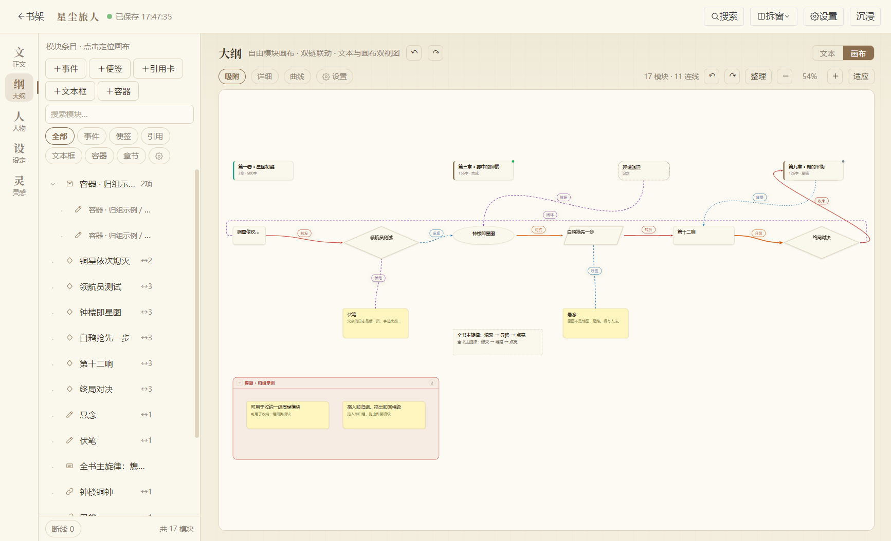
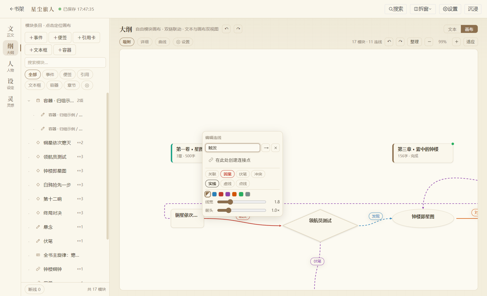
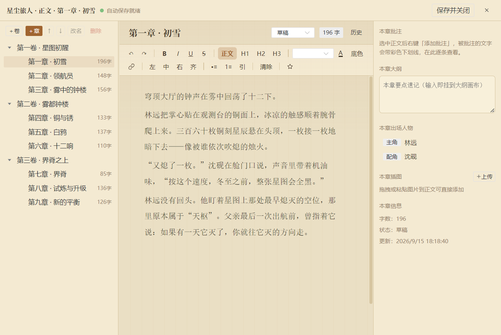

# 小说工坊 Novel Studio · 开发流程与工程规范

> 本文档定义本项目的**工程准则与交付规范**，涵盖架构约束、版本纪律、五步开发法、测试验收、多端同步与打包发布；**本文档是现行工程规则的唯一权威来源**。
>
> - 功能演进与版本历史见 [CHANGELOG.md](../CHANGELOG.md)；产品功能全览见 [产品介绍.md](项目展示文档/产品介绍.md)；桌面使用说明见 [使用手册.md](使用手册.md)。
> - 所有自动测试、手动验收与发版前功能验证统一遵循 **§5.1 的 dev 实例规则**；文末 **§10 历史定向验证记录**仅作追溯参考，不作为现行执行指令。

### 隐现（幻流）与 DSH 插件同步规则

- 桌面版幻流界面（代码代号 `latent` / `dsh`）的美术调整、交互优化及共用功能改动，须在**同一次任务**内同步至同级仓库 `dsh-novel-studio`（插件前端源码位于 `app/src/`，宿主皮肤层位于 `app/plugin/dsh/`；本仓库的 `dist-plugin/` 为独立插件构建目标）。
- 合并时按功能逐处同步，保留插件端的宿主主题令牌、DSH 助手、浏览器下载及插件存储适配；桌面端专属 IPC、跨窗口实体锁及其他历史皮肤代码则按各自运行环境独立维护。同步前请先核对两个工作区的未提交改动。
- 同步完成后在 `dsh-novel-studio` 仓库执行 `npm run build:app`，刷新插件实际加载的 `assets/app/` 产物。验证直接沿用桌面版已有的测试验收结果，无需针对同步另跑插件端测试或宿主验收；桌面端继续严格执行 §5.1 规则，交付说明中记录同步范围、插件构建结果及所沿用的桌面验收结论即可。

---

## 一、项目概览（当前工程快照）

| 项 | 内容 |
|---|---|
| 项目位置 | `F:\deepseek workplace\novel-studio` |
| 代码仓库 | <https://github.com/linque0/novel>（`main` 为稳定集成与发布分支；大改动走主题分支） |
| 核心技术栈 | Electron 33 + Vue 3 + Pinia + Naive UI + TipTap + Dexie / IndexedDB + ECharts + Three.js / WebGL |
| 代码与验证规模 | `src/` 共 **358** 个源码文件（含 **171** 个 `.vue` 组件）、**112** 套 `*-verify.mjs` 验收脚本、**133** 次提交 |
| 当前版本 | **以 `package.json` 的 `version` 字段为唯一权威来源**（当前快照 `1.2.6`）；演进详情见 [CHANGELOG.md](../CHANGELOG.md) |
| 交付形态 | `electron-builder` 打包 NSIS 安装包与免安装目录（Windows x64），随 GitHub Releases 分发 |

> 上述文件与脚本计数为当前仓库快照值，随日常重构会动态变化，可通过以下命令实时复核：
>
> ```powershell
> (Get-ChildItem src -Recurse -Include *.js,*.vue).Count       # src 源码文件数
> (Get-ChildItem src -Recurse -Include *.vue).Count            # Vue 组件数
> (Get-ChildItem tools\* -Filter *-verify.mjs).Count           # 验收脚本数
> node -p "require('./package.json').version"                  # 权威版本号
> ```

**核心高频文件（改动最频繁、回归风险最集中）**：

| 文件 | 行数 | 核心职责 |
|---|---|---|
| `src/components/skins/latent/outline/OutlineCanvas.vue` | 2712 | 幻流版大纲自由画布（模块、语义连线、连接点、容器与浮层） |
| `src/components/OutlineCanvas.vue` | 2596 | 原版 / 基础大纲自由画布实现 |
| `src/stores/work.js` | 1778 | 作品全部实体的状态管理与持久化调度（章节 / 大纲 / 人物 / 设定 / 灵感） |
| `src/components/MubuView.vue` / `skins/latent/lore/MubuView.vue` | 1073 / 1067 | 设定与文本大纲无限嵌套幕布编辑器 |
| `src/components/CharacterGraph.vue` | 649 | 人物关系图谱与拖线交互 |
| `src/components/outline/canvas-model.js` | 570 | 画布纯函数几何与路由库（尺寸计算、端口锚点、Hanan A* 绕障、双画布共享） |
| `src/services/doublelinks.js` | 422 | `[[关系链接]]` 解析、双向索引与跳转定位 |

---

## 二、架构分层与设计原则

```text
electron/                  主进程：窗口生命周期、app:// 静态协议、文件对话框、
                           导入导出 IPC、多窗口面板管理与实体锁仲裁（panels.js / panel-locks.cjs）、
                           应用内 SHA-512 更新（updates.cjs）
packages/novel-core/       作品核心存储与跨宿主复用领域逻辑底座
plugin/dsh/                DSH 插件宿主适配层
src/
  db/                      Dexie 表结构定义与迁移（database.js）+ Repository 隔离层（repo.js）
  services/                自动保存、导入解析、导出（TXT/MD/OOXML .docx/ZIP）、
                           WebGL 幻流着色器（latent/flow-shaders.js）、双链与写作分析计算
  stores/                  Pinia 状态层：shelf（书架）/ work（作品）/ ui（界面偏好）
  components/              基础组件与 skins/latent/ 幻流统一界面（书架 / 正文 / 大纲 / 设定 / 人物 / 灵感 / 分析 / 设置）
    outline/               画布纯逻辑底座（canvas-model.js）
  styles/                  界面样式与幻流视觉令牌（tokens / fusion / panel-material）
  assets/                  随包本地 OFL 字体（woff2 子集化）与静态资源
tools/                     单元测试与 CDP 端到端验收脚本
build/                     应用图标与 NSIS 自定义更新脚本（installer-update.nsh）
docs/                      使用手册（软件内置同源）、产品介绍与展示素材、开发流程、历史验收存档
```

两条核心架构原则贯穿整个工程：

1. **存储引擎与领域逻辑隔离**：所有数据库读写统一收敛至 `src/db/repo.js` 及 `packages/novel-core/`，视图与 Store 不直接操作 Dexie 底层细节，为后续向 SQLite 单文件底座或插件宿主切换保留单一替换边界。
2. **画布数学与界面渲染解耦**：`canvas-model.js` 保持不依赖 DOM 的纯函数设计（端口锚点计算、全局绕障路由、层级布局），既服务于大纲画布与关系图组件，也可由 Node 直接运行逻辑回归与模糊测试，从而以极低成本锁死几何类回归。

---

## 三、版本、分支与提交纪律

### 3.1 版本号语义与唯一来源

**`package.json` 的 `version` 字段是全仓版本号的唯一权威来源**，其他文件不再各自维护独立版本号：

- `README.md` / `README.en.md` 不在正文写死静态版本号，统一通过 GitHub Release 动态徽章与 `package.json` 对齐；
- `CHANGELOG.md` 按时间倒序保留各版本历史记录，已发布版本段原则上不回改；
- `package-lock.json` 根字段的 `version` 随 `npm install` 与 `package.json` 同步对齐，发布前须确认一致。

版本号仅在**准备正式发布时**更新（如 `1.2.6`），**日常开发提交不强制递增版本号**；一个功能完整闭环或一组相关修复构成一次发布粒度，版本号只进不退。

### 3.2 分支与工作区保护策略

| 分支类型 | 职责与操作约束 |
|---|---|
| `main` | 稳定集成与可随时发布分支；正式发版在此打 Tag |
| 主题分支（`feature/*`、`refactor/*`、`chore/*` 等） | 跨模块功能开发、界面重构与仓内清理的独立开发分支，验证通过后合回 `main` |

- 小范围局部修复可直接合入或提交至 `main`；跨多模块重构或大型特性开发**必须**走主题分支，防止 `main` 长期处于不可打包状态。
- 涉及删文件、调整依赖或改动构建配置的清理类操作，须先记录完整 `git status` 作为现场保护，并在独立分支或隔离 worktree 执行，严禁与业务功能改动混在同一批次提交。
- 构建与临时验证产物不入库（`.gitignore` 已忽略 `dist/`、`dist-plugin/`、`release2/`、`tools/_*.png`、`tools/_*.json` 等）。

### 3.3 提交信息规范

采用 Conventional Commits 风格（类型前缀 + 可选作用域）：

```text
<type>(<scope>): <简明扼要的中文或英文描述>

示例：
feat(snippets): 灵感收敛为单一拼板并支持卡片尺寸与配色调节
fix(outline): 整理布局不再位移已固定的画布模块
chore(release): 版本号定为 1.2.6 —— 灵感拼板重做与人物角色预设精简
```

| `type` | 适用场景 |
|---|---|
| `feat` | 新增用户可见功能或核心能力 |
| `fix` | 缺陷修复与回归治理 |
| `refactor` | 保持外显行为不变的代码结构重构 |
| `chore` | 依赖管理、构建打包配置、版本定号、杂项清理 |
| `docs` | 仅涉及文档、说明与展示材料的修改 |
| `test` | 仅增改自动化测试或验收脚本 |

- 普通开发提交**无需**在标题添加 `vX.Y.Z:` 前缀，仅发布定版提交使用 `chore(release): 版本号定为 X.Y.Z`。
- 提交正文简述「改动原因与方案要点」，涉及自动化验收时附上脚本名与通过项数。

### 3.4 正式发布策略

发布时于 `main` 分支创建对应版本的 Git Tag（如 `v1.2.6`），并在 `CHANGELOG.md` 顶部追加该版本记录（包含日期、一句定性总结、关键修复与算法要点，以及「### 交付」产物规格、冒烟结果与 GitHub Release 链接）。

---

## 四、标准开发五步法



*大纲自由画布集中了节点摆位、四类语义连线、端口锁定与 Hanan A* 自动绕障等核心几何耦合逻辑，任何改动均须同步回归。*

### 第 1 步 · 定位根因

动手前先查阅 `CHANGELOG.md` 中相关模块历史与本文 **§7 缺陷经验库**，并坚持两条定位铁律：

1. **样式疑难先查历史 CSS**：画布与排版异常的头号诱因常为退役或跨模块遗留 CSS 覆盖了 SVG / 内联表现属性，修改前务必全仓检索相关选择器优先级。
2. **同一问题二次反馈即重查机制**：若同一缺陷在修复后再次复现，说明上次改动未触及根因；应立刻停止经验猜测，转而在可复现环境下用计算样式对比或像素采样进行硬核自证。

### 第 2 步 · 收敛修复

- 源码编辑一律使用文件编辑工具写入，禁止通过终端 `cmd` 重定向修改代码（不仅易被提交钩子拦截，且 Windows `cmd` 易造成中文路径与编码损坏）。
- 尽量将修改半径收敛在最小范围；涉及「原版画布 / 幻流画布」或「桌面端 / DSH 插件」共享能力时，**两侧代码须在同一次任务内同步对齐**。

### 第 3 步 · 分层验证

- **纯逻辑模块**（如 `canvas-model.js`、导入导出、纯算法单元）：直接运行 Node 单元测试脚本，无需启动桌面进程。
- **界面与跨进程交互**：连接已运行的 `dev` 实例执行对应功能的 **CDP 端到端脚本**并执行 `npm run build` 检查。
- **回归粒度**：日常迭代跑「受影响功能的专项验证 + 生产构建通过」即可；四套核心全量回归（`canvas-model` / `chargraph` / `olcanvas` / `relfollow`）留待大版本合并、里程碑打包、底层共享层改动或明确要求时统一执行，兼顾验证信心与迭代节奏。



*以 `v1.0.18`「编辑浮层避线弹出」为例：`edgepanel-avoid-verify.mjs` 直接计算浮层与连线路径最小边距，断言边距大于零且完整落于画布可视区内。*

### 第 4 步 · 规范提交

日常提交严禁顺带修改 `package.json` 版本号；按 **§3.3** 撰写清晰提交信息。

### 第 5 步 · 推送与交付构建

```bash
git add <files>
git commit -m "<type>(<scope>): <描述>"
git push
npm run dist            # vite build + electron-builder --win → release2/
```

发布前的功能验收统一在 `dev` 环境完成；`npm run dist` 产出后仅按 **§6.2** 对安装包及清单做静态核对。

---

## 五、质量保障与验证体系

### 5.1 运行时验收铁律

**所有涉及应用运行时的自动测试、手动验收与发版前功能检查，一律复用当前 `npm run dev` 启动的 `--profile=dev` 实例：**

- 开发调试端口固定为 `http://127.0.0.1:5173`，Electron 远程调试端口为 `9222`；脚本连接前须确认页面目标源自 `5173` 与 `dev` 数据目录。
- **只复用 dev 库中已登记的验证书与已有设置**：验收脚本不得擅自新建临时 profile、新测试数据库、未登记验证书、夹具记录或向工作区写入临时截图/日志/导出转储；允许对既有验证书做可还原的交互测试，并在测试末尾清理恢复，严禁破坏或清空整库。
- **严禁启动正式版（`npm start`）、安装程序或打包产物做功能验收**，以防污染作者真实作品数据；若早期历史脚本违背本规则（如自建 profile 或重置验证书），运行前须先将其改造适配或明确标注该部分跳过未测。
- 清理任何历史测试数据时，应先核对其中关联作品，确认所需内容已妥善并入 `dev` 库后再清理残留。

#### 5.1.1 验证书注册表规范（`tools/verify-seeds.mjs`）

「验证书」专指供验收脚本使用的测试作品，**仅允许存在于开发调试库（`--profile=dev`）中**；正式打包版（`DEV === false`）下注册表代码绝不执行，确保零测试数据污染。

| 场景 | 规范要求 |
|---|---|
| 日常自动化验收 | 仅查找并使用 `dev` 库中已就绪的注册验证书；若缺少目标验证书则报告阻塞，不擅自触发重置或补种 |
| 维护开发测试数据 | 仅在用户明确要求时更新验证书；新增验证书须统一登记于 `VERIFY_BOOKS`（包含 `title / owner / create`），`create` 函数保持自包含 |
| 注册表完整性自检 | 运行 `node tools/shelf-verify.mjs`，依据 `VERIFY_BOOKS.length` 动态断言全部验证书均已在架且无未注册残留 |
| 严禁行为 | 禁止在各验收脚本内部私自调用 `db.works.add` 硬插测试书目 |

当前 `VERIFY_BOOKS` 注册验证书涵盖：天穹钟摆（关系星系设计稿 1:1 复刻验证书，`prototypes/lore-galaxy-designs/index.html`）、书内知识验证书（`project-verify`）、双链验证书（`dl-verify`）、批注验证书（`annotation-verify`）、关系图验证书（`chargraph-verify`）、画布验证书 A/B（`olcanvas-verify`）、关系跟随验证书（`relfollow-verify`）、AI 验证书（`agent-task-verify`）、多窗口验证书（`multiwindow-verify`）、画布右键验证书（`canvasctx-verify`）、连接点修复验证书（`junction-fix / freeze-repro / visual-fix` 共用）、线连到线验证书（`line2line-verify`）、塑形验证书（`shape-verify`）、浮层避线验证书（`edgepanel-avoid-verify`）、右键浮层验证书（`edgeedit-ctx-verify`）、侧栏验证书（`sidebar-verify`）及端到端综合测试作品（`cdp-test`）。

#### 5.1.2 AI 能力与真实模型验证准则

- 当任务涉及验证 AI 实际文本生成、大纲续写、知识检索回答、语义审校或创作质量时，**必须调用软件设置中当前配置的 DeepSeek 模型**（当前约定：`deepseek/deepseek-v4.1-flash`），从应用安全存储动态读取端点、模型与凭据——**严禁用本地 Mock 输出代替真实模型能力判定通过**。
- 验证报告须明确记录服务商、模型名称、所用测试样书、验证任务范围及实际结果；若请求未实际发往真实服务端、模型不匹配或发生调用失败，则该项记为「未完成」并说明阻塞原因。
- API Key 与凭据仅驻留于应用安全存储，严禁在验证代码、终端日志、交付报告或对话中打印或硬编码 `baseURL` 与真实密钥。
- 数据库迁移、来源哈希计算、历史切片、Token 预算裁剪与回滚机制等**确定性纯逻辑**允许使用固定样本验证，但其结果仅证明程序逻辑正确，不可充当 AI 语义质量的验收依据。
- `agent-task-verify.mjs`（非 `--real` 分支）、`knowledge-verify.mjs`、`preset-verify.mjs`、`preset-experience-verify.mjs` 等脚本仅作为机制层确定性回归；由于原自动拉起脚本已退役，需要运行 Mock 回归时须另开终端手动启动 Mock 服务：

```bash
node tools/mock-ai.mjs --port 18700
```

#### 5.1.3 核心验收脚本速查

> 下表列出仓库 `tools/` 中核心逻辑自测与专项验收脚本（完整清单随版本演进见 `tools/` 目录；部分早期多皮肤/隔离端历史脚本执行前须按 §5.1 核对路径约束）。

| 脚本 | 检查项 | 覆盖范围与重点 |
|---|---|---|
| `canvas-model-test.mjs` | 48 | 画布纯逻辑与几何算法（Node 直测，含端口锁定、Hanan A* 绕障与 200 组随机布局模糊测试） |
| `latent-integration-verify.mjs` | 综合 | 幻流界面整合、主题流场交互与写作分析回归 |
| `olcanvas-verify.mjs` | 29 | 大纲分层自由画布全链路 |
| `cdp-test.mjs` | 29 | 端到端基础功能综合验收 |
| `annotation-verify.mjs` | 28 | 正文批注添加、用途着色、右侧栏联动及与关系链接共存 |
| `dl-verify.mjs` / `dlpop-verify.mjs` | 20 / 19 | `[[关系链接]]` 全链路及悬浮预览窗动画、拖动钉住与停靠记忆 |
| `lorelink-verify.mjs` | 19 | 设定条目关联、行尾卡片、双向展示与详情关系图谱拖动 |
| `relfollow-verify.mjs` | 15 | 人物关系图拖线建改关系、严格 ±1px 端口锁定与 80 点路径避障采样 |
| `bugfix-verify.mjs` | 14 | 时序恢复、幕布合并及拆窗写回门禁专项回归 |
| `chargraph-verify.mjs` | 12 | 人物关系图谱建边、布局排布与双向同步 |
| `multiwindow-verify.mjs` | 11 | 独立面板拆窗、主进程实体锁占有/只读占位、跨窗切换与关窗释放 |
| `junction-fix-verify.mjs` / `line2line-verify.mjs` | 10 / 4 | 连接点建点、多分支引出、级联删除与线连到线交互 |
| `canvasctx-verify.mjs` / `sidebar-verify.mjs` | 6 / 5 | 画布右键新建与删除、侧栏调宽记忆与文本视图切换 |
| `shape-verify.mjs` / `edgepanel-avoid-verify.mjs` / `edgeedit-ctx-verify.mjs` | 5 / 4 / 3 | 连线手动塑形拉直、右键编辑浮层避线弹出与原地编辑 |
| `freeze-repro-verify.mjs` / `visual-fix-verify.mjs` | 4 / 3 | computed 自引用卡死复现定位与视觉回归专项 |
| `shelf-verify.mjs` | 动态 | 核对 `VERIFY_BOOKS` 全量在架与零未注册残留 |
| `pack-smoke.mjs` | 3 | 界面渲染、Mammoth `.docx` 解析及 Dexie 库打开冒烟 |

---

### 5.2 三条硬件级验证方法论

1. **DOM 属性不等于真实视觉渲染**：CSS 层叠规则随时可能覆盖 SVG `stroke` / `fill` 等表现属性（见 §7 遗留 CSS 覆盖事故）。排查「颜色、粗细或显隐不生效」时，**必须通过 `getComputedStyle` 或画面像素采样查验**，切忌仅凭 DOM 属性下结论。
2. **像素采样与路径几何硬断言**：借助 CDP `Page.captureScreenshot` 结合 Canvas `getImageData` 比对目标坐标真实色差（推荐容差阈值约 `60`）；涉及绕障问题时沿连线多点采样，硬断言路径线段绝不侵入模块边界矩形。
3. **优先采用真实命中测试派发交互**：优先通过 CDP `Input.dispatchMouseEvent` 走浏览器命中测试，而非脱离碰撞检测的合成事件；针对 Chromium 对 SVG `pointer-events: stroke` 右键命中的细微偏差，必要时先调用 `elementFromPoint` 反查坐标真实落点。

### 5.3 调试与运行纪律

- **收尾必退**：每次调试或自动化验收结束后务必执行 `npm run stop` 清理开发进程并确保数据完整落盘（注意**绝不擅自杀停用户本人正开启的运行实例**）。
- **单轮确定性验证**：自动化脚本严格按「跑一轮、遇错即停、修因后再验一轮」执行，禁止靠盲目重试掩盖偶现竞态。
- **警惕最小化与锁屏冻结帧率**：应用处于锁屏（`LockApp`）状态会暂停 `requestAnimationFrame` 并冻结 Vue 过渡动画；窗口最小化时 Chromium 停止产帧导致截图长期挂起——遇到动画超时或截图卡住时先核查窗口可见状态。
- **造数走真实 UI / Store 动作路径**：禁止绕过组件直写数据库篡改测试状态，避免与编辑器的防抖自动保存定时器相互覆盖。

---

## 六、打包与 GitHub 发布流程

### 6.1 构建产物与目录配置

```bash
npm run dist
# 等价于：vite build（编译渲染层到 dist/）+ electron-builder --win --publish never（产出至 release2/）
```

| 交付产物 | 说明 |
|---|---|
| `release2/novel-studio-setup-<版本>.exe` | Windows x64 NSIS 向导式安装程序（含快捷方式、路径选择与增量更新宏） |
| `release2/latest.yml` | 自动更新元数据清单（记录版本号、包名及 SHA-512 校验摘要） |
| `release2/win-unpacked/小说工坊.exe` | 免安装解压运行目录与主程序 |

打包优化要点（见 `package.json` 的 `build` 配置与 `build/installer-update.nsh`）：

- 开启 `compression: maximum` 与 `electronLanguages: ["zh-CN", "en-US"]` 裁剪多余语言包；
- 通过 `files` 白名单精准打包运行时必需的 `node_modules` 依赖（`mammoth` / `jszip` / `electron-updater` 等），显著压减安装包体积；
- 利用 `afterPack: scripts/afterpack.js` 整理授权说明与打包收尾文件。

> **若旧输出目录 `release2/win-unpacked` 遭遇系统文件句柄锁定**：不必强行解锁目录，可临时通过 `-c.directories.output=release-<版本>` 指定新输出目录完成构建。

### 6.2 发版前静态核对

应用核心功能与导入导出链路先在既有 `dev` 环境完成验证；构建出安装包后，**仅针对产出文件执行静态核查**（安装包名称与版本号一致性、`latest.yml` SHA-512 匹配性、资源与白名单依赖完整性），并将核对结果输出到终端；**禁止启动打包产物做读写测试或生成临时数据**。

### 6.3 发布流程清单

```bash
# 1. 定版提交与打 Tag（同步 package-lock.json 并补充 CHANGELOG 顶部版本段落）
npm install
git commit -am "chore(release): 版本号定为 X.Y.Z"
git tag vX.Y.Z
git push origin main && git push origin vX.Y.Z

# 2. 创建 GitHub Release 并上传同批构建产物（novel-studio-setup-X.Y.Z.exe 与 latest.yml）
#    无 gh CLI 时可通过 Git Credential Manager 鉴权后调用 GitHub REST API 上传资产

# 3. 本地交付与记录回填
#    将安装包留档至本地交付目录，并在 CHANGELOG 对应版本补齐「### 交付」信息及 Release 链接
```



*拆窗能力牵涉主进程窗口调度、`panel:open` 实体锁仲裁及渲染层只读占位同步，发版前如有改动须通过 `multiwindow-verify.mjs` 完整回归。*

---

## 七、已修复关键缺陷与工程教训库

下表沉淀了迭代过程中验证定位的典型深水区缺陷，作为后续排查的优先核对清单：

| 缺陷现象 | 根本原因与工程教训 |
|---|---|
| 退役样式 `.om-edges path` 覆盖画布连线 | 旧组件残存 CSS 可长久影响同名选择器并压过 SVG 内联属性；改样式前必先全仓检索全局选择器。 |
| 节点挪位后历史连线接口发生漂移 | 拓扑端口须在**建线时落库锁定**，禁止仅靠渲染期重算；存量旧数据迁移时配合 `Set` 防重入一次性补全。 |
| 局部贪心绕障生成迂回折线与回环 | 避障场景下**局部贪心不等于全局最优**；统一采用 Hanan 稀疏网格 A* 寻路 + 转向惩罚并后置共线拉直。 |
| 打开大纲画布即卡死（`edges` 死循环） | Vue `computed` 内部严禁回读自身派生结果触发自引用重算；连接点几何改从宿主路径直接解析。 |
| 便签节点在重进后被迁移逻辑覆盖为事件 | 数据迁移脚本必须具备不可逆终态标记（如 `olnodes-mig2:`），并严格限定迁移分支的作用域。 |
| 独立面板窗口将自己所持条目误判为他窗锁定 | 主进程与渲染器仲裁锁须携带发送端自身窗口标识（`ownKey`），避免自锁进入只读态。 |
| 字段输入框 `NInput` 变更事件静默丢数 | 第三方 UI 组件 `onUpdate` / `change` 签名须以实测为准；防静默失效须配合「写后回读持久化」断言。 |
| `height: 'auto'` 非容器卡几何错位 | 参与连线与拖拽计算的节点必须拥有明确且一致的渲染/落库尺寸口径，不得在引擎与视图间失配。 |
| 缩放调整尺寸时连带锁死未拖动的轴 | `resize` 落盘时仅更新用户实际拖拽变更的维度，未操作轴维持弹性自适应。 |
| Windows `cmd` 传导中文路径产生乱码 | 凡含中文路径或特殊字符的子进程调起，一律使用参数数组形式调用 `spawn`，规避 shell 二次转义。 |
| 批注高亮标记刷新后凭空消失（`v1.0.19`） | `TextStyle` 默认匹配「任意带 `style` 属性的 `<span>`」，ProseMirror 解析时命中首个规则从而吞掉自定义批注标记。对照「getHTML / store / DB / 重载后 getHTML」四点即可定位；解法为自定义 Mark 设置更高 `priority: 1000`。 |
| 浮窗进入动画在隐藏窗口下永不结束（`v1.0.21`） | Vue `<Transition>` 依赖 `requestAnimationFrame`，后台或最小化时 rAF 挂起导致过渡滞留在初始透明度 `0`。对关键浮层或验收窗口应确保可见，或采用可控定时钩子避免死等。 |
| 隐藏窗口下 CDP 左键按压点击事件丢失（`v1.0.21`） | 隐藏态时 `Input.dispatchMouseEvent` 的 `mousePressed`/`mouseReleased` 不触发实际点击回调（`mouseMoved` 与右键例外）；须先确保调试窗口处于可见激活状态。 |
| `relfollow` 脚本断言旧交互静默报错（`v1.0.22`） | 交互方式调整（如左键改塑形、右键改打开浮层）时，须在同批任务内全局检索并同步更新对应验收脚本的事件期望。 |
| `v-for` 内字符串 `ref` 被收集为数组导致 `.focus()` 报错 | 循环内的模板 `ref` 在 Vue 中解析为数组；使用函数式 `ref` 或先做数组/方法类型校验再调用聚焦。 |

---

## 八、现状与演进路线

| 事项 | 状态 | 说明 |
|---|---|---|
| 应用内自动更新与单皮肤收敛 | ✅ 已落地 | v1.2.4 起已收敛至统一「幻流」工作台并接入 GitHub Releases SHA-512 自动更新链路 |
| 容器高度调整 DOM 消失存量问题 | ⏳ 待跟进 | 与 `.oc-node` 循环内 `inlineEl` 模板引用收集语义同源，待排期一并重构排查 |
| `cdp-test` 字体色/高亮命令余项 | ⏳ 待跟进 | 历史存量 2 项编辑器指令用例待对齐现行工具栏行为 |
| 多窗口其余增强体验 | ⏳ 规划中 | 如全局拆窗快捷键、书架侧活跃面板列表与更细粒度的跨窗即时广播 |
| 全仓深度安全审计 | ℹ️ 待安排 | 计划安排一次系统性安全审计；完成完整审计前不在对外物料中作绝对安全承诺 |
| 「恍然梦」创作协同 Agent | 🚧 持续开发中 | 长篇上下文协同稳定性与知识库链路尚在打磨，当前对外产品页仅作结尾预告 |
| SQLite 单文件底座迁移与 OCR / `.doc` | 📋 长期规划 | 基于已隔离的 `repo.js` / `novel-core` 评估单文件存储切换，并补全扩展导入格式 |

---

## 九、协作纪律十六条速查

1. **平时提交不改版本号**：版本号仅于发版时变更，以 `package.json` 为唯一来源。
2. **提交前缀统一规范**：使用 `feat / fix / refactor / chore / docs / test`；发版统一 `chore(release): 版本号定为 X.Y.Z`。
3. **主干稳健发布，大改走主题分支**：跨越模块的重构与清理在主题分支完成验收后再合入 `main`。
4. **验证粒度按需分层**：日常局部改动跑专项验证 + `npm run build`；大版本或改底层时执行四套核心全量回归。
5. **收尾必清开发进程**：调试或验收结束及时执行 `npm run stop`，绝不干扰用户正在使用的实例。
6. **发布前验证走 dev，打包后只做静态核对**：严禁启动安装包或运行期向正式库写测试数据。
7. **文件锁不硬解**：构建遇到目录句柄占用时切换输出目录，事后还原配置。
8. **双画布 / 双端协同变更必同步**：共享几何或幻流 UI 改动同步覆盖 `dsh-novel-studio` 与两侧画布。
9. **同一问题出现二次返工立即停止猜测**：转向可复现环境自证或向用户索取完整上下文。
10. **严谨对外表述**：未完成系统安全审计前不作「绝对安全」类夸大宣传；未定型的「恍然梦」Agent 不作为成熟特性对外宣讲。
11. **严守 dev 既有环境**：自动与手动验收仅复用 `dev` 已登记验证书，禁止私建临时 profile 或重写整库。
12. **CDP 测试先验窗口可见性**：注意 `_cdp-lib.mjs` 隐藏态告警，必要时先激活窗口恢复渲染帧率。
13. **精准运行当前需求测试**：逐功能迭代只执行直接相关脚本，避免全仓测试拖垮验证效率。
14. **测试不落多余垃圾文件**：验证结果直出终端与汇报，严禁在源码仓留存临时截图、快照或调试脚本。
15. **清理现场先做保护**：删文件或改依赖前先留存完整 `git status`，禁止粗暴 `stash` / `reset` 覆盖他人或并发改动。
16. **以当前真实代码为准**：凡文档描述涉及文件、按键、版本号与交互规则时，必须与仓库实态核对一致。

---

## 十、历史定向验证追溯档案（2026-10 专题归档）

> 以下条目记录 `2026-10` 皮肤重构与纸面装帧迭代期的专项回归参数与目录存档位置，**仅供历史回溯与路径核对**；当前任何新增回归与验证须统一遵循 **§5.1 现行 dev 规则**。

- **正文方向工作流验证（2026-10-24）**：曾使用隔离 `--profile=booksource-verify`（CDP `9333`）与《AI 验证书》，配合本地 SSE 服务运行 `writing-workflow-unit-verify.mjs`、`writing-application-race-verify.mjs`、`writing-workflow-verify.mjs`（含 `--restart-check`）及四皮肤截图脚本 `writing-workflow-visual-verify.mjs`（`9229`）；交付存档位于 `docs/writing-workflow-20261024/`。
- **助手对话界面验证（2026-10-25）**：沿用独立验证环境运行 `agent-chat-ui-unit-verify.mjs`、`agent-chat-ui-verify.mjs`、`agent-chat-ui-window-verify.mjs` 与 `agent-chat-ui-visual-verify.mjs`（`300/400/640px` 视口原生合成截图），截图与入口映射存档位于 `docs/agent-chat-ui-20261024/`。
- **赤月戏正文目录入口（2026-10-25）**：通过 `crimson-writing-rail-verify.mjs` 核验三卷九章拓展下的工具条布局与 `1280×720` / `1440×900` / `1920×1080` 多视口无横溢表现（局部布局迁移，未改动存储规则）。
- **正文纸面装帧与长标题验证（2026-10-25）**：通过 `writing-paper-unit-verify.mjs`、`writing-paper-verify.mjs`、`writing-paper-window-verify.mjs`（含 `--restart-check`）与 `writing-paper-visual-verify.mjs` 完成材质、排版与配置持久化回归（记录在 `docs/writing-paper-20261025/` 与 `docs/writing-paper-fine-20261025/`）；同日通过 `chapter-title-wrap-verify.mjs` 完成 20 项长标题换行与 IME 输入验证（记录位于 `docs/chapter-title-wrap-20261025/`）。
- **引力与琉光正文场景验证（2026-10-26）**：通过 `studio-writing-skins-verify.mjs`（22 项真实交互检查）与 `studio-writing-skins-layout.mjs`（两皮肤 × 三侧栏 × 三纸面 × 三视口共 54 组布局及 200% 缩放检查），独立复核报告与入口映射归档于 `docs/studio-writing-skins-20261026/`。
