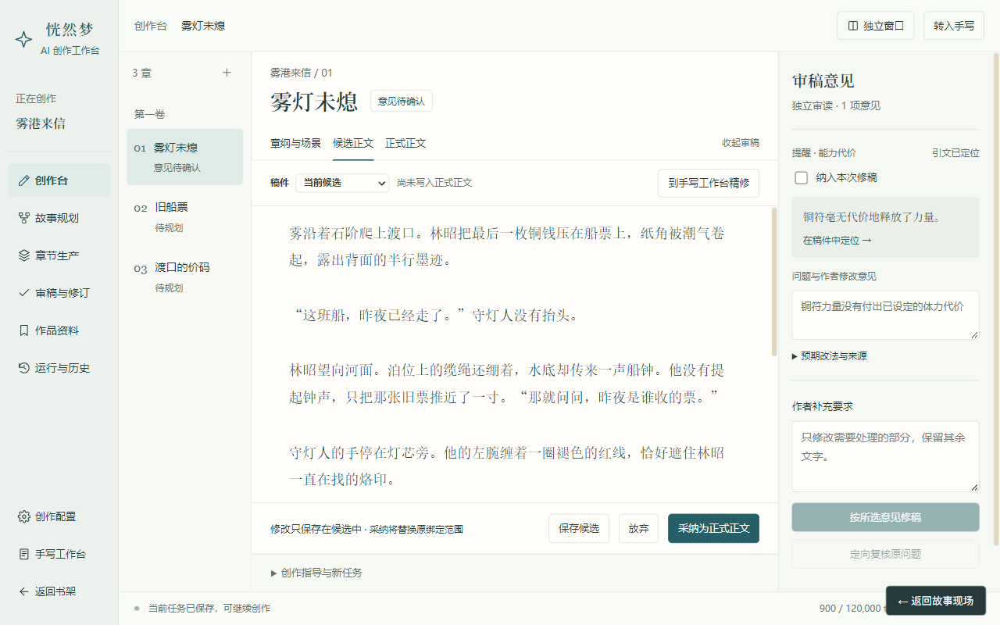

# 恍然梦独立 AI 工作台实施验收

实施完成日期：2026-10-28；目录沿用 10-27 启动方案的命名。本页是第一里程碑的实际证据，非后续所有产品能力的完成声明。

## 使用入口

书架作品菜单「用恍然梦 AI 创作台打开」，或手写顶栏「AI 创作台」。创作台顶栏「独立窗口」可打开完整桌面窗口。两种视图共用正式正文，候选经作者采纳才写入；候选可转入手写精修。

## 实际画面

- [候选稿 · 1440×900](candidate-1440.png)
- [独立审稿 · 1440×900](review-1440.png)
- [独立审稿 · 1280×800](review-1280.png)
- [作者采纳后 · 1440×900](adopted-1440.png)



## 验证记录

[verification.json](verification.json) 为最新 15 项真实 Vue/Pinia/Dexie/Electron 界面与事务机制记录。固定 SSE 服务只提供输入，脚本通过实际组件派发、编辑、审修和采纳，不评价模型质量。在冷启动的隔离环境中，最终脚本连续 3 次 15/15。

```powershell
# 使用已有开发服务和隔离 Electron，勿运行于正式数据目录
$env:NOVEL_STUDIO_DEV='1'
# 终端分别启动 Vite 5173 与 electron . --profile=booksource-verify --remote-debugging-port=9333
node tools/agent-workbench-verify.mjs
node tools/creative-workflow-verify.mjs
$env:CDP_PORT='9333'
$env:AI_TEST_PROFILE='booksource-verify'
node tools/writing-workflow-verify.mjs
```

创作工作流 10/10，旧方向/位置续写 28/28，14 组定向 Node 检查与正式构建通过。主测试目录仍输出 `tools/_creative-workflow-results.json` 与 `docs/writing-workflow-20261024/integration-results.json`；本次摘要一并保存于 [acceptance.json](acceptance.json)。

旧续写回归在开发服务热更新后出现自动保存钩子未进入同一模块实例的失败；冷启动服务与应用后原断言 28/28。后续跨模块自动化验收应冷启动或确保模块实例一致。创作回归中“删除记录不能复活”用例结束后，清理它故意遗留的不可保存内存任务，再验证独立窗口同步，未放宽旧记录保护。

## 审查及处理

| 复核问题 | 处理与证据 |
| --- | --- |
| 主窗口旧 TipTap 在归还编辑权后可能覆盖新稿 | DB 重读、重建 Editor、清除旧撤销；检查真实编辑器并继续输入后核对数据库 |
| 候选转手写时模块/章节不匹配 | 显式绑定章节和正文模块；切章退出旧候选 |
| 章纲输入被切章覆盖 | 持久化局部草稿，重开恢复，创建任务前先保存当前章纲 |
| 保存失败后定时 load 丢输入 | 独立 dirty 状态阻止刷新；实际 DB 故障注入后调用 load 验证 |
| await 保存后读到另一个选中候选 | 点击时捕获运行/章节/候选，延迟保存并切换版本验证 |
| 专用窗口手写书架动作留空页/锁 | 该入口关闭专用窗口；主作品保留、锁归还 |
| 移交编辑权保存失败后可能重载旧正文 | 区分临时冻结与实际远端锁；故障注入检查同一编辑器、输入与撤销保留 |
| 关窗保存期间新增候选输入 | 关闭时冻结输入；实际 store 动作夹具验证保存期间新增修改也被落盘 |
| 关窗保存失败仍关闭 | 失败时保留窗口/输入/锁，实际拒绝保存后重试退出 |
| 1280 正文首屏偏短，采纳后文案冲突 | 合并版本栏、收紧标题、采纳后展示已保存与查看正式正文；突出采纳按钮 |

针对最后两项故障的独立源码/内存复核确认已修复，限定范围无剩余 P1/P2。

独立静态视觉审查 8/10：正文为最大连续画布，引用和意见关系清晰；主按钮已按建议强化。未用静态画面评分动效。

## 真实模型与实现边界

已实际启动指定模型验证检查，但该隔离 profile 当前不满足远程 DeepSeek 模型配置，报告 incomplete，未发送真实模型请求。详见 [real-model-check.json](real-model-check.json)。没有生成质量、冲突率或 Token 节省的完成结论。

首版完整 AI 窗口锁定整部作品正文；两种工作台共享同一作品库。故事种子建全书、富文本块级合并、退出应用后的后台执行仍未实现。不提交 Git，不升级版本，不改正式 profile 数据；验收启动的进程在交付前关闭。
