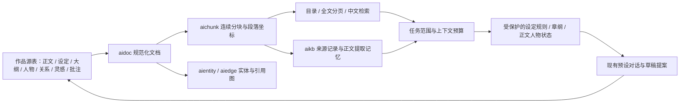

# 恍然梦书库读模型实施说明

日期：2026-10-13；代码版本：1.0.24；数据库版本：Dexie v11。

本次按《恍然梦数据架构方案-书库读模型》落实全书读取、来源索引、作品记忆和创作上下文基础。现有预设对话、正文草稿与提案应用流程接入该基础。完整的分场景整章生成、正文反推纲、自动人物捕捉与联合建卡、生成后语义一致性审核仍需后续实现，不能把数据索引完成视为这些产品流程全部完成。

## 1. 数据组织



作品源表继续作为权威数据；投影和知识记录带来源版本，可从源数据重建。新表如下：

| 表 | 作用 | 关键身份 |
|---|---|---|
| `aidoc` | 规范化全文、目录路径、语义性质、来源与结构依赖 | `doc:<workId>:<sourceType>:<sourceId>` |
| `aichunk` | 全文连续核心区、重叠区、段落身份、原文坐标 | 文档 + 核心内容 + 段落身份 + 同文出现序号 |
| `aiindex` | 当前可用批次、来源清单、覆盖、问题和失效状态 | `workId` |
| `aikbblock` | 正文块的事实提取结果缓存 | 文档 + 块身份；另核验完整依赖缓存键 |
| `aientity` | 登记人物、别名、设定与势力分类索引 | 来源类型 + 源 ID |
| `aiedge` | 登记关系、正文提及、父子、纲文引用、双链、附件引用 | 两端 + 类型 + 来源 |

`aikbmeta` 增加文档索引；`aikbvec` 增加 `refType/refId`，旧 `cardId` 保留并补齐新字段。没有新增依赖包，也没有切换存储引擎。

## 2. 读取与事实边界

- 正文、人物字段与小传、登记关系、设定树、大纲树及文本框、旧大纲、灵感、批注均进入可读投影。HTML 转纯文本保留段落边界；显式纯文本中的尖括号不当 HTML。
- 分块的核心区连续覆盖全部规范化文本，重叠区另标坐标并计入预算。完整读取通过游标分页，不以标题命中或前后片段冒充全文。
- 附件投影元信息和已有 `transcript/extractedText`。没有转写的图片、PDF 等列为未解析；没有实现 OCR、PDF 自动解析或附件模型理解。
- 正文标记 `fact`；设定与人物档案标记 `setting`；大纲标记 `plan`；灵感标记 `inspiration`；批注标记 `comment`。登记资料的本地知识记录为 `authorRecord`，文档状态注明 `extracted:false`，不会伪装成模型提取的正文事实。
- 人物出场属于 `mention`，不自动升级为正式关系。重名、标题双链歧义、缺失引用、树循环与未解析附件可查看。

## 3. 变更、发布与恢复

`src/db/project-repo.js` 在只读事务内获得全源快照。全量重建先写新批次，再在事务内校验来源版本、作者裁决、恢复代数与作业租约，最后发布 `aiindex`；读取只使用该批次。

普通更新复用当前批次，比较规范化文档、块、实体、边，仅提交变化或删除的行。祖先改名、人物关系、章节卷序等参与依赖校验。当前实现仍会扫描并规范化全书计算差异；百万字与千章性能尚未专项测量。

源表事务提交后按作品聚合变更通知，覆盖自动保存、直接删除、导入及附件链接。主窗口负责防抖构建，租约防止多个窗口同时发布；后台异常记录索引状态。恢复备份期间暂停投影发布，以代数阻止旧任务迟到提交。

备份保留作品原始资料、知识、作者裁决和现有向量，剔除凭据与活跃租约。新投影及块提取缓存不导出，恢复后按需重建；附件额外元数据与已有转写随备份保存。清理知识不会删除作者裁决或源资料。

## 4. Agent 工具与上下文

新增工具已进入预设对话的工具注册与请求 schema。需在所选预设中开启函数调用；小模型预算不足时沿用现有工具降级机制。

| 工具 | 用途 |
|---|---|
| `get_book_coverage` | 可读目录、来源类型计数、未解析与问题清单 |
| `read_document` | 根据 `docId` 和 `cursor` 连续读取全文 |
| `search_book` | 正文、设定、大纲、人物、灵感与批注的中文关键词检索 |
| `get_related_entities` | 登记实体、提及与引用邻接，最多两跳 |
| `get_entity_state` | 回放任务截至位置的有证据人物状态 |

原章节检索与读取工具复用读门面。查询没有匹配证据时返回不足，不用任意最近材料填充为命中。来源标识包含文档、文本版本、块、段落及偏移；重复摘引必须提供正确位置，否则拒绝定位。

每轮任务冻结作品版本、章节范围和隐私设置。应用新提案时同时核验内存与数据库的全书来源版本，资料变化后须重新生成，即使目标正文没变也不能使用旧上下文。历史任务不能用工具参数扩展到未来章节；没有历史生效范围的当前人物小传、字段与关系不当作过去状态。人物状态只回放有效正文证据，空证据与伪造摘引不能标为有效，缺少记录明确提示不足。登记身份和设定也可能需要作者补充时间信息。

上下文先保留写作对象、设定规则候选、章纲及祖先计划、相关人物正文状态，再装配正文参照、知识卡、人物档案、设定、前情和跨资料检索。必要材料受预设预算保护；不足时明确停止。规则目前是从设定中的“禁止、不得、必须、代价”等表述识别出的候选，不是已完成语义验证的硬规则系统。

隐私模式的新读取工具只回传已有有效章节摘要和允许的结构信息，屏蔽资料全文。旧工具继续结构字段与去摘引策略；隐私模式不会自动生成摘要。必要规则原文被屏蔽时，界面说明无法保证完整约束。

## 5. 知识与摘要

更新知识首先在本地索引全源登记资料，再逐章对完整正文分块提取事件、人物状态、伏笔及实体候选，并生成全文摘要。长章中间部分参与提取与摘要；摘要按预算逐层归并，不再截取首尾。

提取缓存绑定块内容、提示词、版本、供应商、模型、前章来源、实体与设定、活跃伏笔和作者裁决。前章变化会使下游依赖失效，过期知识不进入任务事实。达到模型输出条数上限标为部分完成，不宣称事实完整。摘要提交时核验当前章版本，迟到旧摘要被拒绝。

这一层属于可追溯的外部记忆与检索，不会训练模型权重。缓存命中可不发请求；冷缓存的自动任务在请求前预留每日预算，超限停止。知识构建中的暂停、凭据、真实 API 调用仍沿现有机制。

## 6. 验证与使用

新增样书“书内知识验证书”已登记到 `tools/verify-seeds.mjs`。数据库、来源版本、历史范围、隐私过滤等确定性检查使用独立 `booksource-verify` profile。真实 AI 行为验证按[开发流程 §5.1.2](./开发流程.md)执行：在小说工坊设置选择并使用 `deepseek/deepseek-v4.1-flash`；不得以本地 Mock 替代模型请求。独立验证 profile 也必须通过应用设置配置所选模型。操作同一测试库的脚本必须串行运行。

```powershell
node tools/project-unit-verify.mjs
node tools/preset-unit-verify.mjs
$env:CDP_PORT='9235'
$env:AI_TEST_PROFILE='booksource-verify'
node tools/project-verify.mjs
node tools/knowledge-verify.mjs
node tools/preset-verify.mjs
npm run build
```

针对性结果：投影单测 13/13，数据库与读取 18/18，知识构建 19/19，预设对话 20/20，预设核心 16/16。上述历史回归结果中，预设对话与知识构建链路曾使用本地 Mock，验证了覆盖、证据、缓存、预算、隐私、范围与应用门禁。按照本次更新的验证规则，这些结果不算真实模型的 AI 行为验证；真实模型的情节质量与语义一致性仍需使用小说工坊设置中的 `deepseek/deepseek-v4.1-flash` 评测。共享模块回归与生产构建结果见本版 CHANGELOG。

日常使用：打开作品后自动建立可读索引；在恍然梦知识面板查看覆盖与未解析资料，执行“更新变更章节”建立正文记忆与全文摘要；选择支持工具调用的预设后，可要求检索某个人物、设定或灵感并阅读全文。源资料修改后索引与相关知识失效，下一次更新补齐。

## 7. 后续阶段

本次实现 P0 的主要读取基础、P1 的全源来源记忆与正文提取改造、P2 的基础状态和约束接入。尚未完成方案各阶段的全部退出条件。后续需落地：字段级带时间的实体知识、关系变化提取、纲文节拍映射、分场景生成作业、正文反推纲、捕捉与原创新人物的联合提案、生成后冲突检查、真实模型评测与大书性能测试。可选分块向量和磁盘镜像仍未实现。
