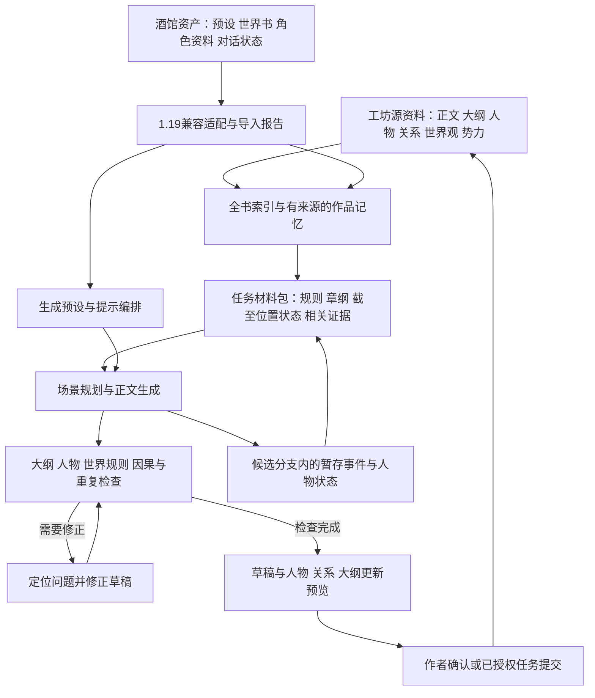

# 恍然梦酒馆 1.19 兼容与全书创作闭环方案

日期：2026-10-13。对象：当前小说工坊工作区及本地 `E:/SillyTavern/SillyTavern-1.19.0/SillyTavern-1.19.0`。

这是基于本地对话、状态快照、工作记录和源码的研究建议，尚未实施本方案。项目另一个聊天“优化工坊AI创作方案”仍在完成数据层收尾；本文以本次读取的代码和记录为准。此次新增本文及脱离正文内容的调研清单，没有修改应用功能。

## 1. 可行性判断

恍然梦可以兼容酒馆的预设、世界书、角色资料和对话资产，并借鉴酒馆的长期记忆及状态维护方式，达到辅助写作、按章纲生成正文、正文反推纲、人物捕捉与关系维护的产品目标。当前已经具备部分必要基础。

实现的重点是：**酒馆兼容层提供生成控制，工坊作品记忆提供书内依据，写作任务执行器负责生成、核对、修正和资料更新。** 单独提高预设兼容度不足以完成所有目标；酒馆本身也依靠扩展和作者维护的材料来增强连续性。

“AI 学习全书”应实现为可更新、可追溯的外部记忆：先完整读取与提取，再按本轮任务检索和装配。每次模型请求读取的是本轮选出的材料，并非永久记住整本书或改变模型权重。基础模型、上下文容量和检索覆盖仍影响效果。

结构和版本问题可以用程序严格校验；人物动机、因果合理性和文风属于语义判断，需要复核及真实模型评测。不能把“导入成功”“有总结”或“模型自检通过”当成全书逻辑正确的证明。酒馆官方也说明世界书能引导生成，但不保证模型采用其内容：[World Info](https://docs.sillytavern.app/usage/core-concepts/worldinfo/)。

## 2. 本次实际读取的材料

### 2.1 酒馆数据范围

- 本地 `package.json` 的版本为 **1.19.0**；实际程序根目录位于用户给定目录的下一层同名目录。
- `data/default-user/chats` 有 **10 个 JSONL 文件、737 条消息记录**。其中包含空会话、默认示例、导入记录和实际长对话，不能把 10 个文件都视作独立的完整创作实验。
- 选中消息的 `mes` 合计约 **281.5 万字符**，包含正文、输入包装、状态指令和 HTML；这个数不是小说正文字数。候选文本也没有据此重复计入。
- `data/default-user/backups` 有 **139 个聊天备份**。它们主要是同一会话的历史快照，不作为额外独立样本。
- `worlds` 有 **26 份世界书、4,515 个条目**，包括已禁用条目。
- 安装扩展包括 `JS-Slash-Runner`、`ST-Prompt-Template` 和 `World`。世界书里有 **106 个包含 EJS 标记的条目**、**106 个引用状态/助手宏的条目**；两项有重合，不能相加作为独立条目数。

完整文件清单、内容哈希、消息类型和结构统计见 [调研清单](./调研证据/酒馆1.19.0-恍然梦调研清单.json)。清单不包含聊天正文、模型推理文本或凭据。

### 2.2 对话中可直接观察到的机制

| 记录 | 实际结构 | 对工坊的启发 |
|---|---|---|
| 命定之诗 v4.1 / v4.2 | 231 / 272 条消息；存在世界书绑定、候选列表、候选状态数组、状态更新输出及人物表导出 | 长期设定、当前状态、候选分支分别维护，不能只发送最近几轮对话 |
| 世界调制器 | 143 条消息；出现角色列表、世界规则、`qrf_plot` 等规划字段，以及 20 条带表格快照的消息 | 自由生成需要受到规则与结构化记忆共同约束；规划文本不等于正文事实 |
| 第四天灾 v2.8 | 41 条消息；状态包含 NPC 档案、阵营与势力动态、任务日志、长短线剧情；14 条消息带表格快照 | 可以将人物、势力、任务、剧情进度分成独立状态域 |
| 异世界 | 37 条消息；世界书含人物表、人物索引和多个纪要条目 | 重要人物按实体检索，历史剧情按纪要检索，避免每轮整表灌入 |

进一步的本地证据：

1. `命定之诗总结世界书_mm0rz35xrmag.json` 有 **16 个总结条目**，名称明确区分小段总结与大总结，如“总结47-66楼”“大总结129-188楼”，且部分旧条目已禁用。这是分层压缩历史的实际资料形式，但记录不能证明所有总结都完整、准确或每轮被使用。
2. `第四天灾 2.9.json` 的“变量列表”通过 `{{format_message_variable::stat_data}}` 注入当前状态；`[mvu_update]` 条目规定状态更新输出。消息中能看到 `<UpdateVariable>` 与 JSONPatch 结构。
3. 消息的 `variables` 是与候选有关的数组，不是简单的单个 `stat_data` 对象。兼容导入必须先解析候选及对应状态，保留原始索引；不能直接读取 `message.variables.stat_data`。
4. `TavernDB_ACU_IsolatedData` 保存 `storageFrame/headRevision/checkpoint/logEntries`。第四天灾记录中能看到初始完整检查点、后续增量日志和手动完整检查点，数据域包含世界地图、势力、重要 NPC、任务、纪要和核查建议。这是实际可借鉴的“快照＋增量”工作记录。
5. 部分长对话中的大量非用户记录设置了 `is_system:true`。例如 v4.2 的 136 条非用户记录中有 125 条如此标记。研究历史必须区分存储记录与实际发送历史；不能直接照搬所有消息作为正文或训练样本。
6. `qrf_plot/qrf_plot_tasks` 字段说明存在额外规划材料，但缺少当时完整出站请求和执行追踪，不能据此断言规划总被执行、质量达标或自动修正成功。

这些证据说明你的酒馆能力来自多个部件协作。只导入 Chat Completion 预设，会遗漏动态世界书、候选状态、表格记忆、EJS 和助手扩展宏。

### 2.3 工作日志的证据边界

`content.log` 的内容是默认资源路径清单，属于资源安装记录。`.mimosa/history` 和 `.mimosa/reports` 的一轮开发审查标记为 `inconclusive`，原因为缺少任务基线；不能作为功能验收通过的记录。

更有业务价值的工作记录来自上述 ACU 检查点和增量日志，以及总结世界书。扩展 `World` 2.1.1 的源码还提供重大事件账本：对比推演前检查点与推演后状态，记录事件新建、推进、终结和风声变化；重生成时替换同轮账本，最多保留 20 轮。其状态储存位于浏览器 IndexedDB/localStorage，本轮没有获取该扩展的实际运行存档，所以这里只评估代码机制，不声称已验证实际推演结果。

## 3. 恍然梦现在能做到什么

本次重新核对了源码，不能继续沿用早期能力评估里“没有预设、没有全书读取”的旧结论。

| 用户目标 | 当前基础 | 仍需完成的流程 |
|---|---|---|
| 正文辅助写作、局部改写、续写 | 预设驱动对话、上下文装配、候选、继续生成、草稿应用已经存在 | 将人物状态、章纲和设定检查纳入稳定的写作任务 |
| 按大纲自动生成整章 | 章纲和祖先计划能够进入必要上下文；可提交正文草稿 | 分场景规划、分段生成、段间状态推进、整章复核、定点修正及恢复 |
| 将已有正文总结成大纲 | 全文分页读取、事件事实提取、分层摘要；已有大纲建议及画布应用 | 有证据的章纲反推、卷纲归并、纲文关联、与既有计划的差异展示 |
| 自行设计新人物并生成正文 | 模型可提出原创实体建议 | 新人物的稳定身份、暂存角色卡、设定核查及正文与人物联合提交 |
| 从正文捕捉人物、建立人物卡 | `new_entities` 能提取实体候选；姓名、别名和状态有检索基础 | 去重、重名消歧、证据聚合、候选合并和正式人物卡创建 |
| 自动绘制人物关系图 | 工坊已有关系表、人物图及布局；能更新已有角色的已登记关系 | 从正文提取有方向、有类型、有时间的关系，并与新人物一并应用 |
| 世界观与势力一致 | 全源登记资料、跨资料检索、规则候选和来源版本保护 | 结构化规则、势力状态、规则适用范围、语义冲突检测与修正 |

关键源码证据：

- `src/services/project/normalize.js`：正文、人物、关系、设定、大纲、灵感、批注及附件元信息的统一投影。
- `src/services/ai/booksource.js`：目录、全文分页、中文检索、关联实体；历史读取限制。
- `src/services/ai/knowledge.js:84`：正文事件、伏笔、人物状态、设定名词及新实体的事实提取；证据匹配及来源失效。
- `src/services/ai/book-memory.js`：作者资料记录与正文事实分开；规则目前仍由“必须、不得、代价”等词识别为待审候选。
- `src/services/ai/constraints.js`：章纲及祖先计划、规则候选、人物正文状态进入必要上下文。
- `src/services/ai/dialogue.js:104`：提案目标必须已存在；新增实体只是 `originalProposals`，尚无完整的建人及联合建关系路径。
- `src/services/ai/application.js:204`：人物建议能更新已有角色并创建登记人物之间的关系；未登记或有歧义的人物会被拒绝。
- `src/components/CharacterGraph.vue`：已有图展示和布局维护。需要补齐的是关系数据生成与审核，图形渲染可以复用。
- `CHANGELOG.md:15`、`docs/恍然梦书库读模型实施说明.md`：本版明确只交付数据基础与现有流程接入，四项完整创作流程尚未完成。

## 4. 建议的总体架构

工坊原始资料继续作为作品权威数据。生成期间的新事件、新人物和状态变化保存在任务分支，供下一场景使用；选中并应用草稿后才成为正式作品资料。重新生成、切换候选和丢弃草稿，都必须切换或丢弃对应的暂存状态。

“已发生事实”“作者锁定设定”“计划”“模型建议”是不同性质的资料。发现已写正文与设定冲突时，返回冲突及可选修订，不直接通过覆盖资料把矛盾消除。未来大纲可以作为计划传入，但未来正文事实不能泄漏到过去人物的知情状态。

## 5. 酒馆兼容应接到哪一层

建议采用工坊原生兼容层，日常运行继续在恍然梦内完成。优先支持可解释的资产和生成行为；额外进程桥接可作为后续特殊需求。

| 方式 | 能提供什么 | 代价与适用性 |
|---|---|---|
| 工坊原生兼容层，推荐 | 预设编排、世界书触发、角色资料、对话及状态转换；能与工坊来源、预算和写回共用 | 需要逐项对照 1.19，适合长期维护的小说创作产品 |
| 调用本地酒馆服务或已有扩展 | 某些现成脚本可能继续使用 | 依赖酒馆进程和扩展；请求追踪、作品身份和回滚需要跨系统协调，适合单独验证特定脚本 |
| 嵌入完整酒馆前后端 | 更接近酒馆自身界面和运行环境 | 集成范围大，仍不能自动补齐工坊的章纲、人物卡和联合写入逻辑；暂不作为主路线 |

### 5.1 第一层：核心资产和行为

升级现有主要按 1.15 对照的预设编译器，建立本地 1.19 固定样例，对照真实最终请求的角色、内容、顺序、深度、触发、宏、候选、续写和参数。

补齐世界书资产：关键词及次级条件、常驻、位置与优先级、扫描深度、递归、预算、黏性/冷却等。兼容模式按酒馆执行；工坊原生创作模式把作者确认的硬规则单独保留，普通相关资料再按检索与预算选入。每次显示命中原因、未激活条目和裁剪原因。

支持角色卡和 JSONL 对话导入：保留来源文件、候选、时间及角色字段，映射到工坊角色身份；对话正文先进入参考/待提取资料，不能自动并入作品正式正文。昵称、`{{char}}` 代表的对话角色和小说里所有人物之间需要显式映射，不能把整本书都当成一张角色卡。

### 5.2 第二层：结构化状态与记忆

将 MVU/JSONPatch、ACU 表格、总结世界书转换为工坊认识的数据：人物状态、事件、任务、势力、关系、摘要和剧情进度。导入遵循结构校验、候选映射、版本检查与差异预览；只接受已登记字段及合法实体引用。

先针对实际样本支持 `stat_data` 和关键字段的声明式转换。`{{format_message_variable::…}}` 等助手宏通过受限状态读取适配器实现，并报告不支持的扩展宏。EJS 条件和循环只能在明确定义的受限表达式子集中逐步支持；任意脚本、iframe 和扩展调用不等同于文本兼容。

建立分层记忆：最近正文保留原文；旧章保留结构化事件及章摘要；再生成卷摘要和主线摘要。人物、关系、伏笔和锁定规则保持独立检索。向量用于召回补充，不承担人物身份或时间判定。酒馆官方机制可参考 [Chat Vectorization](https://docs.sillytavern.app/extensions/chat-vectorization/)、[Summarize](https://docs.sillytavern.app/extensions/summarize/) 和 [Data Bank](https://docs.sillytavern.app/usage/core-concepts/data-bank/)。

### 5.3 第三层：工作日志

借鉴 ACU 的完整检查点与增量日志，为每个任务记录：作品和预设版本、章节范围、各步骤输入摘要、命中的资料、生成结果身份、核查问题、修正次数、用量、作者处理及应用记录。日志不要求保存模型隐藏推理。

在每个场景完成后创建恢复点；恢复时核验源版本。正文或设定被作者修改后，旧结果标记失效并重算受影响步骤。借鉴 World 账本的同轮替换方式，避免重生成重复增加人物事件；全书账本应按章归档，而非照搬“只留20轮”的限制。

## 6. 六个目标的具体执行流程

### 6.1 辅助写作和自动正文生成

统一由恍然梦对话入口承接：“续写这个选段”“按第八章大纲生成本章”“参考这些节点改写”等指令。任务识别后确定章节、字数、视角、风格、参考范围、新人物权限与约束，信息不足时只询问影响结果的项目。

整章任务按以下顺序执行：

1. 读取目标章纲及祖先计划，检索涉及人物、地点、势力、已发生事件和未回收伏笔。
2. 生成场景表：本场目标、冲突、入场状态、关键动作、出场状态、需要完成的纲点及不可提前发生的内容。
3. 按场景生成正文，每场使用相关材料与前场实际草稿结果，不只使用前场计划。
4. 从本场草稿提取暂存状态；检查世界规则、人物动机和知情边界、纲点完成、因果、时间地点、重复及断尾。
5. 定位问题段落并修正，复核修正是否引入新问题。建议默认最多两轮；仍有问题时保留草稿和明确的未解决事项，不无限循环。
6. 对合并后的整章再检查衔接、视角和总体纲点，生成正文与关联资料更新预览。

普通纯文本聊天继续使用预设；需要自动阅读、生成和检查的任务由任务执行器调用所需工具。这样不依赖导入预设是否恰好开启函数调用来完成整章任务，创作正文仍遵循作者选择的预设。

### 6.2 让正文遵守大纲

为纲点建立稳定 ID，并记录本章必须完成、可选择、以后完成、禁止提前发生四种状态。每个纲点附参与者、前置条件、结果要求、对应正文段落及完成状态。

生成后返回覆盖表：完成 / 部分完成 / 未完成 / 偏离，每项都指向草稿段落。出现偏离时可以修正文或提出大纲调整，由作者选择；不能让模型自动改纲来掩盖偏离。

### 6.3 从正文反推大纲

逐章完整读取，提取带原文位置的事件，再整理为章纲、卷纲和全书主线。节点包含人物、时地、目标、冲突、结果、因果、伏笔及来源。

反推得到的是“已写内容纲”，与未来“创作计划纲”分开保存并双向关联。支持合并重复、补缺、挂到现有章节和差异预览；疑似隐含动机只列待确认，不当作明确事实。正文修改后增量重算对应节点，保留作者已确认的纲点。

### 6.4 新人物设计与正文人物捕捉

采用两条入口、共用一套实体身份：

- **创作新人物**：为剧情需要建立任务内的暂存角色卡，包括角色功能、性格底线、目标、能力限制、所属势力和初始关系。后续场景按同一暂存 ID 使用，避免同名人物被多次创造。
- **捕捉已有正文人物**：按段提取名字、别名、称谓、出场和资料证据；跨章聚合与重名消歧。明确身份属性和阶段性状态分开，资料没有写出的部分保持未知。

单独展示新建、合并、更新候选，允许作者批量确认。故事中出现的新人物不会因角色卡尚未确认而丢失，也不会提前被当成正式全书设定。草稿被接受时可以把正文、新人物、关系及关联记录联合应用；失败时整批回滚。

### 6.5 人物关系自动建图

从正文提取“谁—与谁—什么关系—依据—何时生效—谁知道”，记录方向、类型和状态变更。亲属、师徒、敌对、同盟和单方面认识需要区分，不能把同场出现升级为关系。

关系提案先解决人物身份，再更新工坊关系表并复用现有人物图布局。已有作者关系保留，冲突关系显示差异；新人物与新关系使用同一批次的临时 ID 到正式 ID 映射。支持按章节查看关系历史，避免把后期同盟作为前期人物已知事实。

### 6.6 世界观、势力和人物不偏离

建立作者可确认的规则：适用实体或地域、生效区间、约束内容、允许例外、强度和来源。人物“不能背叛”与“通常忠诚”采用不同强度；突破规则必须有作者批准的例外或正文证据。

每个势力具有目标、资源、行动范围、盟敌关系及已发生行动。World 扩展可借鉴“势力状态转为自然语言材料”的做法；自动世界推演先产生候选计划，作者接受或写入正文后才成为事实。幕后变化与视角人物实际知道的信息分别维护。

核查分为：程序检查实体引用、版本、时间范围和明确数值上限；模型检查动机、因果、计划兑现及文字是否违背规则。核查器获得草稿和相关来源，输出可定位的问题与理由；核查结果用于定点修正，而不是只生成一份报告。

## 7. 数据及模块建议

复用 `aidoc/aichunk/aiindex/aikb/aientity/aiedge/airuns/aidecisions` 和作品源表，避免再建一个与正文脱节的第二书库。

需要补充的逻辑记录可以先扩展现有结构，待访问模式明确后再决定新增表：

- 创作任务及场景：`runId/stepId/status/checkpoint/sourceVersions/usage`。
- 暂存实体与状态：`runId/candidateId/tempEntityId/asOfScene/assertionStatus`。
- 规则：`scope/strength/effectiveFrom/effectiveTo/exceptions/source`。
- 纲点实现：`outlineNodeId/chapterId/paragraphRange/status/sourceVersion`。
- 关系事件：`fromId/toId/type/direction/effectiveTime/evidence/assertionStatus`。
- 核查问题：`ruleId/paragraphRange/sourceRefs/severity/resolution`。

建议模块职责：`presets.js` 与独立 world-info 适配器负责酒馆行为；`booksource/knowledge/state/constraints` 负责作品依据；新增创作任务执行器、反推纲、实体提案和一致性核查模块；`application.js` 扩展联合提交、审计与撤销。UI 保留主对话、独立预设窗口及现有人物/大纲视图，任务进度和待确认内容在对话中展示。

## 8. 实施顺序与验收

| 阶段 | 交付重点 | 进入下一阶段的依据 |
|---|---|---|
| P0 | 对齐 1.19 核心预设及世界书；状态和扩展依赖报告；任务材料包与日志 | 固定样例的请求对照通过；相关规则、章纲及人物状态可查看来源和裁剪原因 |
| P1 | 分场景整章生成、大纲覆盖检查、语义复核与定点修正 | 场景能接续已生成状态；暂停恢复有效；硬问题仍存在时不能显示为检查通过 |
| P2 | 正文反推章纲/卷纲、人物捕捉、新人物设计、关系提取及联合应用 | 原文能定位；重名及共现有正确处理；草稿与正式资料不混淆；联合应用和撤销完整 |
| P3 | 势力演化、主线与伏笔持续维护、长篇性能优化 | 后台计划不会自动成为事实；长篇检索、成本和失效重算达到实测目标 |

为了尽早产生写作价值，P1 可先使用工坊原生材料，不必等待所有第三方酒馆扩展兼容完毕。P2 的反推纲和人物捕捉可共享一次正文事件提取结果，减少额外模型调用。

验收只运行本次功能相关检查，遵循用户此前“只跑更新功能部分测试”的要求。AI 生成与理解相关验证遵循[开发流程 §5.1.2](./开发流程.md)，使用小说工坊设置中已配置的 `deepseek/deepseek-v4.1-flash`，不得以本地 Mock 替代模型。确定性程序检查与真实模型行为评测分别记录：

1. **程序验收**：来源与实体引用正确，未来事实隔离，候选状态隔离，改源拒绝旧提交，恢复不重复执行，联合创建不产生悬空关系，撤销及取消有效。
2. **真实模型评测**：使用上述已配置模型，准备带人物身份变化、规则代价、伏笔、势力关系和已知标准答案的样书；记录设置中实际使用的模型与任务范围，多次生成，人工评价因果、人物及文风。本地 Mock 的输出不能作为 AI 行为或创作质量验证结果。

建议记录纲点完成率、严重设定冲突、人物知情错误、事实证据可定位率、人物/关系误建率、重复率、修正成功率和每章用量。先取得当前版本基线，再制定发布阈值；检索召回未测量前不宣称“全书关联已全部可靠”。

自动模式默认完成整套草稿和资料建议，作者一次检查并应用；若以后授权某类任务自动写入，再按任务范围启用并保留检查点及撤销。预算按任务预留，先显示预估，实际用量记入日志；缓存只在来源与依赖都有效时复用。

## 9. 建议的下一次开发范围

下一次建议实施 **“按章纲生成一章＋规则/人物核查＋定点修正＋草稿预览”**，同时补最影响任务材料的世界书与 1.19 兼容差异。它能最快检验“预设、全书记忆和创作上下文”是否真正共同工作。

随后完成 **“从正文生成大纲、人物卡和关系图的联合提案”**。先把正文到结构化资料的路径做可靠，再增加自动世界推演。这样生成结果既有书内依据，也能反过来更新工坊中可维护的资料。

## 10. 主要来源

本地证据的相对路径均基于第二段所列酒馆根目录：

- `data/default-user/chats/命定之诗与黄昏之歌v4.2/命定之诗与黄昏之歌v4.2 - 2026-04-11@18h24m10s936ms imported.jsonl`
- `data/default-user/chats/第四天灾 v2.8/第四天灾 v2.8 - 2026-06-20@21h28m56s965ms.jsonl`，尤其第 2、4、6、20 行的表格检查点与增量日志。
- `data/default-user/worlds/命定之诗总结世界书_mm0rz35xrmag.json`
- `data/default-user/worlds/命定之诗与黄昏之歌v4.2.json`
- `data/default-user/worlds/第四天灾 2.9.json`
- `data/default-user/worlds/异世界.json`
- `data/default-user/extensions/JS-Slash-Runner/CHANGELOG.md`
- `data/default-user/extensions/ST-Prompt-Template/README_CN.md`
- `data/default-user/extensions/World/manifest.json`、`world-engine-ledger.js`、`world-engine-inject.js`、`world-engine-evolution.js`、`world-engine-store.js`
- `.mimosa/history/run-20261012T164121591Z-26672-839fec5a882d.json`
- `public/scripts/world-info.js`、本地 `package.json`。

在线官方文档用于解释通用机制；具体 1.19 的行为以本地实现及后续固定请求对照为准。本轮没有重放扩展、测量百万字性能或调用真实模型，因此没有给出写作效果已达标的结论。
