# 小说工坊 Novel Studio · 产品介绍

> 本地优先的小说创作软件 ｜ 当前版本 **v1.2.6** ｜ Windows x64（另提供 DSH 插件端同步构建）
> 项目主页：<https://github.com/linque0/novel> ｜ 安装程序：[Releases](https://github.com/linque0/novel/releases)
>
> **图文排版版**：[产品介绍-图文版.html](产品介绍-图文版.html) · [产品介绍-图文版.pdf](产品介绍-图文版.pdf)（20 页 A4，封面 / 目录 / 分章排版，适合直接分发或打印）
>
> 本文全部 22 张配图位于 [项目展示图例/](项目展示图例/)，均为软件真实界面截图（使用当前主界面「幻流」拍摄，演示作品为虚构的《星尘旅人》，书架页及全局统计同步展示测试书目）。画面中的书名、人物、章节与数据仅作功能展示，不来自任何真实作者作品。

---

## 一、这是什么

**小说工坊**是一款面向长篇创作者的本地优先桌面写作软件：把「**正文 / 大纲 / 设定 / 人物 / 灵感**」五个创作要素收进同一个工作台，并结合「**恍然梦**」AI 协同工作流，以**输入即存、永不丢稿**为第一原则——所有作品数据留在本机，除你主动配置并触发的模型服务外，不联网、不上传、不登录。

它着重解决长篇小说创作中最常见的四个断裂：

| 创作痛点 | 小说工坊的做法 |
|---|---|
| 正文与大纲分离，写着写着失去结构 | 大纲支持**分层自由画布**与**文本幕布双视图**同源切换；事件、便签、引用、文本框、章节锚点、卷与容器自由摆位，四类语义连线自动绕障；正文可拆窗与大纲并排 |
| 人物关系与世界观设定散落多处 | 人物提供**卷宗档案 + 关系剧场**；设定是一棵**无限嵌套的幕布树**，配有**阅读视图**与交互式**关系星系**；三者均可与正文通过**关系链接**互相引用、悬停预览 |
| 灵感随手记下却难以进入正文结构 | 灵感采用**按标签分组的拼板看板**，可拖动排序、跨组归类，并在侧栏抽屉中**一键转为章节或设定**（保留原灵感） |
| 心血丢失、版本混乱、AI 越权改稿 | **1 秒防抖落盘 + 30 秒兜底 + 失焦/切章/关窗强制保存**，配自动版本快照与回收站；「恍然梦」只生成候选稿与提案，所有正文采纳与设定修改均由作者确认 |

*书架主界面（幻流）。顶部胶囊切换「书架 / 正文 / 大纲 / 设定 / 人物 / 灵感」六大视图，右侧集中放置保存状态、搜索、写作统计、设置、锁屏与「恍然梦-入梦」入口；中央为 3D 轮播书封与作品信息，下方票根记录上次读到的章节与进度。*

---

## 二、界面总览：幻流工作台与流场背景

自 v1.2.4 起，桌面端界面收敛为统一的「**幻流**」（原开发代号 `LATENT`）设计语言，覆盖书架、六大工作区、设置窗口与拆出的独立面板窗口：

- **统一顶栏**：左侧品牌与当前皮肤标，居中胶囊导航切换「书架 / 正文 / 大纲 / 设定 / 人物 / 灵感」，右侧常驻保存状态（「已保存」）、全局搜索、写作统计、设置、锁屏以及「恍然梦-入梦 / 恍然梦-浅眠」入口；支持开启「默认隐藏顶栏」获得更安静的写作视野。
- **WebGL 流场背景**：底层由实时着色器渲染柔和流动的色彩光影。既可选择**跟随作品封面**自动取色（切换书目时背景自然过渡），也可切换**自定义两色**（RGB / 色板 / 五组推荐配色：雾蓝暮紫、松林薄雾、落日余晖、深海极光、玫瑰墨夜），并支持 `0–2×` 调节流动速度（`0×` 为静止）与深/浅两档面板明暗。

*流场配色切换示意（早期版本左上角标识为 `LATENT`，现已统一为「幻流」）。同一书架结构在不同流场配色下呈现截然不同的视觉氛围；顶部「全部 · 21 / 21」支持按连载、完结、构思、搁置等创作状态筛选。*

---

## 三、正文：三栏稿面与专注写作

正文采用**卷—章两级目录树 + TipTap 富文本编辑器**，在幻流工作台下呈现为左目录、中稿纸、右札记的三栏协作布局：

- **左栏 · 章节目录**：支持搜索章节、★ 书签收藏、按卷分组、拖拽排序、字数统计，底部快捷「＋ 新建章 / 新建卷」。
- **中栏 · 稿面与工具栏**：顶部显示当前章节标题、目标字数进度条（如 `196 / 3,000 字`）与「恍然梦 · 正文助手」提示条；工具栏覆盖撤销重做、加粗 / 斜体 / 下划线 / 删除线、正文与 `H1–H3` 标题、字号、字体颜色、突出显示、对齐、列表与引用、超链接、清除格式，以及「发送给恍然梦」。
- **右栏 · 批注栏联动**：随当前章节实时切换，整合**本章批注**、**本章大纲**（要点速记，输入即挂到大纲画布）、**本章出场人物**（自动识别）、**本章插图**（支持拖拽或粘贴上传）与**本章信息**（字数 / 状态 / 更新时间）。

*正文三栏工作台。选中的正文语句以高亮标出；右侧「批注栏」把本章批注、大纲速记、出场人物、插图与信息收拢在视野边缘，写作时无需来回跳转模块。*

### 批注、关系链接与专注写作

- **批注与关系链接同句共存**：选中文字右键「添加批注…」可生成带用途色（待改红 / 疑问蓝 / 伏笔紫 / 灵感绿 / 考据橙 / 待定灰或自定义色）的**实线下划线**；右键「添加关系链接…」或输入 `[[标题]]` 则生成贴字的**点状下划线**。两者上下错位叠加在同一段文字上互不遮挡；悬停关系链接弹出可拖动钉住的预览窗。
- **Word 式右键菜单**：右键选区就地弹出快捷编辑栏，包含剪切 / 复制 / 粘贴纯文本、格式化、标题与对齐飞出菜单、批注与关系链接入口。
- **收起侧栏与阅读模式**：点击左右分隔手柄即可将章节目录与批注栏收起为极窄竖轨标签（「批注」「章节」），专注长段输出；需要通读校验时可切入只读**阅读模式**。写作期间输入防抖 1 秒落盘 + 30 秒兜底 + 失焦/切章/关窗强制保存，并按 5 分钟冷却自动保留最近 30 份版本快照以便随时回滚。

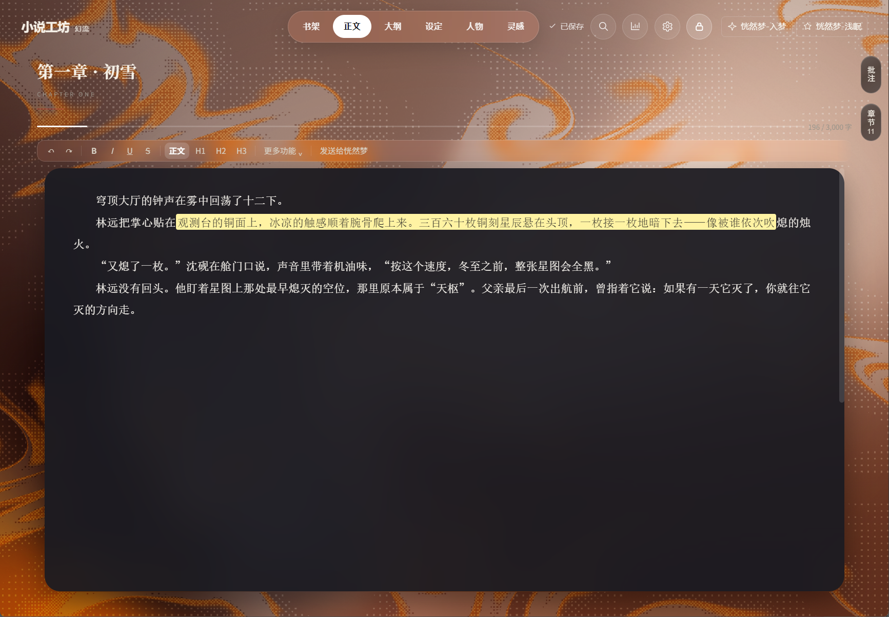

*专注写作视角。左右两栏收起后，稿面居中铺展；右侧边缘仅保留竖向「批注」「章节 11」快捷标签，随时点击呼出。*

---

## 四、大纲：分层自由画布与文本双视图

大纲是一个**可逐层下钻的自由模块画布**，同时配备共享数据的**文本视图**，方便在「全局推演」与「条理梳理」两种节奏之间零成本切换。

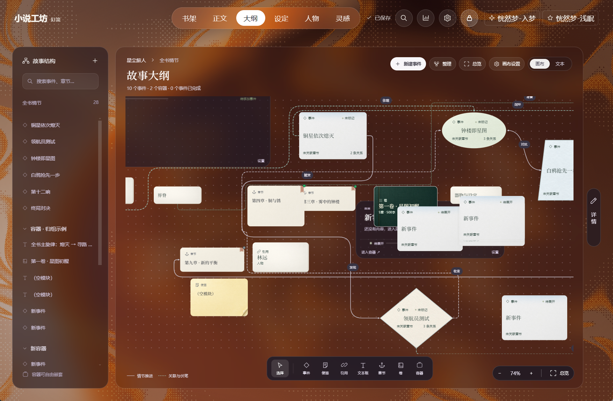

*大纲画布视图。左侧「故事结构」树同步全书层级与搜索定位；底部居中悬浮「选择 / 事件 / 便签 / 引用 / 文本框 / 章节 / 卷 / 容器」工具条，画布内不同形状的事件卡、黄色折角便签、人物引用卡、章节卡与容器通过实线/虚线语义连线串联并自动绕行。*

### 七类模块、分层容器与容器详情

- **七类模块与放置预览**：画布底部工具条提供**事件**（支持矩形 / 菱形 / 平行四边形 / 椭圆 4 种 SVG 描边形状，以及已完成 / 正在写 / 待修改 / 待展开 4 种状态）、**便签**、**引用**（关联设定 / 章节 / 人物）、**文本框**（透明度可调）、**锚点**（绑定或新建章节）、**卷**（绑定分卷）与**容器**。从工具条或右键新建锚点/卷时先跟随指针显示落点预览，点击落定。
- **分层下钻与就地展开**：根层仅展示直接子节点，容器以章节卡呈现。点击「**进入容器 ↗**」进入次级画布，顶部面包屑（如 `星尘旅人 > 全书情节`）逐级返回并恢复各层相机；也可直接点击「**就地展开 ＋**」在当前画布内将容器展开为两列迷你卡（窄容器单列），支持迷你卡拖动重排、拖出回当前层或跨容器换组。
- **容器详情与节点操作**：选中任意模块或容器可在右侧「详情」抽屉查看并编辑故事摘要、完成进度、关联章节与故事关系；右键模块支持切换形状、画布内编辑、固定位置、发送给恍然梦、分支调色及多选封装容器。

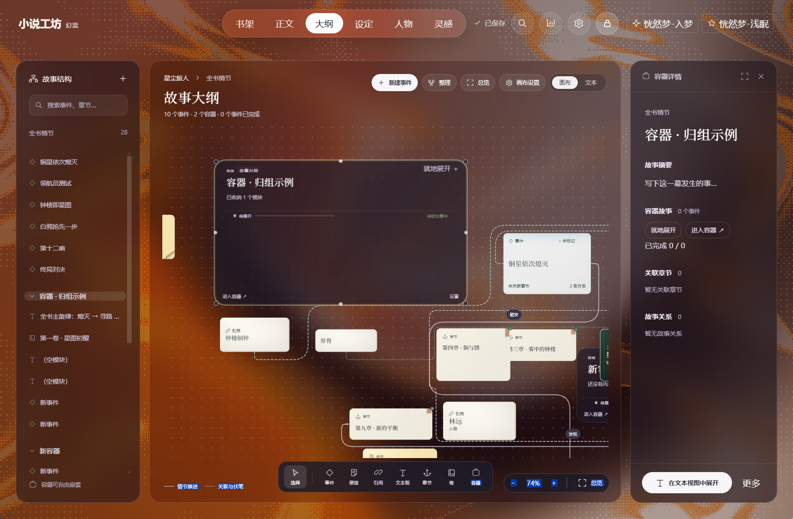

*选中「容器 · 归组示例」后，右侧展开「容器详情」面板，集中展示故事摘要、容器事件完成进度、就地展开 / 进入容器入口、关联章节与故事关系，底部支持一键「在文本视图中展开」。*

### 连线工程保证、连接点与文本视图

- **四类语义与严格端口锁定**：连线按**关联**（蓝）、**因果**（红）、**伏笔**（紫，默认虚线）、**冲突**（橙）着色，支持单向 / 双向 / 无向箭头、实线 / 虚线 / 点线、线宽与箭头大小独立覆盖。建立连线时记录两端接口方向并落库，挪动节点**绝不漂移端口**；途经任何模块采用 **Hanan 稀疏网格 A\*** 求解全局最短绕行（现有布局无通道时以虚线「路径受阻」提示，移动卡片即自动恢复）。
- **线连到线（连接点）与塑形**：右键连线可在路径上创建双向**连接点**（可被接入也可再拖出多条分支，1.6 秒高亮提示后淡出为微观透明态）；左键按住连线可拖动塑形，双击恢复自动路由；右键编辑浮层自动避开连线本体放置。
- **关系投影与文本视图**：收起容器或跨层连线会投影到最近可见容器卡或「前接 / 后续」接续卡，不丢失全局脉络；右上角切换「画布 / 文本」进入幕布式缩进树，`Ctrl+K` 搜索全部层级并自动进入目标父层定位；画布支持点阵开关、16px 网格吸附、总览与整理布局。

---

## 五、设定：幕布树、阅读视图与关系星系

设定模块把全书世界观收进一棵**统一节点树**，并提供**节点大纲 / 阅读视图 / 视觉导图**三种视图模式，兼顾速记、精读与关系俯瞰。

### 1. 节点大纲（幕布树）

没有「文件夹 / 条目」二分，任意节点地位平等、支持无限嵌套与三区插入指示拖拽排序（带悬停自动展开与 FLIP 衔接动画）。顶部集成「恍然梦 · 设定助手」提示条与内联格式工具栏（撤销重做、加粗/斜体/下划线/删除线、字色/底色/清除、`MD/TXT` 导入、＋同级/＋子级、折叠/展开、`H` 标题级、关系链接），底部实时显示面包屑路径与快捷键提示（`Enter 同级 · Tab 层级 · 圆点进入 · [[ 链接`）。

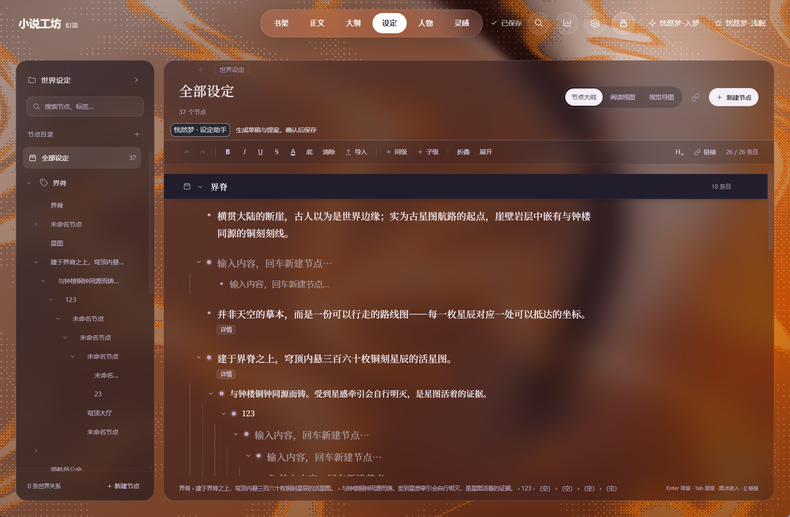

*设定「节点大纲」视图。左侧「世界设定」目录树与中间幕布编辑区实时同步；带「详情」标记的条目可双击进入深度详情，也可以右键「设置关系…」建立设定↔设定或设定↔人物的带类型关联。*

### 2. 阅读视图

三栏结构适合沉浸翻阅大量世界观资料：左侧为全局节点目录，中间列出当前设定集或父节点下的**同级条目卡片**（支持按标签筛选与关联计数预览），右侧呈选中条目的**阅读详卡**（面包屑、`子节点 / 后代节点` 统计、「条目中定位」「查看导图」按钮、正文内容、关联关系与可下钻的编号子条目列表）。

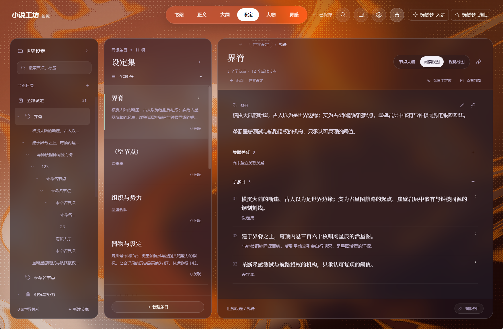

*设定「阅读视图」。选中《界脊》后，中栏同级条目卡与右栏详卡联动展示其 3 个直接子节点与 12 个后代节点，点击「编辑条目」即可就地修改。*

### 3. 视觉导图：层级导图与关系星系

右上角切到「视觉导图」后，可在**层级导图**与**关系星系**之间切换。**关系星系**将整部作品的设定集与条目化作围绕核心（如《星尘旅人》）运转的多圈同心轨道星系：

- **直观编码**：星体圆环与名称显示各设定集（如《界脊 · 8》《器物与设定 · 4》《民俗与信仰 · 2》）及内部条目节点；图例清晰区分**条目织网**（虚线）、**集内关系**与**跨集关系**（实线）。
- **深度可调**：支持左键拖动空白旋转视角、中键平移、滚轮或右下角控件缩放（如 `135%`）与「聚焦」；支持**拖动圆边调整条目大小**、**独立拖拽轨道与靠近并轨**、右键星体调整公转/自转速度，以及调节轨道间距与入口半径，所有自定义布局按作品持久化，也可一键「恢复自动布局」。

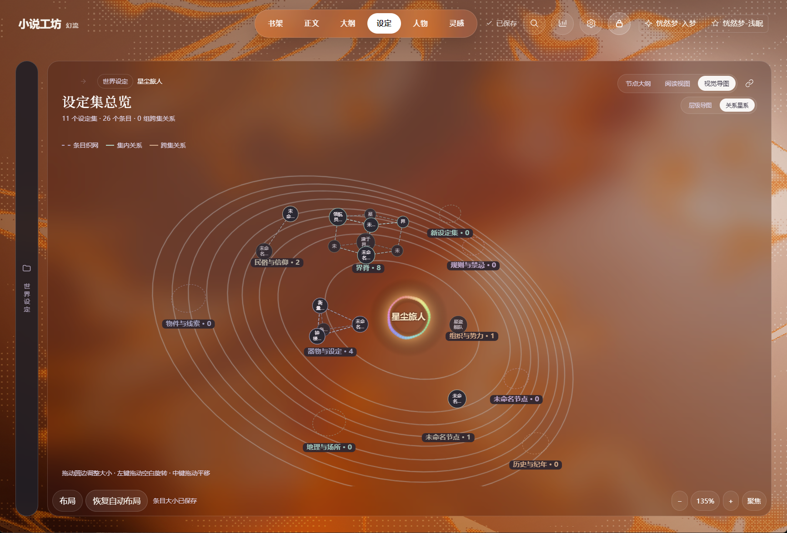

*设定「视觉导图 → 关系星系」。左侧目录收起为竖向「世界设定」边条，中央星系完整呈现 11 个设定集与 26 个条目的轨道分布、集内织网及关系脉络。*

---

## 六、人物：人物卷宗与关系剧场

人物模块分为**人物卷宗**与**关系剧场**双视图，既能深挖单个人物生平，也能俯瞰整张人际关系网。

### 人物卷宗（浏览与编辑）

- **三栏档案布局**：左侧「人物名录」支持姓名/别名/标签搜索与按角色、标签双重筛选；中间为人物卷宗主体；右侧「**关系与设定（故事坐标）**」以迷你预览图直观展示当前人物的一度关系与关联设定，点击「在关系图中查看」直达剧场。
- **多篇小传与自由字段**：卷宗支持上传自定义头像、设置角色定位（支持多个角色用 `/` 分隔，内置主角 / 配角 / 反派 / 导师 / 盟友 / 旁观者 / 龙套等预设胶囊并可自定义输入，兼容既有数据）与人物标签；自 v1.2.5 起支持**多篇带标题的人物小传**（点击「＋ 添加小传」自由增删，旧版单篇小传无缝兼容），并保留可自由增删的**自定义字段**（默认预置外貌、性格）与**关联关系（设定 / 人物）**。

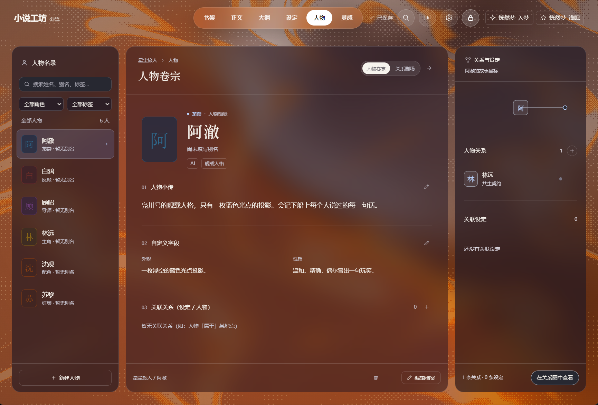

*人物卷宗浏览态。中间依序呈现《阿澈》的头像与标签、`01 人物小传`、`02 自定义字段`（外貌 / 性格）与 `03 关联关系`，右侧「故事坐标」同步预览其与《林远》的「共生契约」关系。*

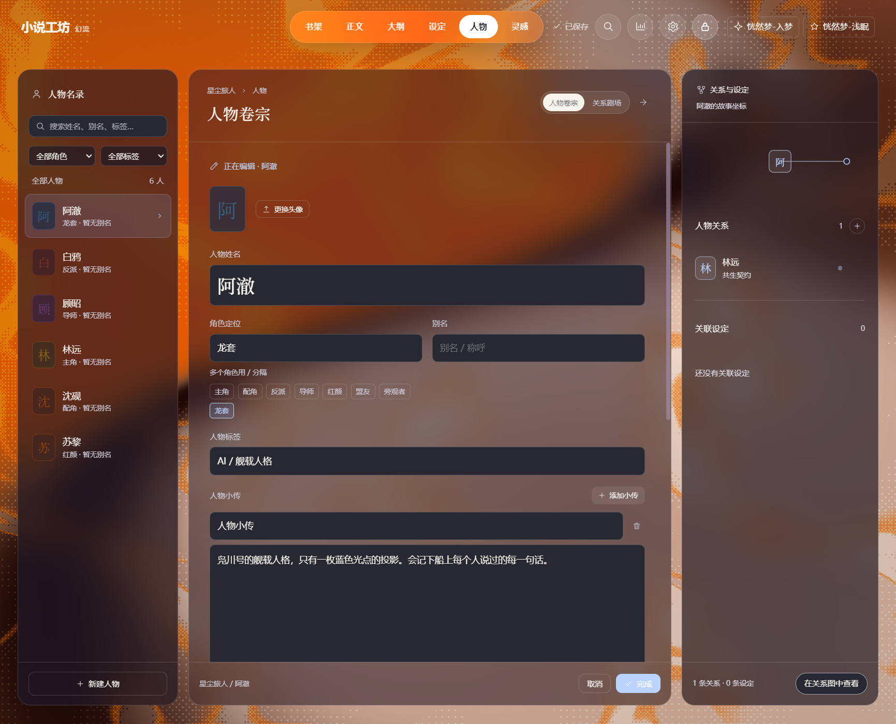

*人物卷宗编辑态。支持更换头像、以 `/` 分隔输入多个角色定位、编辑标签，以及通过「＋ 添加小传」为同一人物维护多篇独立标题的经历小传。*

### 关系剧场

切换至「关系剧场」后，人物名录中的角色化作画布节点：

- **统一拖线手势**：从节点拖线到另一人物即可建立关系并命名（如「共生契约」「青梅竹马」「宿敌」「同盟」）；拖线落到**已有关系**上则直接打开编辑浮层改写或删除——建立与修改是同一个手势。
- **聚焦与联动**：顶部可切换「一度关系 / 全部人物」，支持圆形 / 网格一键排布、孤岛人物提示，画布改动与卷宗关系列表双向实时同步；也可右键节点一键发送为大纲引用卡。

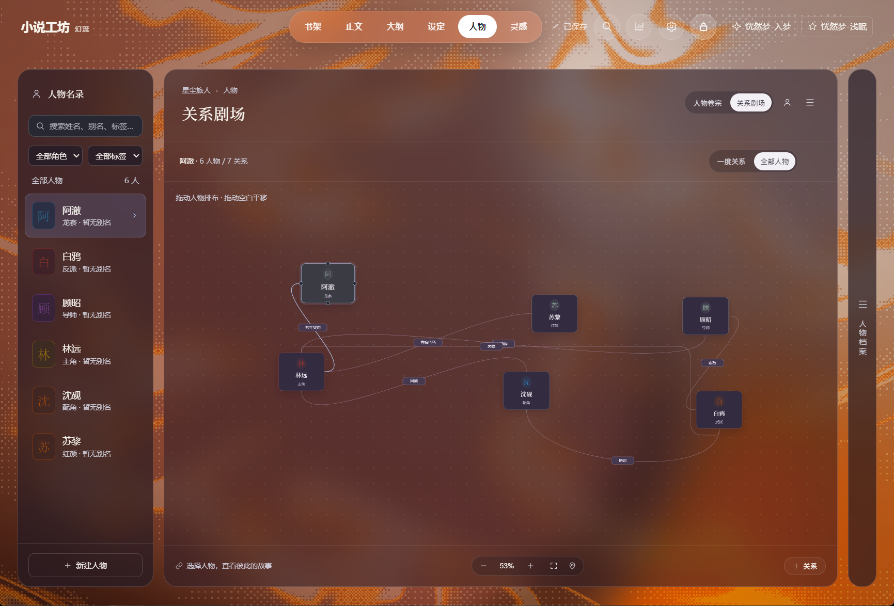

*关系剧场视图。展示 6 位人物与 7 条带名关系弧线，右侧档案面板收起为极窄「人物档案」竖轨以腾出最大画布视野；底部居中提供缩放比例（53%）、适应全图与位置辅助。*

---

## 七、灵感：单一拼板与一键转化

自 v1.2.6 起，灵感模块收敛为高效的**单一拼板**工作台，把零散念头、分组整理与转化落地合为一体：

- **按标签分组看板**：卡片按标签分栏展示（如「未标记」及各类自定义标签组），每张卡片顶部带有图钉与编辑按钮——**拖动图钉即可调整卡片顺序或跨栏更换标签组**，同时记录创建时间与关联计数。
- **可控的视觉节奏**：左下角提供排序切换（`最新 / 最早 / 手动`）、缩放比例滑块（如 `100%`）、三档以上连续可调的**卡片大小**（`80–125`）与卡片配色（默认 / 玫瑰 / 琥珀 / 苔绿 / 雾蓝 / 藤紫），另设独立「回收站」入口防止误删灵感。
- **片段整理与一键转化**：点击卡片在右侧「片段整理」抽屉中编辑标题、正文、标签与跨模块关联，点击「**转为章节**」或「**转为设定**」即可直接落入作品结构，并贴心保留原灵感条目以备追溯。

*灵感拼板视图。左侧栏统计全部灵感、未标记与有关联数量并支持缩放与卡片大小调节；中间看板支持拖动图钉排序与跨栏换组；右侧「片段整理」抽屉提供正文编辑、添加关联与「转为章节 / 转为设定」入口。*

---

## 八、恍然梦 AI 协同与全书知识库

「恍然梦」是深度嵌入创作工作台的 AI 协作者，始终遵循**「作者拥有最终决定权」**的边界——所有生成内容均为候选稿或提案，必须经作者确认才写入正式正文或设定库：

| 模式 / 能力 | 入口与定位 | 核心机制 |
|---|---|---|
| **恍然梦-入梦** | 书架与工作区顶栏右侧入口 | 沉浸式「故事现场」：可选「AI 叙事主写」或「角色参与」，支持写稿推演与讨论模式切换、章节确认锁定、旅程记录回溯、独立审稿清单（带原文证据定位）、修稿前后对照，以及「高级创作工具」多章（最多 10 章）批量规划/写稿/审稿/复核流水线与 Token 预算控制 |
| **恍然梦-浅眠** | 书内顶栏右侧 / 正文工具栏「发送给恍然梦」 | 工坊侧边助手：不离开当前正文、大纲、设定、人物或灵感界面，针对当前上下文发起续写、改写、设定补全或人物/关系/状态联合提案 |
| **全书知识库与记忆队列** | 浅眠知识面板 / 设置「知识库模型」 | 自动增量维护章节记忆任务（内容指纹防过期 + 中断任务租约恢复 + 切作品/隐私模式自动取消）；支持本地索引设定、大纲、人物、关系、灵感、批注与章节事实，默认关键词检索，也可按需开启向量模型（Embeddings）语义检索（失败自动回落关键词检索） |
| **模型与凭据安全** | 设置「模型设置」 | 支持多供应商预设（名称 / Base URL / API 格式 / API Key）、拉取或手动管理模型列表、温度与上下文参数、隐私模式与连接测试；API Key 经系统凭据加密存储在本机，**不写入导出与备份文件** |

---

## 九、全局工具、多窗口与写作分析

- **全局搜索（`Ctrl+Shift+F`）**：跨正文、大纲、人物、设定、灵感五个模块检索，按模块分组高亮命中片段，点击直接跳转定位。
- **关系链接（`[[标题]]`）**：在正文、设定幕布、人物小传或灵感中选中文字右键「添加关系链接…」或输入 `[[标题]]`，即可把章节、人物与设定互相串联；悬停弹出带动画的预览窗，拖动标题栏即可钉住并记忆停靠位置，双击恢复跟随，改名不断链。
- **写作统计与分析（幻流背板 · ECharts）**：完全基于本机保存记录计算生成，无需联网。点击顶栏统计图标先弹出**写作速览**浮窗（当前正文字数、正式章节数、今日净增与近 7 日柱状图），点「查看完整分析」即可进入涵盖六大板块的独立分析窗口：
  - **总览（创作历程 / 作品对照）**：追踪区间累计净增曲线、活跃日期、活跃日历热力格与当日明细，并支持同屏对比两部作品的写作走势与分卷规模；
  - **正文（章节结构 / 改稿轨迹）**：按卷查看章节字数分布与中位数、完成度筛选，或在「章节 × 日期」改稿热力矩阵中逐格回溯每日保存字数差与留存版本；
  - **大纲 / 设定 / 人物 / 灵感剖析**：逐项统计故事容器事件四态、设定根分支节点数、角色定位分组与人物关系网络、灵感标签分布与最近新增，并支持点击联动右侧明细检查器。

*写作速览浮窗。从书架或作品顶栏一键呼出，实时展示正文字数、正式章节数与近 7 日净增，点选柱状图日期可查看当日保存明细或直达完整分析。*

| 总览 · 创作历程 | 总览 · 作品对照 |
|---|---|
|  | 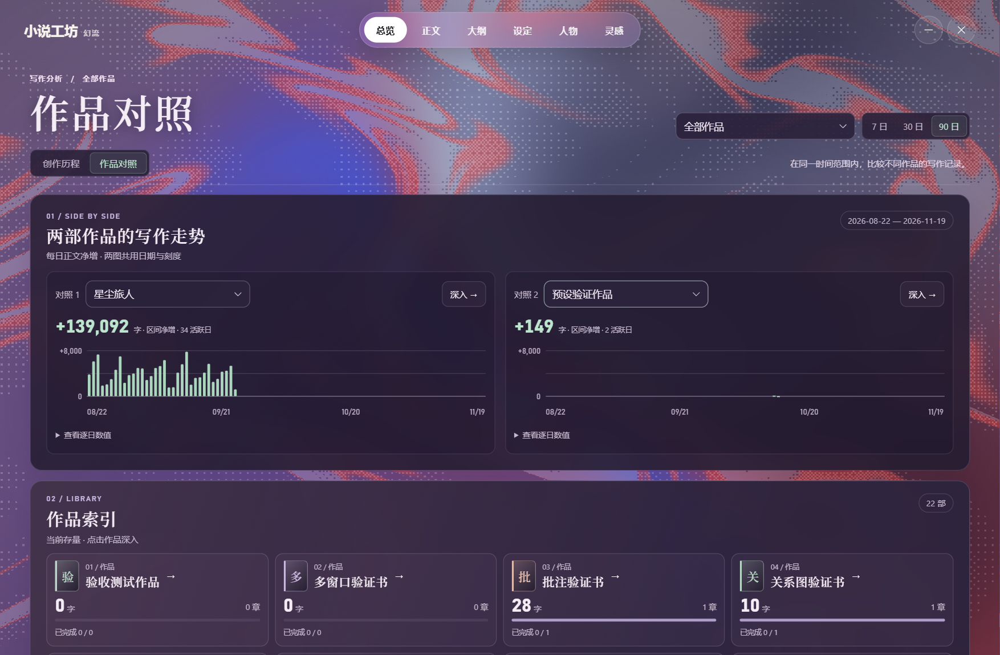 |

| 正文 · 章节结构 | 正文 · 改稿轨迹 |
|---|---|
| 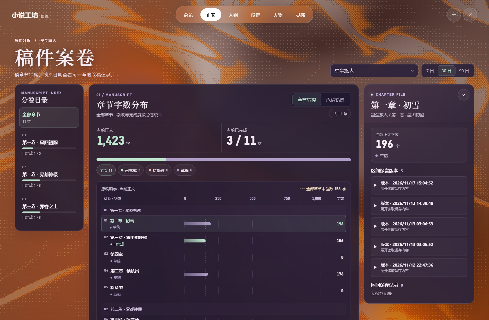 | 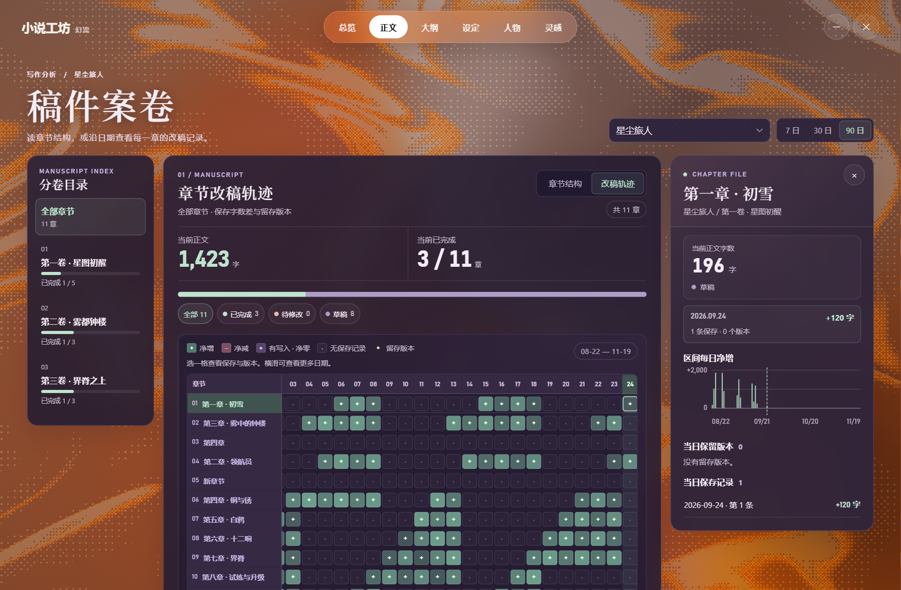 |

| 大纲事件分析 | 设定分支分析 |
|---|---|
| 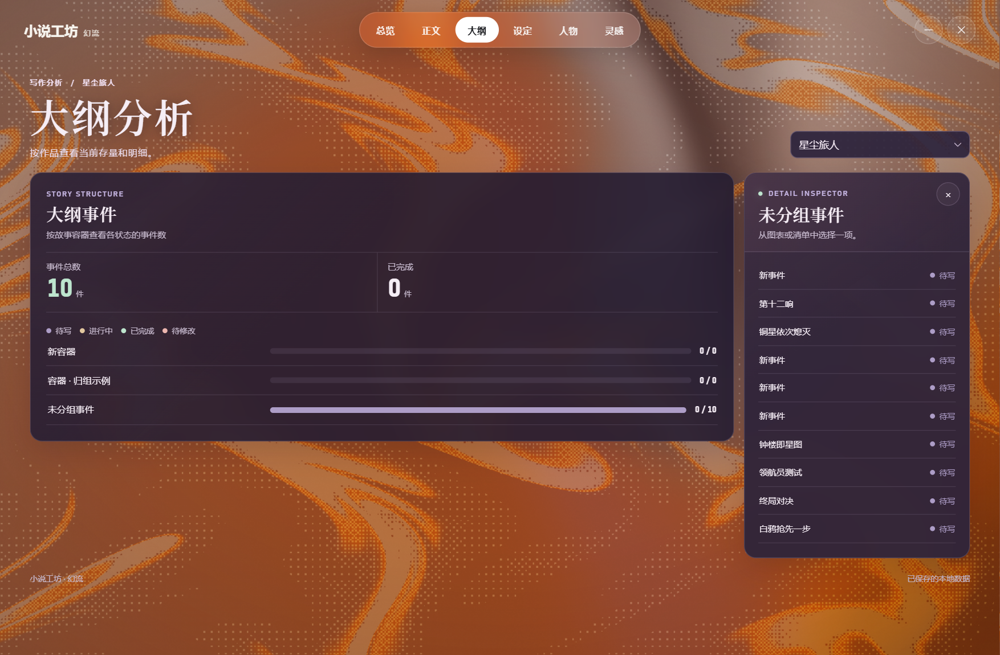 | 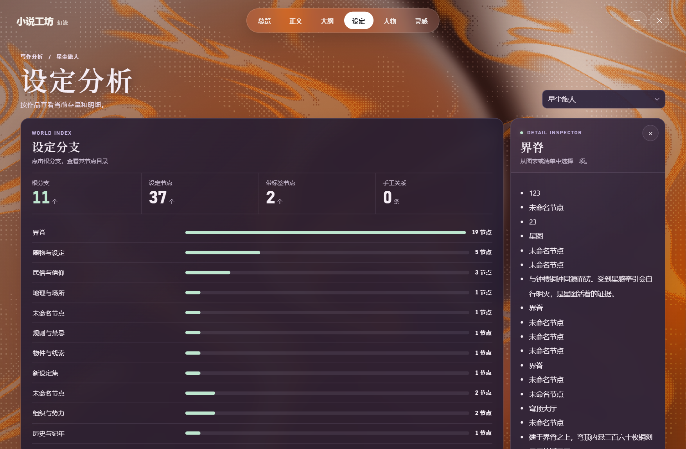 |

| 人物与关系网络分析 | 灵感档案分析 |
|---|---|
| 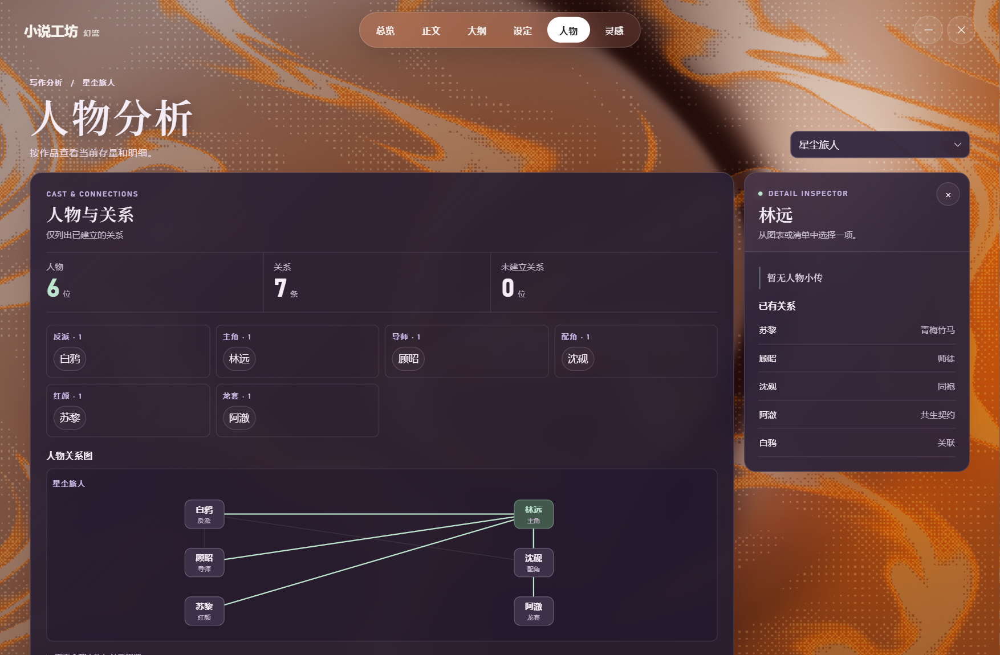 | 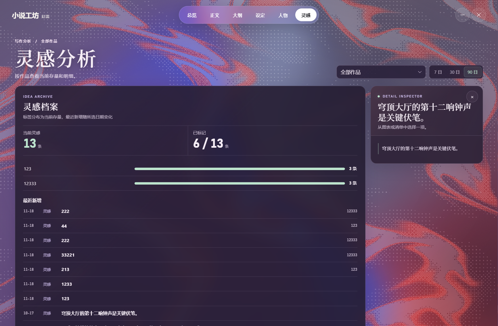 |
- **导入与导出**：
  - **导入**支持 **TXT / Markdown / DOCX / PDF / EPUB / 常见图片**：TXT 自动识别 GBK 等编码并按「第 X 章」智能分章；DOCX 按标题样式解析富文本；PDF 按书签目录分章（扫描件可整页转图）；导入前均提供分章预览。
  - **导出**支持按卷分组勾选章节，输出 **TXT / Markdown / Word（`.docx`）** 三种格式（`.docx` 由 JSZip 组装标准 OOXML，保留加粗、标题、对齐、列表与引用缩进）。单章直接导出；多章在阈值（默认 30，2–500 可调）内逐章分批写入同一目录；超过阈值可选「合并为单文件」或「按章打包 `.zip`（按卷分目录）」。
- **独立拆窗与实体锁**：正文、大纲、人物、设定、灵感及恍然梦均支持拆出为完整交互界面的独立窗口（如双屏左写正文、右看大纲）；内置主进程级**实体锁**防止多窗并发覆写——被独立窗口占用的章节/人物/灵感在主窗口自动转为只读占位并提供「前往窗口」跳转，大纲与设定采用模块级锁，锁随面板内选中条目自动迁移。

---

## 十、设置、排版、数据安全与自动更新

点击顶栏齿轮打开「设置」工作区，左侧分为五大分类并支持顶部关键词实时检索设置项：

1. **外观与排版**：
   - 流动背景（跟随封面 / 自定义两色 / 5 组推荐配色 / `0–2×` 速度调节）、深色/浅色面板切换、默认隐藏顶栏。
   - **中 / 西文分离排版**：中文 6 款（思源宋体 / 霞鹜文楷 / 京华老宋体 / 朝华标题 / 云游手书 / 系统黑体）+ 西文 3 款（跟随中文 / Playfair Display / Montenegrin Gothic One），正文字号 `13–24px` 无级调节并配实时排版预览；全部为随包本地 OFL 字体，**零网络请求**。
2. **模型设置**：多供应商预设、模型启用与连接测试。
3. **知识库模型**：语义检索开关与向量模型选择（沿用当前供应商预设）。
4. **备份与数据**：
   - **作品数据存储位置**：查看当前作品库目录，支持一键迁移到其他文件夹并在系统文件管理器中打开。
   - **整库备份与恢复**：导出含图片在内的全库 JSON 快照，恢复前预览备份摘要后整库还原。
   - **回收站**：对删除的正文、人物、设定、灵感进行按类恢复或彻底清除。
5. **帮助与关于**：内置与源码同源打包的《使用手册》及快捷键速查；桌面端内置**应用内检查更新**（从 GitHub Releases 读取 `latest.yml`，下载安装包后执行 SHA-512 校验再调起安装器）。

**本地数据与运行保护**：作品默认存于本机应用数据目录（`%APPDATA%\小说工坊`），通过 `packages/novel-core/` 文件库底座与 Dexie/IndexedDB 双轨支撑；同一数据目录同一时间仅允许一个实例运行，避免并发写坏数据，需要多开时可通过 `--profile=名字` 隔离目录。

---

## 十一、安装运行与技术一览

### 获取与运行

| 形态 | 获取 / 启动方式 | 说明 |
|---|---|---|
| **Windows 安装程序** | [Releases](https://github.com/linque0/novel/releases) 下载 `novel-studio-setup-1.2.6.exe` | Windows x64，NSIS 向导式安装（支持自定义路径、增量更新与桌面/开始菜单快捷方式） |
| **免安装本体** | `npm run dist` 产物 `release2/win-unpacked/小说工坊.exe` | 解压即用，支持应用内备份与 `--profile` 多开 |
| **源码运行** | `npm install && npm start`（开发热更新 `npm run dev`） | 开发者方式，需 Node.js ≥ 18 |
| **网页调试版** | `npm run web`（`http://127.0.0.1:18688`） | 浏览器本地存储，与桌面端相互独立 |
| **DSH 插件前端** | `npm run build:plugin`（同步至 `dsh-novel-studio`） | 与桌面端幻流界面共用核心源码，适配宿主存储与助手入口 |

> 安装程序未做代码签名，首次运行如遇 Windows SmartScreen 提示，选择「更多信息 → 仍要运行」即可。

### 技术栈与工程规模

| 项 | 内容 |
|---|---|
| 桌面框架 | Electron 33 + Vue 3 + Pinia + Naive UI |
| 编辑器与引擎 | TipTap 富文本（正文）· 自研幕布编辑器（设定 / 大纲文本）· 自研画布引擎（大纲 / 人物关系图）· Three.js / WebGL 着色器（流场背景 / 3D 书封 / 关系星系） |
| 存储与图表 | Dexie / IndexedDB + `packages/novel-core/` 文件库底座（Repository 层隔离）· ECharts（写作分析）· JSZip / Mammoth / PDF.js（导入导出） |
| 打包与更新 | electron-builder（NSIS 安装包 + 免安装目录）+ GitHub Releases `latest.yml` SHA-512 校验更新 |
| 当前代码规模 | `src/` 共 **408 个源码文件**（含 **168 个 Vue 组件**），约 **8.69 万行** JS / Vue / CSS 代码 |
| 验证体系 | **110+ 套**端到端验收与单元测试脚本，覆盖画布路由、分层作用域、人物关系图、设定星系、多窗口锁、流场设置与 AI 工作流 |

更多操作细节见 [使用手册.md](../使用手册.md)，版本演进详见 [CHANGELOG.md](../../CHANGELOG.md)，工程规范见 [开发流程.md](../开发流程.md)。
